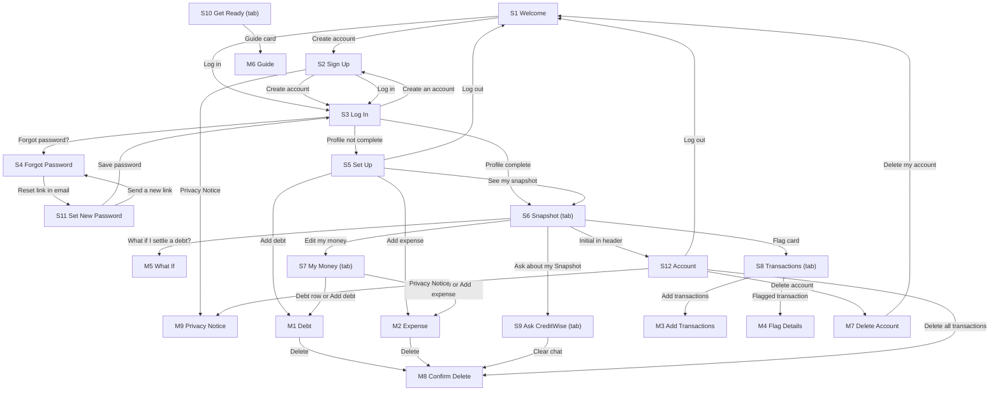

# IMPLEMENTATION_PLAN.md: CreditWise AI

---

## 0. Plan details

| Field | Value |
| --- | --- |
| App name | CreditWise AI |
| Built from PRD version | v0.5 |
| Screen designs | Stitch project "CreditWise AI Designs": https://stitch.withgoogle.com/projects/18129022184648628731 (one row per S# and M#, one frame per state). Normal-state exports go in `docs/designs/` (S1.png … S12.png, M1.png … M9.png, style-guide.png) |
| Plan version | v1.1 |
| Repository | https://github.com/Sijabulile-Ncube/creditwise-ai |
| Status | Ready to build |
| Last updated | 4 Nov 2026 |

---

## 1. Start here (instructions for the coding agent)

Before writing any code:

1. Read this whole file from top to bottom.
2. Read `docs/PRD.md`.
3. Look at the screen designs listed in Section 7.3.
4. Check Section 18. If any clarification is still **Open**, stop and ask the human. Do not start.
5. Check that the prerequisites in Section 4.2 are installed.
6. Start **Phase 1 only**. Follow Section 2 at all times.

---

## 2. Rules for the coding agent (copy word for word, do not edit)

1. **One phase at a time.** Only work on the phase the human asked for. When that phase's Definition of Done is complete, stop and wait for the human to say "Start Phase <number>".
2. **Test-driven development (TDD) for every task.** Follow the cycle in Section 12.1:
    - Write the test.
    - Run it and see it fail for the right reason.
    - Write the smallest code that makes it pass.
    - Run all tests.
    - Refactor while all tests still pass.
3. **Never cheat a test.** Never delete, skip, weaken or change a test just to make it pass. If you believe a test is wrong, stop and explain why to the human.
4. **Never break earlier work.** Every test from earlier phases must still pass before a phase is done.
5. **Build only what is planned.** Build only what is in this file and `docs/PRD.md`. Never build anything in Section 3.3 (Deferred).
6. **Ask, don't guess.** If anything is missing, unclear or contradictory, stop, add it to Section 18, and ask the human.
7. **Match the designs.** Every screen must match its design in Section 7.3: layout, order, labels, text, colours and spacing. Use the design tokens in Section 7.1. Never hard-code colours, font sizes or spacing.
8. **Every state, every screen.** Each screen must handle every state listed for it in Section 7.3 (chosen from normal, empty, loading, error, offline, success, plus any screen-specific states).
9. **Exact wording.** Use the exact labels and messages from the PRD. Never invent wording.
10. **Security first.**
    - Never put secret keys in app code, logs, test files or Git.
    - Every permission rule in Section 9 must be enforced on the server or database, never only in the app.
    - Every permission rule must have a test.
11. **Full check before "done".** Run the full check command (Section 4.3) before saying a phase is done, then add a short summary of the results to the Progress log (Section 17).
12. **Record your progress.** After each phase:
    - tick the checkboxes for that phase in this file;
    - add a row to the Progress log;
    - commit using the commit message given in the phase.
13. **No surprise libraries.** Do not add, remove or upgrade any library or tool not listed in Section 4.1 without asking the human first.
14. **Stuck rule.** If the same problem is still failing after 3 attempts, stop and report:
    - what you tried;
    - the exact error;
    - what you need from the human.
15. **Clean code.** Follow the folder structure in Section 5. Use the PRD's key terms (Section 3.4) for names in code. Keep files small and focused.

---

## 3. Project summary and scope

### 3.1 Summary

CreditWise AI helps working South Africans aged 22 to 45 to see their finances the way a lender does, so that they apply for credit they can afford. Users enter their income, expenses and debts once, then see their DTI, a Green, Amber or Red status band, their Money left and their Room. They can upload their bank activity to flag possible double charges, higher-than-usual amounts and new payees, ask an AI assistant (Ask CreditWise) plain-English questions about their own numbers without receiving financial advice, read short credit guides with a readiness checklist, and use What if to see how settling a debt would change their position.

**Platform:** Web app, mobile-first (designed at 390 × 844 px, then checked on tablet and on desktop at 1440 px). Hosted on Vercel. No app-store app in v1.

### 3.2 Features in scope

| ID | Feature | Priority | Built in phase |
| --- | --- | --- | --- |
| F1 | Account | Must | 3 |
| F2 | Money profile | Must | 4 |
| F3 | Snapshot | Must | 4 |
| F4 | Transaction check | Must | 5 |
| F5 | Ask CreditWise | Must | 6 |
| F6 | Get ready | Should | 7 |
| F7 | What if | Should | 7 |

### 3.3 Deferred: do NOT build

From PRD 3.2 (non-goals):

- Credit applications, links to lenders, or approving or arranging credit
- Financial advice or product recommendations of any kind
- Credit scores or credit bureau data
- Direct bank connections (open banking or bank log-ins)
- Reading PDF bank statements (the CreditWise CSV template is the only import format)
- A native Android or iPhone app

From PRD 4.3 (future features):

- Goal tracking (target DTI and date, monthly progress)
- isiZulu, isiNdebele and Afrikaans versions of screens
- Monthly history of DTI and Money left as a chart
- Employer dashboard for financial wellness programmes

Also not in v1 (from PRD 4.5, 5 and 9.1):

- Push or SMS notifications (only the 2 account emails and the in-app Transactions badge)
- Changing email address; collecting a phone number
- Editing the first name after sign-up
- Dark mode
- Admin screens (admin work is done in the Supabase dashboard)
- Photos, profile pictures or any image upload

### 3.4 Key terms (use these names in code)

| Term (PRD 1.7) | Name in code | Meaning |
| --- | --- | --- |
| Money profile | `MoneyProfile`, table `money_profiles` | Gross and net monthly income, set-up progress; plus the user's debts and expenses |
| Debt | `Debt`, table `debts` | One account paid off monthly, with monthly repayment and balance owing (BR3) |
| Expense | `Expense`, table `expenses` | One fixed monthly cost that is not a debt (BR3) |
| DTI | `dti`, function `calculateDti` | Debt repayments ÷ gross income × 100, whole percentage (BR4) |
| Status band | `StatusBand` (`'green' \| 'amber' \| 'red'`), function `getStatusBand` | Green, Amber or Red from the DTI (BR5) |
| Money left | `moneyLeft`, function `calculateMoneyLeft` | Net income minus expenses minus debt repayments (BR6) |
| Room | `room`, function `calculateRoom` | Extra monthly repayments possible before Red (BR7) |
| Flag | `flag_type`, `flag_status` on `transactions`; component `FlagPill` | A mark on one transaction that may need checking (BR11 to BR14) |
| Ask CreditWise | `ChatMessage`, table `chat_messages`; route `POST /api/ask` | The AI assistant and its messages (BR15 to BR17) |
| Guide / checklist | `Guide`, `ChecklistItem`, `ChecklistTick`; tables `guides`, `checklist_items`, `checklist_ticks` | Get ready content and the user's ticks (BR19) |
| What if | `calculateWhatIf` | Before and after figures for ticked debts, never saved (BR18) |

---

## 4. Tech stack, prerequisites and commands

### 4.1 Stack

| Layer | Tool | Version | Used for |
| --- | --- | --- | --- |
| Frontend | React + Vite, React Router | React 19, Vite 6, React Router 7 | Screens, routing, dev server with `/api` proxy |
| Language | TypeScript (strict mode) | 5.x | All app, API, test and script code |
| Styling | Tailwind CSS | 3.4 | Styling using the tokens in 7.1 (`tailwind.config.ts`) |
| Fonts | `@fontsource/inter`, `@fontsource/ibm-plex-mono` | Latest stable at setup | Inter for text; IBM Plex Mono for rand amounts and percentages (self-hosted, no font CDN) |
| Icons | `lucide-react` | Latest stable at setup | Lucide outline icons (PRD 9.1) |
| Backend client | `@supabase/supabase-js` | v2 | Browser and server access to Supabase |
| Backend and database | Supabase: PostgreSQL, Auth, Cron (pg_cron) | Supabase CLI latest stable at setup | Data, log-in, scheduled cleanup job |
| Server functions | Node.js + Express, deployed as one Vercel Function under `/api` | Node.js 22 LTS, Express 5 | CSV import, adding and deleting transactions, Ask CreditWise, account deletion |
| AI | Anthropic Claude API via `@anthropic-ai/sdk`, model `claude-haiku-5-5` | Latest stable at setup | Ask CreditWise answers (server only) |
| CSV reading | Papa Parse | 5 | Parsing uploaded CSV text on the server (BR9) |
| Data fetching and caching | None (plain hooks in `src/lib/api/`) | None | Not needed for v1 |
| Unit and component tests | Vitest + React Testing Library + jsdom | Vitest 3, latest stable at setup | Business rules, components, screens with fake data |
| Database and permission tests | pgTAP via `supabase test db` | Supabase CLI | Tables, constraints, triggers, functions, RLS |
| Integration tests | Vitest + supertest against the local Express API and local Supabase | Latest stable at setup | `/api` routes and Supabase operations (Section 10) |
| End-to-end tests | Playwright (Chromium and WebKit, viewport 390 × 844) | Latest stable at setup | User flows from PRD 7.1 |
| Lint and type check | ESLint, TypeScript compiler (`tsc`) | Latest stable at setup | Code quality |
| Secret scan | secretlint | Latest stable at setup | Finds keys accidentally committed (T-NFR-5) |
| API dev runner | `tsx` | Latest stable at setup | Runs the Express API locally with watch mode |
| Build and hosting | Vite build + Vercel (Git integration: pushing `main` deploys) | Latest at setup | Demo URL, e.g. creditwise-ai.vercel.app |

### 4.2 Prerequisites on the computer

- [ ] Node.js 22 LTS and npm
- [ ] Git, with a GitHub account and the empty repository `creditwise-ai`
- [ ] Docker Desktop, running (the local Supabase needs it)
- [ ] Supabase CLI (`npx supabase` works)
- [ ] Playwright browsers: `npx playwright install chromium webkit`
- [ ] An Android phone with Chrome and, if available, an iPhone with Safari (manual checks)
- [ ] Accounts: Supabase (hosted project in Phase 9, region London eu-west-2), Vercel (connected to GitHub), Anthropic Console (API key with a US$5 monthly spend limit)

### 4.3 Commands

| Purpose | Command |
| --- | --- |
| Install dependencies | `npm install` |
| Start the local backend | `npx supabase start` |
| Reset the database (migrations + seed data) | `npx supabase db reset` then `npm run seed` (= `tsx --env-file=.env scripts/seed.ts`) |
| Start the API | `npm run dev:api` (= `tsx watch --env-file=.env api/dev.ts`, port 3001) |
| Start the app | `npm run dev` (= `vite`, port 5173; `/api` is proxied to port 3001) |
| Unit and component tests | `npm test` (= `vitest run --project unit --project components`) |
| Database and permission tests | `npx supabase test db` |
| Integration tests | `npm run test:integration` (= `vitest run --project integration`, reads `.env`) |
| End-to-end tests | `npm run test:e2e` (= `playwright test`; its `webServer` setting starts the API and the app) |
| Lint | `npm run lint` (= `eslint .`) |
| Type check | `npm run typecheck` (= `tsc --noEmit -p tsconfig.json && tsc --noEmit -p api/tsconfig.json`) |
| Secret scan | `npm run scan` (= `secretlint "**/*"`) |
| **Full check (run before every "done")** | `npm run check` (runs lint, typecheck, `npm test`, `npx supabase test db`, `npm run test:integration`, `npm run scan`). `npx supabase start` must be running and `npm run seed` must have been run after the last reset. |
| Build for release | `npm run build` (= `vite build`); Vercel builds and deploys on push to `main` |

End-to-end tests (Playwright) run in Step 4 of each feature phase and in Phases 8 and 9. They are not part of `npm run check`, because they start browsers and servers.

---

## 5. Folder structure

```
creditwise-ai/
  src/
    main.tsx                         App entry: fonts, router, providers
    App.tsx                          Routes and redirect rules (Section 11)
    pages/                           One file per screen
      S1Welcome.tsx                  S1 Welcome            /
      S2SignUp.tsx                   S2 Sign Up            /sign-up
      S3LogIn.tsx                    S3 Log In             /log-in
      S4ForgotPassword.tsx           S4 Forgot Password    /forgot-password
      S5SetUp.tsx                    S5 Set Up             /set-up
      S6Snapshot.tsx                 S6 Snapshot           /snapshot
      S7MyMoney.tsx                  S7 My Money           /my-money
      S8Transactions.tsx             S8 Transactions       /transactions
      S9AskCreditWise.tsx            S9 Ask CreditWise     /ask
      S10GetReady.tsx                S10 Get Ready         /get-ready
      S11SetNewPassword.tsx          S11 Set New Password  /set-new-password
      S12Account.tsx                 S12 Account           /account
    modals/                          One file per modal (opened by its parent screen, not a route)
      M1Debt.tsx  M2Expense.tsx  M3AddTransactions.tsx  M4FlagDetails.tsx  M5WhatIf.tsx
      M6Guide.tsx  M7DeleteAccount.tsx  M8ConfirmDelete.tsx  M9PrivacyNotice.tsx
    components/                      Shared components (Section 7.2)
    lib/
      supabase.ts                    Browser Supabase client (VITE_ variables only)
      money.ts                       BR1 formatting and parsing
      calculations.ts                BR4 to BR7 and BR18 (shared by S6 and M5)
      rules/                         Pure validation rules: income, debt, expense, transaction, question, checklist
      api/                           One file per operation group (Section 10)
      messages.ts                    Every user-facing message from the PRD, in one place
      session.ts                     30-minute inactivity and 7-day sign-out (Section 11)
    theme/tokens.ts                  Design tokens (Section 7.1)
  api/                               Express API (Vercel Function)
    index.ts                         Exports the Express app for Vercel
    dev.ts                           Starts the app on port 3001 for local development
    middleware/requireUser.ts        Checks the Supabase login token on every route
    routes/ask.ts                    POST /api/ask (OP20)
    routes/transactions.ts           POST /api/transactions/import, POST /api/transactions, DELETE /api/transactions (OP15 to OP17)
    routes/account.ts                DELETE /api/account (OP7)
    lib/supabaseAdmin.ts             Server-only client with the service role key
    lib/csv.ts                       BR9 parsing and checks
    lib/claude.ts                    The only file that calls the Anthropic API
    lib/assistantPrompt.ts           BR16 context and BR17 guardrail instructions
    tsconfig.json
  supabase/
    config.toml                      Local Supabase settings, Auth settings (Section 13, Phase 3)
    migrations/                      SQL migrations (Section 8.6)
    templates/confirm.html           Verification email (PRD 4.5 exact text)
    templates/recovery.html          Reset email (PRD 4.5 exact text)
    tests/                           pgTAP tests (T-DB, T-BR, T-SEC)
    seed.sql                         Empty on purpose (seeding is done by scripts/seed.ts)
  scripts/seed.ts                    Creates the seed users and their data (uses the secret key; never in the app)
  tests/
    unit/                            T-BR and helper tests (Vitest)
    components/                      T-C, T-S, T-M and screen-state tests (Vitest + React Testing Library)
    integration/                     API and Supabase operation tests (Vitest + supertest)
    fixtures/                        thando-oct.csv (62 rows), sibusiso.csv (40 rows), bad-header.csv, old-rows.csv, too-big.csv, sample.xlsx
  e2e/                               Playwright flows (T-E2E, T-SETUP-4)
  public/creditwise-template.csv     The CSV template users download
  docs/
    PRD.md
    idea.md
    designs/                         Exported designs (S1.png … S12.png, M1.png … M9.png, style-guide.png)
    content/guides.md                Guide text and checklist items for F6 (written by the project owner, Section 18 #7)
    content/privacy-notice.md        Full Privacy Notice text for M9 (written by the project owner, Section 18 #7)
  IMPLEMENTATION_PLAN.md
  .env.example
  vercel.json                        Rewrites /api/* to api/index.ts; maxDuration 35 s
  vitest.config.ts                   Projects: unit, components (jsdom), integration (node)
  playwright.config.ts
  README.md
```

**Rule:** a new folder may only be created if it is added to this section first.

---

## 6. Environment variables and secrets

| Name | What it is | Where to get it | Public or secret | Used by |
| --- | --- | --- | --- | --- |
| `VITE_SUPABASE_URL` | Supabase project address for the browser | Local: `npx supabase status` (http://127.0.0.1:54321). Hosted: dashboard → Project Settings → API | Public | App (`src/lib/supabase.ts`) |
| `VITE_SUPABASE_ANON_KEY` | Public (anon / publishable) key | Same | Public. Safe only because every table has RLS. | App |
| `SUPABASE_URL` | Same project address, for the server | Same | Public, but set only on the server | API, scripts, integration tests |
| `SUPABASE_ANON_KEY` | Same public key, used by the API to check login tokens | Same | Public, but set only on the server | API |
| `SUPABASE_SERVICE_ROLE_KEY` | Admin (service role / secret) key | Same | **Secret** | API (`api/lib/supabaseAdmin.ts`), `scripts/seed.ts`, integration tests only |
| `ANTHROPIC_API_KEY` | Key for the Claude API | console.anthropic.com → API keys | **Secret** | API (`api/lib/claude.ts`) only |
| `ANTHROPIC_MODEL` | Model name, `claude-haiku-5-5` | PRD 11.1 | Public, set on the server | API |
| `SEED_TEST_PASSWORD` | Password for all seed test accounts | You choose it | **Secret** | `scripts/seed.ts`, integration tests, Playwright |
| `E2E_BASE_URL` | Address Playwright opens. Leave empty locally (Playwright then starts the app on http://localhost:5173); set to the Vercel preview URL for T-REL-2 | Vercel dashboard → Deployments | Public | Playwright only (`playwright.config.ts`) |

`.env.example` (committed to Git, placeholder values only):

```
VITE_SUPABASE_URL=http://127.0.0.1:54321
VITE_SUPABASE_ANON_KEY=replace-with-anon-key
SUPABASE_URL=http://127.0.0.1:54321
SUPABASE_ANON_KEY=replace-with-anon-key
SUPABASE_SERVICE_ROLE_KEY=replace-with-service-role-key-never-commit
ANTHROPIC_API_KEY=replace-with-anthropic-key-never-commit
ANTHROPIC_MODEL=claude-haiku-5-5
SEED_TEST_PASSWORD=replace-with-a-test-only-password
E2E_BASE_URL=
```

Rules:

- Real values go in `.env`, which is listed in `.gitignore` and never committed.
- Only variables starting with `VITE_` reach the browser. Nothing in `src/` may read a variable without the `VITE_` prefix; T-NFR-5 fails if `SERVICE_ROLE` or `ANTHROPIC_API_KEY` appears anywhere in `src/`.
- On Vercel, every variable is set in Project Settings → Environment Variables. Secret ones are never given a `VITE_` prefix.
- Secret values are never used in app code. They are used only in the API, scripts or integration tests, read from `.env`.
- If a new variable is needed, add it here and to `.env.example` first.

---

## 7. Design system and screens

### 7.1 Design tokens (`src/theme/tokens.ts`, wired into `tailwind.config.ts`)

| Token | Value | From PRD |
| --- | --- | --- |
| `color.primary` | #0F5C4D (white text on it: 7.9:1) | 9.1 Primary colour |
| `color.accent` | #B7791F (focus outline and small highlights only, never text) | 9.1 Accent |
| `color.background` | #F7F5F0 | 9.1 Background (page) |
| `color.surface` | #FFFFFF | 9.1 Cards |
| `color.border` | #E3DED3 | 9.1 Shadows, 8.3 Card |
| `color.inputBorder` | #D6D1C4 | 8.3 Text field |
| `color.text` | #1F2A37 | 9.1 Main text |
| `color.textSecondary` | #5B6670 | 9.1 Secondary text |
| `color.error` / `color.success` / `color.warning` | #B42318 / #1E7B4A / #B45309 | 9.1 |
| `color.pill.green.bg` / `.text` | #DCF2E3 / #14532D | 8.3 Status pill |
| `color.pill.amber.bg` / `.text` | #FDECD3 / #7C2D12 | 8.3 Status pill, Banner |
| `color.pill.red.bg` / `.text` | #FDE2E0 / #7F1D1D | 8.3 Status pill |
| `color.pill.grey.bg` / `.text` | #EEEBE4 / #5B6670 | 8.3 Flag pill, Offline banner |
| `color.placeholder` | #ECE8DF | 8.3 Loading placeholder |
| `color.toast` | #1F2A37 (white text) | 8.3 Toast |
| `font.family.text` / `font.family.money` | Inter / IBM Plex Mono | 9.1 Font |
| `font.size.display` | 40px bold, IBM Plex Mono | 9.1 Text sizes |
| `font.size.title` | 24px semibold | 9.1 |
| `font.size.heading` | 18px semibold | 9.1 |
| `font.size.body` | 16px regular | 9.1 |
| `font.size.money` | 16px medium, IBM Plex Mono (28px in Stat card) | 9.1, 8.3 Stat card |
| `font.size.small` | 14px regular | 9.1 |
| `font.size.caption` | 12px regular (timestamps and footnotes only) | 9.1, 9.4 |
| `space.1` / `space.2` / `space.3` / `space.4` / `space.5` | 4 / 8 / 16 / 24 / 32 px | 9.1 Spacing unit 8 px |
| `space.screen` | 16px under 640 px; 24px from 640 to 1024 px; 32px above 1024 px | 9.1 Screen side margin |
| `radius.card` / `radius.input` / `radius.button` / `radius.pill` | 12 / 8 / 8 px / full | 9.1 Corner radius |
| `size.button` | 48px | 9.1 Button height |
| `size.touchMin` | 44px | 9.4 |
| `size.header` / `size.tabBar` / `size.sideMenu` | 56 / 64 / 240 px | 8.3 |
| `size.avatar.sm` / `.lg` | 32 / 56 px | 8.3 Initial avatar |
| `size.icon` / `size.iconSmall` | 24 / 20 px | 9.1 Icon set |
| `layout.maxTablet` / `layout.maxDesktop` | 720 / 1120 px | 9.3 |
| `breakpoint.tablet` / `breakpoint.desktop` | 640 / 1024 px | 9.3 |
| `shadow` | none | 9.1 Shadows |

### 7.2 Shared components

| Component | File | Variants and states | Used on | Tests |
| --- | --- | --- | --- | --- |
| Header | `src/components/Header.tsx` | back arrow or logo wordmark; title; Initial avatar or text button on the right; 56 px; sticky | S2 to S12 | T-C-1 |
| TabBar | `src/components/TabBar.tsx` | bottom bar under 1024 px, left side menu 240 px at 1024 px and wider; 5 items; active item; no active item (S12); red badge with count, "9+" above 9 | S6 to S10, S12 | T-C-2 (Phase 3), T-C-2b badge (Phase 5) |
| Button | `src/components/Button.tsx` | primary, secondary, danger, danger text; disabled (40% opacity, not clickable); loading (spinner + label); hover; keyboard focus (2 px accent outline, 2 px gap); 48 px | All | T-C-3 |
| TextField | `src/components/TextField.tsx` | normal, focused, error (border, alert-circle icon, message, keeps text); helper text; password with eye toggle | S2, S3, S4, S11, M1, M2, M3, M7 | T-C-4 |
| MoneyField | `src/components/MoneyField.tsx` | fixed "R" prefix; numeric keyboard (`inputMode="decimal"`); thousands separators after blur (BR1); error | S5, S7, M1, M2, M3 | T-C-5 |
| Card | `src/components/Card.tsx` | white, 1 px border, 12 px corners, 16 px padding, no shadow | S6 to S10, S12 | T-C-6 |
| StatCard | `src/components/StatCard.tsx` | label, money value 28 px, note; value in error colour when negative | S6 | T-C-7 |
| StatusPill | `src/components/StatusPill.tsx` | green "Green: healthy" (check-circle), amber "Amber: getting stretched" (alert-triangle), red "Red: lenders may decline" (x-circle) | S6, M5 | T-C-8 |
| FlagPill | `src/components/FlagPill.tsx` | reason with flag icon; amber for open and querying; grey for dismissed and resolved; status after the reason when not open | S8, M4 | T-C-9 |
| InitialAvatar | `src/components/InitialAvatar.tsx` | first letter of first name; 32 px or 56 px; screen-reader label "Account" | S6 to S10, S12 | T-C-10 |
| DebtRow / ExpenseRow | `src/components/MoneyRow.tsx` | name, type or category in grey, amount right-aligned, optional "Owing R…"; chevron; 56 px min | S5, S7 | T-C-11 |
| TransactionRow | `src/components/TransactionRow.tsx` | description cut with "…"; money out / money in colours; FlagPill; amber left border 4 px when flagged; tappable only when flagged; 64 px min | S8 | T-C-12 |
| ChatBubble | `src/components/ChatBubble.tsx` | user (right, primary background, white text, time); assistant (left, white with border, footer text, time); typing indicator; max 85% width | S9 | T-C-13 |
| GuideCard | `src/components/GuideCard.tsx` | icon, title, summary, progress bar and "2 of 6 done" or "Not started", chevron; whole card tappable | S10 | T-C-14 |
| SettingsRow | `src/components/SettingsRow.tsx` | icon, label, chevron; error-colour variant; 56 px | S12 | T-C-15 |
| Banner | `src/components/Banner.tsx` | green (good news) or amber (warning); icon and one sentence | S3, S4 | T-C-16 |
| Toast | `src/components/Toast.tsx` | one line, white on #1F2A37, 8 px corners; above the tab bar; disappears after 3 seconds | All | T-C-17 |
| ConfirmModal | `src/components/ConfirmModal.tsx` | title, body, danger button, secondary "Cancel"; 400 px max, 50% overlay; closes on Cancel or Escape, never on overlay tap | M7, M8 | T-C-18 |
| Modal / BottomSheet | `src/components/Modal.tsx` | full height on phone, centred dialog on desktop at a given width (480, 560, 720 px); bottom sheet variant; close icon "X" with label "Close"; Escape closes | M1 to M6, M9 | T-C-19 |
| EmptyState | `src/components/EmptyState.tsx` | line illustration 120 px, one sentence, optional primary button | S5, S7, S8, S9 | T-C-20 |
| LoadingPlaceholder | `src/components/LoadingPlaceholder.tsx` | grey #ECE8DF blocks (row, card, bubble, line) with gentle pulse | All lists and cards | T-C-21 |
| OfflineBanner | `src/components/OfflineBanner.tsx` | grey bar, wifi-off icon, "You're offline. Changes won't be saved."; under the Header; shown when `navigator.onLine` is false | All screens | T-C-22 |
| Logo | `src/components/Logo.tsx` | "CreditWise" Inter bold #0F5C4D + "AI" white in a green rounded rectangle (4 px corners); 32 px tall on S1 | S1, S5, S6, S11, side menu | T-C-23 |

### 7.3 Screens

Design reference: Stitch project "CreditWise AI Designs" (link in Section 0). Each screen is one row there; the first frame is Normal and the next frames are the other states. Normal frames are exported to `docs/designs/` with the file names below.

| ID | Screen | Route / file | Design | Who can open it (else redirect to) | Tab bar | Required states | Phase |
| --- | --- | --- | --- | --- | --- | --- | --- |
| S1 | Welcome | `/`, `src/pages/S1Welcome.tsx` | Stitch row S1; `docs/designs/S1.png` | Logged out (else S5 or S6) | No | Normal, Offline, Success (after account deletion) | 1 |
| S2 | Sign Up | `/sign-up`, `S2SignUp.tsx` | Stitch row S2; `S2.png` | Logged out (else S5 or S6) | No | Normal, Loading, Error, Offline, Success | 3 |
| S3 | Log In | `/log-in`, `S3LogIn.tsx` | Stitch row S3; `S3.png` | Logged out (else S5 or S6) | No | Normal (with one of 4 banners), Loading, Error (4 messages), Offline, Success | 3 |
| S4 | Forgot Password | `/forgot-password`, `S4ForgotPassword.tsx` | Stitch row S4; `S4.png` | Logged out (else S6) | No | Normal, Loading, Error, Offline, Success | 3 |
| S5 | Set Up | `/set-up`, `S5SetUp.tsx` | Stitch row S5; `S5.png` | Logged in with an incomplete money profile (else S6; logged out → S1) | No | Normal (steps 1 to 3), Empty (steps 2 and 3), Loading, Error, Offline, Success | 3 (placeholder), 4 |
| S6 | Snapshot | `/snapshot`, `S6Snapshot.tsx` | Stitch row S6; `S6.png` | Logged in, profile complete (else S5; logged out → S1) | Yes | Normal (Green, Amber, Red, negative Money left), Loading, Error, Offline, Success | 3 (placeholder), 4, 5 (Flag card), 7 (What if button) |
| S7 | My Money | `/my-money`, `S7MyMoney.tsx` | Stitch row S7; `S7.png` | Logged in, profile complete (else S5 / S1) | Yes | Normal, Income edit mode, Empty (no debts; no expenses), Loading, Error, Offline, Success | 3 (placeholder), 4 |
| S8 | Transactions | `/transactions`, `S8Transactions.tsx` | Stitch row S8; `S8.png` | Logged in, profile complete (else S5 / S1) | Yes | Normal, Flagged filter, Empty (no transactions; no flags), Loading, Error, Offline, Success | 3 (placeholder), 5 |
| S9 | Ask CreditWise | `/ask`, `S9AskCreditWise.tsx` | Stitch row S9; `S9.png` | Logged in, profile complete (else S5 / S1) | Yes | Normal, Empty, Loading (opening; waiting for answer), Error, Limit reached, Offline, Success | 3 (placeholder), 6 |
| S10 | Get Ready | `/get-ready`, `S10GetReady.tsx` | Stitch row S10; `S10.png` | Logged in, profile complete (else S5 / S1) | Yes | Normal, Loading, Error, Offline, Success | 3 (placeholder), 7 |
| S11 | Set New Password | `/set-new-password`, `S11SetNewPassword.tsx` | Stitch row S11; `S11.png` | Anyone arriving from a valid reset link (password-recovery session); otherwise shows the expired state | No | Normal, Loading, Error (expired link; server), Offline, Success | 3 |
| S12 | Account | `/account`, `S12Account.tsx` | Stitch row S12; `S12.png` | Logged in, profile complete (else S5 / S1) | Yes (no active tab) | Normal, Loading, Error, Offline, Success | 3 ("Delete all transactions" row in 5) |
| M1 | Debt | modal in S5 and S7, `M1Debt.tsx` | Stitch row M1; `M1.png` | Logged in | No | Normal (add, edit), Loading, Error, Offline, Success | 4 |
| M2 | Expense | modal in S5 and S7, `M2Expense.tsx` | Stitch row M2; `M2.png` | Logged in | No | Normal (add, edit), Loading, Error, Offline, Success | 4 |
| M3 | Add Transactions | bottom sheet in S8, `M3AddTransactions.tsx` | Stitch row M3; `M3.png` | Logged in | No | Normal (Upload CSV, Add one), Loading, Error (5 messages), Offline, Success | 5 |
| M4 | Flag Details | bottom sheet in S8, `M4FlagDetails.tsx` | Stitch row M4; `M4.png` | Logged in, own transaction | No | Normal (Open, Querying, Dismissed, Resolved), Error, Offline, Success | 5 |
| M5 | What If | modal in S6, `M5WhatIf.tsx` | Stitch row M5; `M5.png` | Logged in with at least 1 debt (button hidden otherwise) | No | Normal (no tick, ticked), Error (debts changed), Offline | 7 |
| M6 | Guide | modal in S10, `M6Guide.tsx` | Stitch row M6; `M6.png` | Logged in | No | Normal, Loading, Error, Offline, Success | 7 |
| M7 | Delete Account | modal in S12, `M7DeleteAccount.tsx` | Stitch row M7; `M7.png` | Logged in | No | Normal, Loading, Error, Offline, Success | 3 |
| M8 | Confirm Delete | modal in M1, M2, S12, S9, `M8ConfirmDelete.tsx` | Stitch row M8; `M8.png` | Logged in | No | Normal (debt, expense, all transactions, chat), Loading, Error, Offline, Success | 4 (debt, expense), 5 (transactions), 6 (chat) |
| M9 | Privacy Notice | modal in S2 and S12, `M9PrivacyNotice.tsx` | Stitch row M9; `M9.png` | Anyone | No | Normal, Offline | 3 |

---

## 8. Data model and database

All tables live in the `public` schema. `users.id` is the same as the Supabase Auth user id. Money is `numeric(12,2)`. Date-times are `timestamptz` (saved in UTC, shown in SAST). "Cascade" means the row is deleted when the row it points to is deleted.

### 8.1 Tables

**Table: `users`**: one person with an account (created automatically when they sign up).

| Column | Type | Null? | Default | Constraints | Notes |
| --- | --- | --- | --- | --- | --- |
| id | uuid | No | none (Auth user id) | primary key; foreign key → auth.users(id) on delete cascade | |
| email | text | No | none | unique; `email = lower(email)` | Never readable by anyone except the owner (SEC1) |
| first_name | text | No | none | check `char_length between 2 and 40` and `first_name ~ '^[A-Za-zÀ-ÿ'' -]+$'` | Cannot be changed in v1 |
| is_18_or_older | boolean | No | false | check `is_18_or_older = true` | PRD Section 5 |
| privacy_accepted_at | timestamptz | No | now() | | PRD 12.4 consent |
| ask_count | integer | No | 0 | check `ask_count between 0 and 20` | BR15; changed only by the API |
| ask_count_date | date | Yes | none | | SAST date ask_count belongs to (BR15) |
| created_at | timestamptz | No | now() | | |

**Table: `money_profiles`**: one user's income and set-up progress (exactly one per user).

| Column | Type | Null? | Default | Constraints | Notes |
| --- | --- | --- | --- | --- | --- |
| id | uuid | No | gen_random_uuid() | primary key | |
| user_id | uuid | No | none | unique; foreign key → users(id) on delete cascade | |
| gross_income | numeric(12,2) | Yes | none | check `gross_income between 1 and 10000000` | BR2 |
| net_income | numeric(12,2) | Yes | none | check `net_income >= 1 and net_income <= gross_income` | BR2 |
| has_no_debts | boolean | No | false | trigger `check_has_no_debts` | Only true when the user has 0 debts |
| setup_step | integer | No | 1 | check `setup_step between 1 and 3` | BR8 |
| completed_at | timestamptz | Yes | none | trigger `check_profile_complete` | BR8; used for G1 |
| updated_at | timestamptz | No | now() | trigger `touch_money_profile` | Shown on S6 as "Updated …" |
| created_at | timestamptz | No | now() | | |

**Table: `debts`**: one account the user pays off monthly.

| Column | Type | Null? | Default | Constraints | Notes |
| --- | --- | --- | --- | --- | --- |
| id | uuid | No | gen_random_uuid() | primary key | |
| user_id | uuid | No | auth.uid() | foreign key → users(id) on delete cascade | Max 15 per user (trigger `limit_debts`, BR3) |
| name | text | No | none | check `char_length(trim(name)) between 2 and 40` | BR3 |
| type | text | No | none | check in ('Personal loan','Vehicle finance','Home loan','Credit card','Store account','Student loan','Other') | BR3 |
| monthly_repayment | numeric(12,2) | No | none | check `between 1 and 1000000` | BR3 |
| balance_owing | numeric(12,2) | Yes | none | check `between 0 and 10000000` | BR3 |
| created_at | timestamptz | No | now() | | |
| updated_at | timestamptz | No | now() | | |

**Table: `expenses`**: one fixed monthly cost that is not a debt.

| Column | Type | Null? | Default | Constraints | Notes |
| --- | --- | --- | --- | --- | --- |
| id | uuid | No | gen_random_uuid() | primary key | |
| user_id | uuid | No | auth.uid() | foreign key → users(id) on delete cascade | Max 20 per user (trigger `limit_expenses`, BR3) |
| name | text | No | none | check `char_length(trim(name)) between 2 and 40` | BR3 |
| category | text | No | none | check in ('Housing','Transport','Food','Utilities','Insurance','Education','Phone and internet','Family support','Other') | BR3 |
| monthly_amount | numeric(12,2) | No | none | check `between 1 and 1000000` | BR3 |
| created_at | timestamptz | No | now() | | |
| updated_at | timestamptz | No | now() | | |

**Table: `transactions`**: one line of the user's bank activity, with its flag.

| Column | Type | Null? | Default | Constraints | Notes |
| --- | --- | --- | --- | --- | --- |
| id | uuid | No | gen_random_uuid() | primary key | |
| user_id | uuid | No | none | foreign key → users(id) on delete cascade | Max 1,000 per user (trigger `limit_transactions`, BR10) |
| date | date | No | none | trigger `check_transaction_date`: not after today (SAST), not more than 90 days before today | BR9, BR10 |
| description | text | No | none | check `char_length(description) between 1 and 80` | |
| amount | numeric(12,2) | No | none | check `amount <> 0 and abs(amount) <= 1000000` | Negative = money out |
| source | text | No | none | check in ('csv','manual') | |
| flag_type | text | No | 'none' | check in ('none','double_charge','higher_than_usual','new_payee') | BR11 to BR14 |
| flag_status | text | No | 'none' | check in ('none','open','dismissed','querying','resolved'); check `(flag_type = 'none') = (flag_status = 'none')` | 8.3 |
| flag_status_changed_at | timestamptz | Yes | none | | Set by trigger `guard_flag_status`; used for G2 and "Sorted on …" |
| created_at | timestamptz | No | now() | | |

**Table: `chat_messages`**: one question or answer in Ask CreditWise.

| Column | Type | Null? | Default | Constraints | Notes |
| --- | --- | --- | --- | --- | --- |
| id | uuid | No | gen_random_uuid() | primary key | |
| user_id | uuid | No | none | foreign key → users(id) on delete cascade | |
| role | text | No | none | check in ('user','assistant') | |
| text | text | No | none | check `char_length(text) between 1 and 2000`; check `role <> 'user' or char_length(text) <= 500` | BR15 |
| created_at | timestamptz | No | now() | | Deleted after 30 days (job `cleanup_old_data`) |

**Table: `guides`** (reference data): one guide on S10 and M6.

| Column | Type | Null? | Default | Constraints | Notes |
| --- | --- | --- | --- | --- | --- |
| id | uuid | No | gen_random_uuid() | primary key | |
| slug | text | No | none | unique; check in ('vehicle-finance','personal-loans','credit-cards') | |
| title | text | No | none | check `char_length(title) between 1 and 40` | |
| summary | text | No | none | check `char_length(summary) between 1 and 80` | |
| icon | text | No | none | check in ('car','hand-coins','credit-card') | Lucide icon name |
| body | text | No | none | check `char_length(body) <= 6000` | Markdown: "How it works", "Words to know", "What lenders check" |
| sort_order | integer | No | none | check `sort_order between 1 and 3` | |
| created_at | timestamptz | No | now() | | |

**Table: `checklist_items`** (reference data): one item on a guide's checklist.

| Column | Type | Null? | Default | Constraints | Notes |
| --- | --- | --- | --- | --- | --- |
| id | uuid | No | gen_random_uuid() | primary key | |
| guide_id | uuid | No | none | foreign key → guides(id) on delete restrict | 5 to 8 per guide (BR19, T-DB-5) |
| text | text | No | none | check `char_length(text) between 1 and 80`; check that the text starts with "I have ", "I've " or "My ": `text like 'I have %' or text like 'I''ve %' or text like 'My %'` (in SQL, `''` inside quotes is one apostrophe) | BR19 |
| sort_order | integer | No | none | check `sort_order between 1 and 8`; unique (guide_id, sort_order) | |
| created_at | timestamptz | No | now() | | |

**Table: `checklist_ticks`**: one user's tick on one checklist item.

| Column | Type | Null? | Default | Constraints | Notes |
| --- | --- | --- | --- | --- | --- |
| id | uuid | No | gen_random_uuid() | primary key | |
| user_id | uuid | No | auth.uid() | foreign key → users(id) on delete cascade; unique (user_id, item_id) | |
| item_id | uuid | No | none | foreign key → checklist_items(id) on delete cascade | |
| created_at | timestamptz | No | now() | | Unticking deletes the row |

### 8.2 Relationships and delete behaviour

- `users.id` → `auth.users.id`, on delete cascade (deleting the Auth user deletes everything below).
- `money_profiles.user_id` → `users.id`, unique (one per user), on delete cascade.
- `debts.user_id`, `expenses.user_id`, `transactions.user_id`, `chat_messages.user_id`, `checklist_ticks.user_id` → `users.id`, on delete cascade.
- `checklist_items.guide_id` → `guides.id`, on delete restrict (remove items first).
- `checklist_ticks.item_id` → `checklist_items.id`, on delete cascade.
- Users tick many checklist items and each item is ticked by many users, through `checklist_ticks`.

### 8.3 Status changes

| Table.column | From | To | Triggered by | Enforced by |
| --- | --- | --- | --- | --- |
| transactions.flag_status | none | open | Automatic: `recalculate_flags` finds the transaction qualifies (BR11 to BR14) | Function `recalculate_flags` |
| transactions.flag_status | open, dismissed, querying or resolved | none | Automatic: after an import, add or delete, the transaction no longer qualifies (BR14) | Function `recalculate_flags` |
| transactions.flag_status | open | dismissed | User taps "Looks fine" in M4 (OP19) | Trigger `guard_flag_status` |
| transactions.flag_status | dismissed | open | User taps "Undo" in M4 (OP19) | Trigger `guard_flag_status` |
| transactions.flag_status | open | querying | User taps "I'll query it" in M4 (OP19) | Trigger `guard_flag_status` |
| transactions.flag_status | querying | resolved | User taps "Sorted" in M4 (OP19) | Trigger `guard_flag_status` |
| money_profiles.setup_step | 1 → 2 → 3 | next step | User taps "Next" on S5 (OP10) | Check `setup_step between 1 and 3` |
| money_profiles.completed_at | null | date-time | User taps "See my snapshot" on S5 (OP10, BR8) | Trigger `check_profile_complete` |

### 8.4 Indexes

- `debts (user_id)` and `expenses (user_id)`: money profile, limits
- `transactions (user_id, date desc, created_at desc)`: S8 list, newest first
- `transactions (user_id, flag_status)`: Flagged filter, badge count, Flag card
- `transactions (date)`: daily cleanup job
- `chat_messages (user_id, created_at)`: conversation, last 10 messages
- `chat_messages (created_at)`: daily cleanup job
- `checklist_items (guide_id, sort_order)`: guide checklist
- `checklist_ticks (user_id)`: progress per guide

### 8.5 Automatic jobs and triggers

| Name | Runs when | What it does | BR# | Test |
| --- | --- | --- | --- | --- |
| `handle_new_user` | After insert on `auth.users` | Creates the `users` row (email, first_name, is_18_or_older from sign-up data) and an empty `money_profiles` row | Section 5 | T-DB-1 |
| `touch_money_profile` | After insert, update or delete on `debts` and `expenses`; before update on `money_profiles` | Sets `money_profiles.updated_at = now()` | None | T-DB-2 |
| `limit_debts` / `limit_expenses` | Before insert on `debts` / `expenses` | Raises `limit_debts` at the 16th debt, `limit_expenses` at the 21st expense | BR3 | T-BR3-2 |
| `check_has_no_debts` | Before update on `money_profiles`; after insert on `debts` | Refuses `has_no_debts = true` when the user has a debt; adding a debt sets it back to false | BR8 | T-DB-3 |
| `check_profile_complete` | Before update of `completed_at` on `money_profiles` | Refuses to set `completed_at` unless both incomes are saved, there is at least 1 expense, and there is at least 1 debt or `has_no_debts = true` | BR8 | T-BR8-2 |
| `check_transaction_date` | Before insert on `transactions` | Refuses a date after today (SAST) or more than 90 days before today | BR9, BR10 | T-BR10-2 |
| `limit_transactions` | Before insert on `transactions` | Raises `limit_transactions` when the user already has 1,000 | BR10 | T-BR10-3 |
| `guard_flag_status` | Before update on `transactions` | For the `authenticated` role: only `flag_status` may change, and only along the 4 user paths in 8.3; sets `flag_status_changed_at = now()` | BR14 | T-BR14-3, T-SEC-10a / 10b |
| `recalculate_flags(p_user_id uuid)` | Called by the API after OP15 to OP17, and by `cleanup_old_data` | Recalculates every flag for one user in the order BR11, BR12, BR13 (BR14); keeps the status of transactions that still qualify; clears flags that no longer qualify | BR11 to BR14 | T-BR11-1 to T-BR14-2 |
| `cleanup_old_data()` | Daily at 00:00 UTC (02:00 SAST), scheduled by pg_cron | Deletes transactions dated more than 90 days before today (SAST) and calls `recalculate_flags` for each affected user; deletes chat messages older than 30 days | BR10, BR15 | T-BR10-4, T-BR15-3 |

### 8.6 Migrations (in order)

1. `0001_tables.sql`: all tables, constraints and indexes in 8.1 to 8.4
2. `0002_triggers.sql`: `handle_new_user`, `touch_money_profile`, `limit_debts`, `limit_expenses`, `check_has_no_debts`, `check_profile_complete`, `check_transaction_date`, `limit_transactions`, `guard_flag_status`
3. `0003_rls.sql`: RLS switched on for every table; all policies and column privileges in Section 9
4. `0004_flags.sql`: helper `compare_description(text) returns text` (lower case, digits removed, spaces collapsed, trimmed) and `recalculate_flags(p_user_id uuid)`
5. `0005_cleanup.sql`: `cleanup_old_data()`, then `create extension if not exists pg_cron;` and `select cron.schedule('cleanup_old_data', '0 0 * * *', 'select public.cleanup_old_data()');`
6. `0006_reference_data.sql`: the 3 guides and their checklist items, copied word for word from `docs/content/guides.md`

### 8.7 Seed data and test accounts

- **`scripts/seed.ts`** (run with `npm run seed` after every reset) loads the sample data set from PRD 8.4 using the service role key:
    - creates the confirmed Auth users below with the password from `SEED_TEST_PASSWORD` and sign-up data (`first_name`, `is_18_or_older: true`);
    - inserts Thando's, Sibusiso's and Ayanda's money profiles, debts and expenses exactly as in PRD 8.4, with `completed_at` set;
    - inserts Thando's 62 and Sibusiso's 40 transactions from `tests/fixtures/thando-oct.csv` and `tests/fixtures/sibusiso.csv`, moving every date forward by the same number of days so the newest is yesterday (PRD 10.4); then calls `recalculate_flags` for each, and sets Sibusiso's FAMILYCARE FUNERAL PLAN flag to `querying`;
    - inserts the chat messages and checklist ticks from PRD 8.4.
- The rows that PRD 8.4 does not spell out (ordinary spending) are fixed rows in the fixture files that trigger no flags (Section 18 #8). T-DB-4 checks the seed result: Thando has exactly 3 open flags; Sibusiso has exactly 1 flag, status querying.
- **Fixed seed user ids** (so database tests can act as each user):
    - Thando Nkosi = `00000000-0000-0000-0000-000000000001`
    - Sibusiso Ndlovu = `…0002`
    - Ayanda Mthembu = `…0003`
    - Set-up user (confirmed, money profile not complete) = `…0004`
- **Test accounts:**
    - thando.nkosi@example.com (Amber, 3 open flags, chat and ticks)
    - sibusiso.ndlovu@example.com (Red, negative Money left, 1 querying flag)
    - ayanda.mthembu@example.com (no debts, no transactions; use her for empty states)
    - setup.user@example.com (lands on S5; used by E2E tests)
    - The password comes from `SEED_TEST_PASSWORD`. It is never written in this file, in Git or in issues.

---

## 9. Security and permissions

RLS is on for every table. The browser uses only the public key and the user's login, so RLS decides what each user can reach. The Express API checks the login token, then uses the service role key **only** for the actions that browsers may not do directly (marked "API only"), always with `user_id` taken from the checked token, never from the request body.

| ID | Table / resource | Action | Who is allowed | Rule | Enforced by | Tests (allow / deny) |
| --- | --- | --- | --- | --- | --- | --- |
| SEC1 | users | read | Owner only | `id = auth.uid()`; columns id, email, first_name, ask_count, ask_count_date, created_at | RLS select policy + column privileges | T-SEC-1a / 1b |
| SEC2 | users | update | Nobody from the browser | first_name cannot change in v1; ask_count and ask_count_date change only through OP20 | No update policy; `revoke update on users from authenticated` | T-SEC-2b |
| SEC3 | users / Auth user | delete | Owner only, through `DELETE /api/account` | API deletes the Auth user whose id is in the checked token; any id in the body is ignored | API route `account.ts` + no delete policy for `authenticated` | T-SEC-3a / 3b |
| SEC4 | money_profiles | read, update | Owner only | `user_id = auth.uid()`; columns gross_income, net_income, has_no_debts, setup_step, completed_at may be updated | RLS + column privileges | T-SEC-4a / 4b |
| SEC5 | money_profiles | create, delete | Nobody from the browser | Row is created by `handle_new_user` and removed by cascade | No insert or delete policy | T-SEC-5b |
| SEC6 | debts | read, create, update, delete | Owner only | `user_id = auth.uid()` (with check on insert and update) | RLS | T-SEC-6a / 6b |
| SEC7 | expenses | read, create, update, delete | Owner only | `user_id = auth.uid()` (with check on insert and update) | RLS | T-SEC-7a / 7b |
| SEC8 | transactions | read | Owner only | `user_id = auth.uid()` | RLS | T-SEC-8a / 8b |
| SEC9 | transactions | create, delete | Owner only, API only | Browser inserts and deletes are refused; OP15 to OP17 insert or delete for the token's user | No insert or delete policy for `authenticated`; API routes | T-SEC-9a / 9b |
| SEC10 | transactions | update | Owner only | Only `flag_status`, only along the paths in 8.3 | RLS update policy + `grant update (flag_status)` + trigger `guard_flag_status` | T-SEC-10a / 10b |
| SEC11 | chat_messages | read, delete | Owner only | `user_id = auth.uid()` (delete used by "Clear chat") | RLS | T-SEC-11a / 11b |
| SEC12 | chat_messages | create | Owner only, API only | Browser inserts are refused; OP20 inserts the question and answer after the daily limit check | No insert policy for `authenticated`; API route `ask.ts` | T-SEC-12a / 12b |
| SEC13 | guides, checklist_items | read | Any logged-in user | Logged-out visitors cannot read; nobody can write from the browser | RLS select for `authenticated` only; no write policies | T-SEC-13a / 13b |
| SEC14 | checklist_ticks | read, create, delete | Owner only | `user_id = auth.uid()`; no update | RLS | T-SEC-14a / 14b |
| SEC15 | `POST /api/ask` | call | Logged-in user, for themselves | Valid token required; acts only on the token's user; daily limit checked before calling the AI | Middleware `requireUser` + route | T-SEC-15a / 15b |
| SEC16 | `POST /api/transactions/import`, `POST /api/transactions`, `DELETE /api/transactions` | call | Logged-in user, for themselves | Valid token required; `user_id` from the token only | Middleware `requireUser` + routes | T-SEC-16a / 16b |
| SEC17 | Every `/api` route | call without a token | Nobody | Missing or invalid token → 401 and "You were logged out to keep your money details safe. Log in again." | Middleware `requireUser` | T-SEC-17b |

**Always-on security checks** (tested in Phase 8):

- [ ] T-DB-6: a database test lists every table in `public` and fails if any has RLS switched off.
- [ ] Input is checked in the app (`src/lib/rules`, `src/lib/money.ts`) **and** on the server or database (constraints in 8.1, `api/lib/csv.ts`).
- [ ] Rate limits from the PRD are enforced on the server: BR15 (20 questions a day, in OP20), BR3 and BR10 limits (database triggers), "Resend email" once every 60 seconds (Supabase Auth email rate limit) and the log-in limit (Supabase Auth rate limit, Section 18 #2).
- [ ] File uploads check type and size before upload and again on the server: `.csv` only, 1 MB or smaller, 500 data rows at most (BR9); cells starting with `=`, `+`, `@`, or `-` followed by a letter are stored as plain text and never evaluated (PRD 12.3).
- [ ] No passwords, tokens, emails or money figures are written to logs (T-NFR-6).
- [ ] A secret scan of the repository finds no keys (T-NFR-5).
- [ ] Ask CreditWise receives only the BR16 figures, and the user's question is wrapped in clear markers with an instruction to ignore instructions inside it (PRD 12.3, T-BR16-1, T-NFR-11).

---

## 10. Backend operations

Browser operations live in `src/lib/api/`; server routes live in `api/routes/`. Each returns either data or one of the exact messages in `src/lib/messages.ts`. Server routes return `{ error: <exact message> }` with a 4xx or 5xx status.

| ID | Operation | Who can call it | Input | Output | Rules | Errors (exact message) | Built as | Tests |
| --- | --- | --- | --- | --- | --- | --- | --- | --- |
| OP1 | Sign up | Anyone logged out | first_name, email, password, is18, agreedPrivacy | Account created; verify email sent | Section 5 | "This email already has an account. Log in instead?" / "Something went wrong. Try again." | Supabase Auth `signUp` with `data: { first_name, is_18_or_older }` and `emailRedirectTo` = `/log-in?verified=1` | T-US1-1, T-US1-2 |
| OP2 | Log in | Anyone logged out | email, password | Session; goes to S5 or S6 | Section 5, BR8 | "Email or password is incorrect." / "Please verify your email first." / "Too many attempts. Wait 5 minutes and try again." / "Something went wrong. Try again." | Auth `signInWithPassword` | T-US2-1, T-US2-2, T-AUTH-2 |
| OP3 | Resend verification email | Anyone logged out | email | Toast "Verification email sent." | Once every 60 seconds | "Something went wrong. Try again." | Auth `resend({ type: 'signup' })` | T-AUTH-3 |
| OP4 | Request password reset | Anyone (S4); logged-in user (S12 "Change password") | email | S4: "If an account exists for this email, we've sent a reset link." S12: Toast "We've sent a reset link to your email." | Never reveals whether an account exists | "Something went wrong. Try again." | Auth `resetPasswordForEmail` with `redirectTo` = `/set-new-password` | T-US2-3, T-S12-1 |
| OP5 | Set new password | User with a valid reset link | new password, confirm | Signed out everywhere → S3 with "Password changed. Log in with your new password." | Section 5 password rules | "At least 10 characters, with a letter and a number." / "The passwords don't match." / "This link has expired. Ask for a new one." | Auth `updateUser({ password })` then `signOut({ scope: 'global' })` | T-US2-3, T-US2-4 |
| OP6 | Log out | Logged in | none | Session ended → S1 | None | None | Auth `signOut`; clears cached data and replaces history | T-US3-1 |
| OP7 | Delete account | Logged in (self) | none | Everything deleted → S1 with Toast "Your account and all your data have been deleted." | Section 5, SEC3 | "We couldn't delete your account. Try again." | `DELETE /api/account`: deletes the Auth user (cascade removes every row) | T-US3-2, T-SEC-3a / 3b |
| OP8 | Get money profile | Owner | none | money profile, debts (highest repayment first), expenses (highest first), first name | SEC4, SEC6, SEC7 | "We couldn't load your money details. Try again." / "We couldn't load your Snapshot. Try again." | Three selects with RLS | T-US6-1, T-INT-1 |
| OP9 | Save income | Owner | gross_income, net_income | Updated profile; Toast "Income saved" (S7) | BR1, BR2 | "Enter an amount from R1.00 to R10,000,000.00." / "Take-home pay can't be more than your income before deductions." / "We couldn't save that. Try again." | Table update `money_profiles` | T-US4-1, T-US4-2 |
| OP10 | Save set-up progress | Owner | setup_step, has_no_debts, complete (true/false) | Updated profile; S6 with Toast "Your Snapshot is ready." | BR8 | "We couldn't save that. Try again." | Table update `money_profiles` (`completed_at = now()` when complete) | T-US4-3, T-US4-4, T-BR8-1, T-BR8-2 |
| OP11 | Add or edit debt | Owner | name, type, monthly_repayment, balance_owing | Saved debt; Toast "Debt saved" | BR1, BR3 | Field messages in PRD 8.2 M1 / "You've reached the limit of 15 debts." / "We couldn't save that. Try again." | Table insert / update `debts` | T-US5-1, T-US5-3, T-BR3-1 |
| OP12 | Delete debt | Owner | debt id | Removed; Toast "Debt deleted" | None | "We couldn't delete that. Try again." | Table delete `debts` | T-US5-2 |
| OP13 | Add or edit expense | Owner | name, category, monthly_amount | Saved expense; Toast "Expense saved" | BR1, BR3 | Field messages in PRD 8.2 M2 / "You've reached the limit of 20 expenses." / "We couldn't save that. Try again." | Table insert / update `expenses` | T-M2-1, T-BR3-1 |
| OP14 | Delete expense | Owner | expense id | Removed; Toast "Expense deleted" | None | "We couldn't delete that. Try again." | Table delete `expenses` | T-M2-2 |
| OP15 | Import CSV | Logged in (self) | `{ fileName, csvText }` (file read in the browser, 1 MB max) | `{ added, skipped, needChecking }`; Toast "62 transactions added, 0 skipped. 3 need checking." | BR9, BR10, BR14 | "This file doesn't match the CreditWise template. Download the template and try again." / "Please choose a .csv file. In Excel, use Save As and choose CSV." / "This file is bigger than 1 MB or has more than 500 rows. Split it into smaller files." / "This would take you over 1,000 transactions. Delete all transactions in Account, then try again." / "Something went wrong. Try again." | `POST /api/transactions/import`: `api/lib/csv.ts` checks rows, removes duplicates (BR9), inserts with the service role, calls `recalculate_flags` | T-US7-1, T-US7-2, T-US7-3, T-EDGE-3, T-EDGE-7 |
| OP16 | Add one transaction | Logged in (self) | date, description, amount, direction (in / out) | Saved; Toast "Transaction added" | BR10, BR14 | "Choose a date in the last 90 days." / "Enter a description of up to 80 characters." / "Enter an amount from R0.01 to R1,000,000.00." / "Something went wrong. Try again." | `POST /api/transactions` + `recalculate_flags` | T-US7-4 |
| OP17 | Delete all transactions | Logged in (self) | none | Removed; Toast "All transactions deleted." | None | "We couldn't delete that. Try again." | `DELETE /api/transactions` | T-INT-2 |
| OP18 | List transactions | Owner | filter (all / flagged), page (50 per page) | Rows newest first, grouped by date; flagged count (open + querying); badge count (open only) | BR14 | "We couldn't load your transactions. Try again." | Select with RLS, `range()` for paging | T-US8-1, T-INT-3 |
| OP19 | Change flag status | Owner | transaction id, new status | Updated flag; Toasts "Marked as querying. Contact your bank to ask about it." / "Marked as fine." / "Marked as sorted." / "Flag reopened." | BR14, 8.3 | "We couldn't update this flag. Try again." | Table update `transactions.flag_status` | T-US8-2, T-US8-3, T-BR14-3 |
| OP20 | Ask a question | Logged in (self) | question (1 to 500 characters) | Answer (200 words or fewer); questions left today | BR15, BR16, BR17 | "Questions can be up to 500 characters." / "You've used your 20 questions for today. You can ask again after midnight." / "Ask CreditWise is not available right now. Try again in a few minutes." | `POST /api/ask`: checks limit, builds context (BR16) and guardrails (BR17), sends the last 10 messages, calls Claude with a 30-second limit, then saves question and answer and adds 1 to `ask_count` | T-US9-1, T-US9-3, T-US10-1 to T-US10-3, T-BR15-1, T-BR16-1 |
| OP21 | Get chat and questions left | Owner | none | Messages oldest first; questions left = 20 − ask_count (0 used if ask_count_date is not today SAST) | BR15 | "Something went wrong. Try again." | Select `chat_messages` and own `users` row with RLS | T-S9-1 |
| OP22 | Clear chat | Owner | none | All messages removed; Toast "Chat cleared"; daily count unchanged | BR15 | "We couldn't delete that. Try again." | Table delete `chat_messages` | T-S9-2 |
| OP23 | List guides with progress | Logged in | none | 3 guides with "x of y done" | BR19 | "We couldn't load the guides. Try again." | Select `guides`, `checklist_items`, own `checklist_ticks` | T-S10-1 |
| OP24 | Get one guide | Logged in | guide slug | Guide body and checklist with ticks | BR19 | "We couldn't load the guides. Try again." | Select with RLS | T-US11-1 |
| OP25 | Tick or untick an item | Owner | item id, ticked | Saved immediately; progress updates | BR19 | Toast "We couldn't save that tick. Try again." (tick goes back) | Table insert / delete `checklist_ticks` | T-US11-2 |

Calculations that do not touch the backend (BR1, BR4 to BR7, BR18) run in the browser from OP8 data, using `src/lib/calculations.ts` and `src/lib/money.ts`.

---

## 11. Navigation rules

- **Logged out:** can only open S1, S2, S3, S4 and S11 (S11 only through a reset link), and M9 from S2. Any other route → S1.
- **Logged in, setup not finished:** always → S5 until "See my snapshot" completes the money profile (BR8). S5 reopens at `setup_step`. The tab bar is hidden.
- **Logged in:** opening S1, S2, S3 or S4 → S6 (or S5 if the profile is not complete). S11 opened from a reset link stays on S11 until the password is saved (Supabase `PASSWORD_RECOVERY` event), even if a session exists.
- **Email verified:** the verification link opens `/log-in?verified=1`; S3 shows "Your email is verified. Log in to continue." The user then logs in normally.
- **Tabs:** S6 Snapshot, S7 My Money, S8 Transactions, S9 Ask, S10 Get Ready. Bottom tab bar under 1024 px; left side menu at 1024 px and wider. Tapping the active tab scrolls to the top. S12 shows the tab bar with no active tab. The Transactions tab shows the open-flag badge.
- **Header avatar:** the Initial avatar on S6 to S10 opens S12. S12's back arrow returns to the tab it came from (S6 if opened directly).
- **Back button:** the browser back button goes back one screen; modals close with "X", "Cancel", "Close" or Escape (confirmation pop-ups never close on overlay tap). After log out or account deletion, history is replaced so going back shows no data (T-US3-1).
- **Automatic log out:** after 30 minutes with no taps, clicks or typing, and always 7 days after log-in, the app signs out and opens S3 with "You were logged out to keep your money details safe. Log in again." Unsaved form values are discarded (Section 18 #3).
- **Navigation map:** copied from PRD 7.2.



---

## 12. Testing strategy

### 12.1 The TDD cycle (every task, every phase)

1. **Red:** write one test for the behaviour, using the acceptance criterion or rule. Run it. It must **fail**, and fail for the expected reason (e.g. "screen not found", not "syntax error").
2. **Green:** write the **smallest** amount of code that makes that test pass. Run **all** tests.
3. **Refactor:** clean up names, remove duplication, move code to the right folder. Run all tests again. They must still pass.
4. Repeat for the next test.

### 12.2 Test levels

| Level | What it proves | Tool | Folder | Command |
| --- | --- | --- | --- | --- |
| Unit | Business rules and helpers (`src/lib`, `api/lib`) give the right answers | Vitest | `tests/unit/` | `npm test` |
| Component | Each component and screen shows the right things in every state, with fake data | Vitest + React Testing Library (jsdom); `src/lib/api` mocked | `tests/components/` | `npm test` |
| Database and permissions | Constraints, triggers, functions and RLS allow and deny the right people | pgTAP | `supabase/tests/` | `npx supabase test db` |
| Integration | OP1 to OP25 and every `/api` route work against the local Supabase; the Anthropic call is replaced by a fake in `api/lib/claude.ts` | Vitest + supertest + supabase-js | `tests/integration/` | `npm run test:integration` |
| End-to-end | Whole user flows from PRD 7.1 work in a real browser at 390 × 844 | Playwright (Chromium; WebKit for Safari checks) | `e2e/` | `npm run test:e2e` |
| Manual | Screens match the designs; real-device checks; the real Claude model follows BR17 | Human | Checklists in each phase | Not applicable |

### 12.3 Test IDs

Every automated test name starts with its ID, e.g. `it('T-US1-2 shows the already-registered message', …)`, so one test can be run on its own with `npm test -- -t "T-US1-2"`.

| Prefix | Comes from | Example |
| --- | --- | --- |
| T-SETUP-# | Phase 1 tool and setup checks | T-SETUP-1 |
| T-US#-# | PRD acceptance criteria (Section 6) | T-US1-2 |
| T-AUTH-# | Account rules (PRD Section 5) | T-AUTH-1 |
| T-BR#-# | Business rules (PRD 4.4) | T-BR4-1 |
| T-SEC-#a / b | Permission rules (Section 9), allow / deny | T-SEC-9b |
| T-DB-# | Database constraints and triggers not covered by a BR | T-DB-2 |
| T-INT-# | Backend operations not covered by a T-US test (Section 10) | T-INT-1 |
| T-C-# | Shared components (Section 7.2) | T-C-8 |
| T-S#-# / T-M#-# | Extra states or behaviour of one screen or modal | T-S6-1 |
| T-NAV-# | Navigation rules (Section 11) | T-NAV-1 |
| T-EDGE-# | Edge cases (PRD 6.2) | T-EDGE-3 |
| T-E2E-# | User flows (PRD 7.1) | T-E2E-1 |
| T-NFR-# | Quality requirements (PRD 12.1, 12.3) | T-NFR-4 |
| T-REL-# | Release checks (release phase) | T-REL-1 |

The same ID may be used at two levels when both prove the same criterion, e.g. T-US1-1 as a component test and as an integration test.

### 12.4 Test data rules

- Tests never depend on each other or on the order they run in.
- pgTAP tests run inside a transaction and roll back; each starts from the seed data. To act as a seed user: `set local role authenticated; select set_config('request.jwt.claims', json_build_object('sub', '<seed uuid>', 'role', 'authenticated')::text, true);`
- Integration tests create their own users with random `@example.com` emails and delete them at the end. They never call the real Anthropic API.
- Component tests use the PRD 8.4 sample data (Thando, Sibusiso, Ayanda) as fake data, never real network calls.
- Tests never use real personal data, real bank statements or real passwords.

### 12.5 Coverage rules

- 100% of PRD acceptance criteria (T-US…) have an automated test, or a manual check where automation is not possible (marked "manual").
- 100% of business rules (BR1 to BR19) have unit or database tests.
- 100% of permission rules have an allow test and a deny test (SEC2, SEC5 and SEC17 have deny tests only, because nobody is allowed).
- 100% of PRD edge cases have a test.
- At least 90% line coverage for `src/lib/money.ts`, `src/lib/calculations.ts`, `src/lib/rules/` and `api/lib/csv.ts`.

---

## 13. Phases

### 13.0 Phase overview

| Phase | Name | Features | Screens | Main tests |
| --- | --- | --- | --- | --- |
| 1 | Foundation | None | S1 | T-SETUP-1 to 4, T-C-1, 3 to 6, 10, 16 to 23, T-S1-1 |
| 2 | Data and security | None | None | T-DB-1 to 5, T-BR2-2, T-BR3-2 to 3, T-BR8-2, T-BR10-2 to 4, T-BR11 to T-BR14, T-BR15-3, T-SEC-1, T-SEC-2, T-SEC-4 to 14 |
| 3 | Accounts | F1 | S2, S3, S4, S11, S12, M7, M9, S5 placeholder, tab bar with placeholder tabs | T-US1 to T-US3, T-AUTH-1 to 4, T-NAV-1 to 3, T-SEC-3, T-SEC-17, T-C-2, T-C-15, T-E2E-6, T-E2E-7 |
| 4 | Money profile and Snapshot | F2, F3 | S5, S6, S7, M1, M2, M8 (debt, expense) | T-US4 to T-US6, T-BR1 to T-BR8, T-C-7, 8, 11, T-EDGE-1, T-EDGE-6, T-E2E-1 |
| 5 | Transaction check | F4 | S8, M3, M4, M8 (all transactions), S6 Flag card, S12 row, tab badge | T-US7, T-US8, T-BR9, T-BR10-1, T-SEC-16, T-EDGE-3, T-EDGE-7, T-NFR-9, 10, T-E2E-2 |
| 6 | Ask CreditWise | F5 | S9, M8 (chat) | T-US9, T-US10, T-BR15 to T-BR17, T-SEC-15, T-NFR-11, T-E2E-3 |
| 7 | Get ready and What if | F6, F7 | S10, M6, M5, S6 What if button | T-US11, T-US12, T-BR18, T-BR19, T-EDGE-2, T-E2E-4, T-E2E-5 |
| 8 | Hardening | None | All | T-EDGE-4, T-EDGE-5, T-NFR-1 to 8, T-DB-6, T-E2E-1 to 7 |
| 9 | Release | None | All | T-REL-1 to 3, full suite on a clean install |

---

### Phase 1: Foundation

**Goal:** The app opens on S1 Welcome, matching its design, the API and local database start, and every test level has one passing example test.

**Covers:** Features none · Stories none · Screens S1 · Rules none · Operations none · Permissions none · Components Header, Button, TextField, MoneyField, Card, InitialAvatar, Banner, Toast, ConfirmModal, Modal, EmptyState, LoadingPlaceholder, OfflineBanner, Logo

**Starts when:** All of Section 18 is Answered and the human says "Start Phase 1".

**Step 1: Write the failing tests first (Red)**

| Test ID | Level | File | What it checks |
| --- | --- | --- | --- |
| T-SETUP-1 | Unit | `tests/unit/tokens.test.ts` | Every token matches Section 7.1 exactly (e.g. `color.primary` is #0F5C4D, `size.button` is 48) |
| T-C-1 | Component | `tests/components/Header.test.tsx` | Shows the back arrow or logo, the title, and the right-hand item; back arrow calls its action |
| T-C-3 | Component | `Button.test.tsx` | Primary, secondary, danger and danger text render with the right token classes; disabled cannot be pressed; loading shows a spinner and its label and blocks presses; height is 48 |
| T-C-4 | Component | `TextField.test.tsx` | Shows the label and helper text; with `error` set shows the red border, alert icon and message and keeps the typed text; eye icon toggles password visibility |
| T-C-5 | Component | `MoneyField.test.tsx` | Shows the "R" prefix; uses `inputMode="decimal"`; after blur shows "25,000.00" for 25000 |
| T-C-6 | Component | `Card.test.tsx` | Renders children with the card tokens and no shadow |
| T-C-10 | Component | `InitialAvatar.test.tsx` | Shows "T" for Thando at 32 px and 56 px; has the label "Account" |
| T-C-16 | Component | `Banner.test.tsx` | Green and amber variants show their icon and sentence |
| T-C-17 | Component | `Toast.test.tsx` | Shows the text and disappears after 3 seconds |
| T-C-18 | Component | `ConfirmModal.test.tsx` | Danger button calls confirm; "Cancel" and Escape call cancel; tapping the overlay does nothing |
| T-C-19 | Component | `Modal.test.tsx` | Full height under 640 px and centred at the given width on desktop; "X" (label "Close") and Escape close it; bottom-sheet variant |
| T-C-20 | Component | `EmptyState.test.tsx` | Shows the illustration, sentence and an optional button that calls its action |
| T-C-21 | Component | `LoadingPlaceholder.test.tsx` | Renders row, card, bubble and line shapes in #ECE8DF |
| T-C-22 | Component | `OfflineBanner.test.tsx` | Visible with "You're offline. Changes won't be saved." when offline; hidden when online |
| T-C-23 | Component | `Logo.test.tsx` | Shows "CreditWise" and "AI" with the right colours |
| T-S1-1 | Component | `S1Welcome.test.tsx` | S1 shows, in order: logo, "See your money the way a lender does.", the body text, the 3 benefit rows, "Create account", "Log in" and the small disclaimer from PRD 8.2; the buttons go to S2 and S3 |
| T-SETUP-2 | Database | `supabase/tests/000_setup.test.sql` | pgTAP runs: `select has_schema('public')` passes |
| T-SETUP-3 | Integration | `tests/integration/setup.int.test.ts` | supabase-js reaches the local backend; the Express app loads in supertest and answers an unknown route with 404 |
| T-SETUP-4 | E2E | `e2e/00_launch.spec.ts` | At 390 × 844 the app opens on S1 and shows "Create account" |

- [x] All tests above are written, run, and fail for the expected reason.

**Step 2: Backend (Green)**

- [x] `npx supabase init`; `npx supabase start` works; the pgTAP extension is enabled for tests.
- [x] `api/index.ts` exports an Express 5 app with JSON body limit 1.5 MB and a JSON 404 handler; `api/dev.ts` starts it on port 3001; `vercel.json` rewrites `/api/(.*)` to `api/index.ts` with `maxDuration` 35.
- [x] `src/lib/supabase.ts` creates the browser client from the `VITE_` variables only.

**Step 3: Frontend (Green)**

- [x] Create the Vite React TypeScript (strict) app; add every library in Section 4.1; Vite proxies `/api` to `http://localhost:3001`.
- [x] `src/theme/tokens.ts` with every token in 7.1, wired into `tailwind.config.ts`; Inter and IBM Plex Mono loaded from `@fontsource`.
- [x] Build the 14 components listed under "Covers" (T-C tests above).
- [x] Build S1 Welcome to Stitch row S1 (`docs/designs/S1.png`), with its Offline state.
- [x] Add `.env.example`, `.gitignore` (includes `.env` and `.env.hosted`), `vitest.config.ts` (projects unit, components, integration), `playwright.config.ts` (viewport 390 × 844; `webServer` starts `npm run dev:api` and `npm run dev`), the `npm run check` script, and a README with setup steps.

**Step 4: Refactor and full check**

- [x] Code cleaned up; no duplicated logic; names use PRD key terms.
- [x] Full check passes (lint, type check, every automated test from every phase so far). `npm run test:e2e -- e2e/00_launch.spec.ts` passes (T-SETUP-4).

**Step 5: Manual checks (human)**

- [x] S1 on a real phone (Chrome, local network address) matches Stitch row S1 side by side: layout, text, colours, spacing.
- [x] `git status` does not show `.env`.
- [x] Each screen in this phase matches its design side by side: layout, text, colours, spacing.

**Definition of Done**

- [x] Every test in Step 1 passes.
- [x] All earlier tests still pass.
- [x] Every screen in this phase shows all its required states.
- [x] Manual checks are ticked by the human.
- [x] Progress log updated (Section 17), including the exact versions installed.

**Commit message:** `Phase 1: Foundation`

**STOP.** Wait for the human to say "Start Phase 2".

---

### Phase 2: Data and security

**Goal:** The whole database exists with every constraint, trigger, job and permission rule enforced and tested, the reference data is loaded, and the seed data loads with two commands.

**Covers:** Features none · Stories none · Screens none · Rules BR2, BR3, BR8, BR10, BR11, BR12, BR13, BR14, BR15 (database parts), BR19 (reference data) · Operations none (tables and functions only) · Permissions SEC1, SEC2, SEC4 to SEC14 (SEC3 and SEC15 to SEC17 are API routes, tested in Phases 3, 5 and 6)

**Starts when:** Phase 1 is complete, `docs/content/guides.md` exists (Section 18 #7), and the human says "Start Phase 2".

**Step 1: Write the failing tests first (Red)**

All tests in this phase are pgTAP tests in `supabase/tests/`, acting as the seed users in 8.7.

| Test ID | Level | File | What it checks |
| --- | --- | --- | --- |
| T-DB-1 | Database | `010_tables.test.sql` | Every table and column in 8.1 exists with the right type, null rule and default; creating an Auth user with sign-up data creates one `users` row and one empty `money_profiles` row |
| T-DB-2 | Database | `020_triggers.test.sql` | Adding, editing or deleting a debt or expense, or updating income, sets `money_profiles.updated_at` to now |
| T-DB-3 | Database | same | `has_no_debts = true` is refused while the user has a debt; adding a debt sets it back to false |
| T-BR2-2 | Database | `030_rules.test.sql` | Gross income R0.00 or R10,000,000.01 is refused; net income higher than gross is refused |
| T-BR3-2 | Database | same | The 16th debt raises `limit_debts`; the 21st expense raises `limit_expenses` |
| T-BR3-3 | Database | same | Names of 1 or 41 characters, an unknown type or category, and a repayment of R0.00 or R1,000,000.01 are refused |
| T-BR8-2 | Database | same | Setting `completed_at` is refused with no income, with no expense, or with no debt and `has_no_debts = false`; allowed when all are met |
| T-BR10-2 | Database | same | A transaction dated tomorrow (SAST) or 91 days ago is refused; today and 90 days ago are accepted |
| T-BR10-3 | Database | same | The 1,001st transaction raises `limit_transactions` |
| T-BR10-4 | Database | `040_jobs.test.sql` | `cleanup_old_data()` deletes transactions dated 91 days ago, keeps those dated 90 days ago, and recalculates flags for that user |
| T-BR15-3 | Database | same | `cleanup_old_data()` deletes chat messages older than 30 days and keeps newer ones |
| T-BR11-1 | Database | `050_flags.test.sql` | FITZONE GYM DEBIT −R399.00 on 1 Oct and 2 Oct: the 2 Oct one is flagged `double_charge` / `open`; 1 Sep is not flagged |
| T-BR11-2 | Database | same | Descriptions are compared after lower case, digits removed and spaces collapsed ("FITZONE GYM 0012" matches "fitzone  gym 0013"); 4 days apart is not flagged; equal dates flag the second one |
| T-BR12-1 | Database | same | PREPAID ELECTRICITY −R350.00, −R380.00, then −R1,150.00 flags the last one `higher_than_usual` |
| T-BR12-2 | Database | same | Not flagged when the amount is under R200.00, when there are fewer than 2 earlier payments, or when it is less than 2 times their average |
| T-BR13-1 | Database | same | ONLINE TECH STORE −R2,499.00 with no earlier match, 30 or more days after the earliest stored transaction, is flagged `new_payee` |
| T-BR13-2 | Database | same | Not flagged when under R1,000.00 or within 30 days of the earliest stored transaction |
| T-BR14-1 | Database | same | Money-in is never flagged; a transaction matching more than one rule gets only one flag, in the order BR11, BR12, BR13 |
| T-BR14-2 | Database | same | Recalculating keeps the status (e.g. querying) of a transaction that still qualifies, and clears the flag of one that no longer qualifies |
| T-BR14-3 | Database | `060_status.test.sql` | As the owner: open → dismissed, dismissed → open, open → querying and querying → resolved are allowed and set `flag_status_changed_at`; open → resolved, and changing any other column, are refused |
| T-DB-4 | Database | `070_seed.test.sql` | After `npm run seed`: Thando has exactly 3 open flags (FITZONE GYM DEBIT, PREPAID ELECTRICITY, ONLINE TECH STORE) and DTI inputs from PRD 8.4; Sibusiso has exactly 1 flag, status querying |
| T-DB-5 | Database | same | There are 3 guides; each has 5 to 8 checklist items whose text matches `docs/content/guides.md` |
| T-SEC-1a/1b, T-SEC-2b, T-SEC-4a/4b … T-SEC-14a/14b | Database | `080_rls.test.sql` | One allow and one deny test per row SEC1, SEC2 and SEC4 to SEC14 in Section 9 (SEC2 and SEC5: deny only; SEC3 is tested in Phase 3), acting as Thando and Sibusiso, and as a logged-out visitor for SEC13 |

- [ ] All tests above are written, run, and fail for the expected reason.

**Step 2: Backend (Green)**

- [ ] Migrations `0001` to `0006` exactly as in Section 8.6, applied with `npx supabase db reset`.
- [ ] `scripts/seed.ts` and the fixture files load the seed data in 8.7 (`npm run seed`).
- [ ] Every function has `set search_path = ''`. These are `security definer`: `handle_new_user`, `touch_money_profile`, `limit_debts`, `limit_expenses`, `check_has_no_debts`, `check_profile_complete`, `check_transaction_date`, `limit_transactions`, `recalculate_flags`, `cleanup_old_data`. `guard_flag_status` is security invoker so it can tell the `authenticated` role apart.
- [ ] `recalculate_flags` can be executed only by `service_role` and `postgres` (revoked from `anon` and `authenticated`).

**Step 3: Frontend (Green)**

- [ ] None in this phase.

**Step 4: Refactor and full check**

- [ ] Code cleaned up; no duplicated logic; names use PRD key terms.
- [ ] Full check passes (lint, type check, every automated test from every phase so far).

**Step 5: Manual checks (human)**

- [ ] In the local Supabase Studio, the 9 tables, the 4 seed users, their money profiles and transactions are visible, with 3 flags for Thando.
- [ ] RLS shows "enabled" on every table.

**Definition of Done**

- [ ] Every test in Step 1 passes.
- [ ] All earlier tests still pass.
- [ ] Reset + seed works from scratch with two commands.
- [ ] Manual checks are ticked by the human.
- [ ] Progress log updated (Section 17).

**Commit message:** `Phase 2: Data and security`

**STOP.** Wait for the human to say "Start Phase 3".

---

### Phase 3: Accounts (F1)

**Goal:** A person can sign up, verify their email, log in, reset a forgotten password, read the Privacy Notice, log out, be logged out automatically, and delete their account.

**Covers:** Features F1 · Stories US1, US2, US3 · Screens S2, S3, S4, S11, S12, M7, M9, placeholder page for S5, tab layout with placeholders for S6 to S10 · Rules Section 5 account rules · Operations OP1 to OP7 · Permissions SEC3, SEC17

**Starts when:** Phase 2 is complete, `docs/content/privacy-notice.md` exists (Section 18 #7), and the human says "Start Phase 3".

**Step 1: Write the failing tests first (Red)**

| Test ID | Level | File | What it checks |
| --- | --- | --- | --- |
| T-AUTH-1 | Unit | `tests/unit/password.test.ts` | "creditwise1" passes; "creditwise" (no number), "1234567890" (no letter) and "abc12345" (too short) fail with "At least 10 characters, with a letter and a number." |
| T-US1-1 | Component + Integration | `S2SignUp.test.tsx`, `auth.int.test.ts` | First name, email, valid password, both boxes ticked, "Create account" → account created → S3 with "Check your email and tap the link to verify your account." |
| T-US1-2 | Component + Integration | same | Existing email → "This email already has an account. Log in instead?" with a "Log in" link to S3 |
| T-US1-3 | Component | `S2SignUp.test.tsx` | Either box unticked or invalid password → "Create account" disabled; leaving the password field shows the red border and "At least 10 characters, with a letter and a number." |
| T-US2-1 | Component + Integration | `S3LogIn.test.tsx`, `auth.int.test.ts` | Verified user logs in → S5 if the money profile is not complete (setup.user), otherwise S6 (Thando) |
| T-US2-2 | Component + Integration | same | Unverified user → "Please verify your email first." and a "Resend email" link |
| T-US2-3 | Component + Integration | `S4ForgotPassword.test.tsx`, `S11SetNewPassword.test.tsx` | Any email on S4 → "If an account exists for this email, we've sent a reset link." (same for unknown emails); from the link, S11 with a valid new password and "Save password" → S3 with "Password changed. Log in with your new password." |
| T-US2-4 | Component | `S11SetNewPassword.test.tsx` | Expired or used link → "This link has expired. Ask for a new one." with "Send a new link" → S4; mismatched passwords → "The passwords don't match." |
| T-US3-1 | Component + E2E | `S12Account.test.tsx`, `e2e/07_account.spec.ts` | "Log out" → S1; the browser back button shows no data |
| T-US3-2 | Component + Integration | `M7DeleteAccount.test.tsx`, `account.int.test.ts` | Typing DELETE and "Delete my account" → all rows for the user are gone → S1 with "Your account and all your data have been deleted." |
| T-US3-3 | Component | `M7DeleteAccount.test.tsx` | Anything other than DELETE in capital letters keeps "Delete my account" disabled |
| T-AUTH-2 | Component | `S3LogIn.test.tsx` | When Supabase Auth returns its rate-limit error → "Too many attempts. Wait 5 minutes and try again." and "Log in" disabled (Section 18 #2); wrong details → "Email or password is incorrect." |
| T-AUTH-3 | Component | same | "Resend email" sends again, shows the Toast "Verification email sent." and is disabled for 60 seconds (Section 18 #9) |
| T-AUTH-4 | Unit + Component | `tests/unit/session.test.ts`, `App.test.tsx` | 30 minutes with no input, or 7 days after log-in, signs the user out → S3 with "You were logged out to keep your money details safe. Log in again."; activity resets the 30-minute timer |
| T-S12-1 | Component + Integration | `S12Account.test.tsx` | S12 shows the Initial avatar, "Thando", the email, the 4 rows (except "Delete all transactions", added in Phase 5), "Delete account" and the London storage line; "Change password" sends the reset email and shows "We've sent a reset link to your email." |
| T-M9-1 | Component | `M9PrivacyNotice.test.tsx` | M9 opens from S2 and S12, shows "Last updated 27 Oct 2026" and the text of `docs/content/privacy-notice.md`, works offline, and "Close" returns to the screen it came from |
| T-C-2 | Component | `TabBar.test.tsx` | 5 items in order with their icons and labels; the active item is primary colour with the 3 px bar; no active item on S12; bottom bar under 1024 px, side menu at 1024 px and wider |
| T-C-15 | Component | `SettingsRow.test.tsx` | Icon, label and chevron; error-colour variant |
| T-SEC-3a / 3b | Integration | `account.int.test.ts` | A user can delete only their own account; a request whose body contains Sibusiso's id, sent with Thando's token, deletes only Thando |
| T-SEC-17b | Integration | `auth.int.test.ts` | Every `/api` route without a token, or with an invalid one, returns 401 with "You were logged out to keep your money details safe. Log in again." |
| T-NAV-1 | Component | `App.test.tsx` | Redirect rules in Section 11 for logged-out users, users with an incomplete profile and users with a complete profile |
| T-NAV-2 | Component | same | `/log-in?verified=1` shows "Your email is verified. Log in to continue." |
| T-NAV-3 | Component | same | A `PASSWORD_RECOVERY` session stays on S11 until the password is saved |
| T-E2E-6 | E2E | `e2e/06_forgot_password.spec.ts` | Flow 6: S3 → S4 → reset email (read from the local Supabase email inbox) → S11 → S3 with the success banner |
| T-E2E-7 | E2E | `e2e/07_account.spec.ts` | Flow 7: S12 → M9 → S12 → M7 → S1 with the deletion Toast (using a newly created test user) |

- [ ] All tests above are written, run, and fail for the expected reason.

**Step 2: Backend (Green)**

- [ ] Supabase Auth settings in `supabase/config.toml`: `minimum_password_length = 10`; `password_requirements = "letters_digits"`; `[auth.email] enable_confirmations = true`; `otp_expiry = 3600` (both links work for 1 hour, Section 18 #4); `max_frequency = "60s"` (resend limit); `site_url = "http://localhost:5173"`; `additional_redirect_urls` include `http://localhost:5173/**`; `[auth.rate_limit] sign_in_sign_ups = 30` (30 sign-in and sign-up attempts per IP address in each 5-minute window; server side of T-AUTH-2, Section 18 #2).
- [ ] Email templates `supabase/templates/confirm.html` and `recovery.html` with the exact subject, body and button text from PRD 4.5 (v0.4).
- [ ] `api/middleware/requireUser.ts` (checks the Bearer token with `SUPABASE_ANON_KEY`; on failure returns 401 with the logged-out message) and `api/routes/account.ts` for OP7 using `api/lib/supabaseAdmin.ts`.

**Step 3: Frontend (Green)**

- [ ] `src/lib/rules/password.ts`, `src/lib/api/auth.ts` (OP1 to OP7) and `src/lib/messages.ts`.
- [ ] S2, S3 (4 banners, resend link), S4, S11, S12 (without "Delete all transactions"), M7 and M9, each built to its Stitch row with every state in 7.3.
- [ ] Redirect rules, `PASSWORD_RECOVERY` handling and `src/lib/session.ts` (30 minutes, 7 days) in `src/App.tsx`.
- [ ] Placeholder page for S5 at `/set-up` that shows only the title "Set up your money profile" (no tab bar), so log-in redirects (T-US2-1, T-NAV-1) and the manual sign-up check work. The real S5 replaces it in Phase 4.
- [ ] Tab layout with TabBar (T-C-2) and placeholder pages for S6 to S10 that show only the screen title and the tab bar. Each is replaced in its own phase.

**Step 4: Refactor and full check**

- [ ] Code cleaned up; no duplicated logic; names use PRD key terms.
- [ ] Full check passes (lint, type check, every automated test from every phase so far).
- [ ] `npm run test:e2e -- e2e/06_forgot_password.spec.ts e2e/07_account.spec.ts` passes.

**Step 5: Manual checks (human)**

- [ ] On a real phone: sign up, open the verification email in the local email inbox (address from `npx supabase status`), log in.
- [ ] Reset a password from the email link and log in with the new one.
- [ ] Leave the app untouched for 30 minutes and confirm you are logged out with the right message.
- [ ] Delete a test account and confirm in Supabase Studio that its rows are gone.
- [ ] Each screen in this phase matches its design side by side: layout, text, colours, spacing.

**Definition of Done**

- [ ] Every test in Step 1 passes.
- [ ] All earlier tests still pass.
- [ ] Every screen in this phase shows all its required states.
- [ ] Manual checks are ticked by the human.
- [ ] Progress log updated (Section 17).

**Commit message:** `Phase 3: Accounts (F1)`

**STOP.** Wait for the human to say "Start Phase 4".

---

### Phase 4: Money profile and Snapshot (F2, F3)

**Goal:** A new user completes the 3-step set-up, sees their DTI, status band, Money left and Room on the Snapshot, and keeps their income, debts and expenses up to date.

**Covers:** Features F2, F3 · Stories US4, US5, US6 · Screens S5, S6 (without Flag card and What if button), S7, M1, M2, M8 (debt and expense) · Rules BR1 to BR8 · Operations OP8 to OP14 · Permissions SEC4, SEC6, SEC7 (already tested; used here)

**Starts when:** Phase 3 is complete and the human says "Start Phase 4".

**Step 1: Write the failing tests first (Red)**

| Test ID | Level | File | What it checks |
| --- | --- | --- | --- |
| T-BR1-1 | Unit | `tests/unit/money.test.ts` | 1234.5 → "R1,234.50"; 0 → "R0.00"; −3100 → "-R3,100.00"; 10000000 → "R10,000,000.00" |
| T-BR1-2 | Unit | same | "R 25 000" and "25000.5" are read as 25000.00 and 25000.50; "12.345", "abc" and "1.2.3" are refused |
| T-BR2-1 | Unit | `tests/unit/income.test.ts` | Gross R1.00 to R10,000,000.00 accepted; net above gross → "Take-home pay can't be more than your income before deductions." |
| T-BR3-1 | Unit | `tests/unit/debtExpense.test.ts` | Debt and expense field rules and exact messages from PRD 8.2 M1 and M2; balance owing optional |
| T-BR4-1 | Unit | `tests/unit/calculations.test.ts` | R9,000.00 ÷ R25,000.00 → 36%; R14,400.00 ÷ R32,000.00 → 45%; no debts → 0%; 12.5% rounds to 13% |
| T-BR5-1 | Unit | same | 30% → green "Green: healthy"; 31% and 40% → amber "Amber: getting stretched"; 41% → red "Red: lenders may decline" |
| T-BR6-1 | Unit | same | Thando → R1,702.00; Sibusiso → −R3,100.00; Ayanda → R3,700.00 |
| T-BR7-1 | Unit | same | Thando → R1,000.00; Ayanda → R5,600.00; Sibusiso → R0.00 (negative becomes 0); results are rounded down to the whole rand |
| T-BR8-1 | Unit | `tests/unit/setup.test.ts` | "See my snapshot" is allowed only with both incomes, at least 1 expense, and at least 1 debt or "I don't have any debts" ticked |
| T-US4-1 | Component + Integration | `S5SetUp.test.tsx`, `moneyProfile.int.test.ts` | Step 1 with R25,000.00 and R19,800.00 and "Next" → step 2 with "Step 2 of 3"; income saved |
| T-US4-2 | Component | `S5SetUp.test.tsx` | Net above gross → message on blur and "Next" disabled |
| T-US4-3 | Component + Integration | same | 1 expense and 1 debt (or the box ticked) → "See my snapshot" → profile complete → S6 with Toast "Your Snapshot is ready." |
| T-US4-4 | Component | same | No debts and box unticked → "See my snapshot" disabled with "Add a debt or tick 'I don't have any debts'." |
| T-US5-1 | Component + Integration | `S7MyMoney.test.tsx`, `M1Debt.test.tsx` | Editing a debt's repayment in M1 and "Save debt" → M1 closes, Toast "Debt saved", totals on S7 and S6 use the new amount |
| T-US5-2 | Component + Integration | `M8ConfirmDelete.test.tsx` | "Delete" in M1, then "Delete" in M8 ("Delete Clothing store card?", "Your Snapshot will update straight away.") → debt gone, Toast "Debt deleted" |
| T-US5-3 | Component | `S7MyMoney.test.tsx` | With 15 debts, "Add debt" is disabled with "You've reached the limit of 15 debts."; with 20 expenses, "Add expense" is disabled with "You've reached the limit of 20 expenses." |
| T-M2-1 | Component + Integration | `M2Expense.test.tsx` | Adding and editing an expense saves it and shows Toast "Expense saved" |
| T-M2-2 | Component + Integration | same | Deleting an expense through M8 removes it and shows Toast "Expense deleted" |
| T-US6-1 | Component | `S6Snapshot.test.tsx` | Thando's data → "36%", "Amber: getting stretched", Money left "R1,702.00", Room "R1,000.00", the DTI scale, the sentence "R9,000.00 of your R25,000.00 monthly income goes to debt repayments." and the bar Expenses R9,098.00 (46%), Debt repayments R9,000.00 (45%), Money left R1,702.00 (9%) |
| T-US6-2 | Component | same | Sibusiso's data → Money left "-R3,100.00" in the error colour with "You're spending more than you take home.", Room R0.00 with "You have no Room before the Red band.", and "Over by R3,100.00 each month" |
| T-US6-3 | Component | same | Server error → "We couldn't load your Snapshot. Try again." with "Try again"; no old numbers shown |
| T-S6-1 | Component | same | Ayanda's data → 0%, "Green: healthy"; Loading shows placeholders; Offline keeps loaded figures and disables "Ask about my Snapshot" |
| T-S7-1 | Component | `S7MyMoney.test.tsx` | Income "Edit" → money fields with "Save income" and "Cancel"; save shows Toast "Income saved"; 0 debts shows "No debts added. Your DTI is 0%."; deleting the last expense shows "Add at least 1 expense so your Money left is correct."; rows are sorted highest first |
| T-C-7 | Component | `StatCard.test.tsx` | Label, value and note; negative value in error colour |
| T-C-8 | Component | `StatusPill.test.tsx` | Each band shows its icon and exact words, never colour alone |
| T-C-11 | Component | `MoneyRow.test.tsx` | Debt row shows name, type, repayment and "Owing R68,000.00"; expense row shows name, category and amount |
| T-INT-1 | Integration | `moneyProfile.int.test.ts` | OP8 returns only the caller's profile, debts and expenses, sorted highest first |
| T-EDGE-1 | Component + Integration | `S6Snapshot.test.tsx` | Lowering gross income moves Thando from Amber to "Red: lenders may decline" the next time S6 loads; nothing else changes |
| T-EDGE-6 | Component | same | Gross income R1.00 with large repayments shows "999%+"; the real value is kept |
| T-E2E-1 | E2E | `e2e/01_signup_to_snapshot.spec.ts` | Flow 1: S1 → S2 (opens M9 and closes it) → S3 with verify banner → verify by email link → log in → S5 steps 1 to 3 with Thando's figures → S6 shows 36%, Amber, R1,702.00, R1,000.00 |

- [ ] All tests above are written, run, and fail for the expected reason.

**Step 2: Backend (Green)**

- [ ] No new migrations expected. `src/lib/api/moneyProfile.ts` implements OP8 to OP14 against the Phase 2 tables. If a test shows a missing database rule, add a new migration (never edit old ones).

**Step 3: Frontend (Green)**

- [ ] `src/lib/money.ts` (BR1), `src/lib/calculations.ts` (BR4 to BR7), `src/lib/rules/` for income, debt, expense and set-up (BR2, BR3, BR8).
- [ ] S5 (3 steps, reopens at `setup_step`), S6 (without Flag card and What if button), S7, M1, M2 and M8 (debt and expense variants), each built to its Stitch row with every state in 7.3.
- [ ] StatCard, StatusPill and MoneyRow components.

**Step 4: Refactor and full check**

- [ ] Code cleaned up; no duplicated logic; names use PRD key terms.
- [ ] Full check passes (lint, type check, every automated test from every phase so far).
- [ ] `npm run test:e2e -- e2e/01_signup_to_snapshot.spec.ts` passes.

**Step 5: Manual checks (human)**

- [ ] On a real phone: log in as setup.user and complete S5 with your own test figures; check S6 against a calculator.
- [ ] Log in as Sibusiso and Ayanda and compare S6 with the Stitch S6 frames (Red, Green).
- [ ] Each screen in this phase matches its design side by side: layout, text, colours, spacing.

**Definition of Done**

- [ ] Every test in Step 1 passes.
- [ ] All earlier tests still pass.
- [ ] Every screen in this phase shows all its required states.
- [ ] Manual checks are ticked by the human.
- [ ] Progress log updated (Section 17).

**Commit message:** `Phase 4: Money profile and Snapshot (F2, F3)`

**STOP.** Wait for the human to say "Start Phase 5".

---

### Phase 5: Transaction check (F4)

**Goal:** A user uploads their bank activity with the CreditWise CSV template or adds one transaction by hand, sees flagged transactions, and marks each flag as fine, querying or sorted.

**Covers:** Features F4 · Stories US7, US8 · Screens S8, M3, M4, M8 (all transactions), S6 Flag card, S12 "Delete all transactions" row, TabBar badge · Rules BR9, BR10, BR11 to BR14 (through `recalculate_flags`) · Operations OP15 to OP19 · Permissions SEC8 to SEC10 (used), SEC16

**Starts when:** Phase 4 is complete and the human says "Start Phase 5".

**Step 1: Write the failing tests first (Red)**

| Test ID | Level | File | What it checks |
| --- | --- | --- | --- |
| T-BR9-1 | Unit | `tests/unit/csv.test.ts` | First row must be exactly `date,description,amount` (capital letters allowed); anything else → "This file doesn't match the CreditWise template. Download the template and try again." |
| T-BR9-2 | Unit | same | A row is skipped when the date is not YYYY-MM-DD, is in the future or is more than 90 days old; the description is empty or over 80 characters; or the amount has an R, spaces, commas or more than 2 decimals |
| T-BR9-3 | Unit | same | Only `.csv` files, 1 MB or smaller, with 500 data rows at most; otherwise the exact messages in OP15 |
| T-BR9-4 | Unit | same | Duplicate rule: for each identical date + description + amount, only rows beyond those already stored are added, so the same file twice adds nothing; identical rows inside one file are all kept |
| T-BR10-1 | Unit | `tests/unit/transaction.test.ts` | Add one: date in the last 90 days, description 1 to 80 characters, amount R0.01 to R1,000,000.00, Money in or Money out; exact messages from PRD 8.2 M3 |
| T-NFR-10 | Unit | `tests/unit/csv.test.ts` | Cells starting with `=`, `+`, `@`, or `-` followed by a letter are stored as plain text and never evaluated (PRD 12.3) |
| T-US7-1 | Integration + Component | `transactions.int.test.ts`, `M3AddTransactions.test.tsx` | A new user uploads `tests/fixtures/thando-oct.csv` (62 rows) → M3 closes; S8 lists them newest first; Toast "62 transactions added, 0 skipped. 3 need checking." |
| T-US7-2 | Integration + Component | same | `bad-header.csv` → M3 shows the wrong-template message; nothing saved |
| T-US7-3 | Integration | `transactions.int.test.ts` | `old-rows.csv` with 10 rows older than 90 days → "52 transactions added, 10 skipped." |
| T-US7-4 | Component + Integration | `M3AddTransactions.test.tsx` | "Add one" with today's date, "Taxi fare", R45.00, Money out → appears on S8; Toast "Transaction added" |
| T-US8-1 | Component | `S8Transactions.test.tsx` | Thando's data with "Flagged" on → exactly 3 rows: FITZONE GYM DEBIT R399.00 ("Possible double charge"), PREPAID ELECTRICITY R1,150.00 ("Higher than usual"), ONLINE TECH STORE R2,499.00 ("New payee") |
| T-US8-2 | Component + Integration | `M4FlagDetails.test.tsx` | "I'll query it" → flag shows "Querying"; the tab badge drops by 1; Toast "Marked as querying. Contact your bank to ask about it." |
| T-US8-3 | Component + Integration | same | "Looks fine" → "Dismissed" with "Undo"; "Undo" → open again with Toast "Flag reopened."; "Sorted" on a querying flag → "Status: Sorted on <date>" and no buttons |
| T-US8-4 | Component | `S8Transactions.test.tsx` | No transactions → "No transactions yet. Upload your bank activity to check for double charges and unusual amounts." with "Add transactions" opening M3; Flagged with none → "Nothing to check right now. We'll flag anything unusual when you add transactions." |
| T-M4-1 | Component | `M4FlagDetails.test.tsx` | Each reason shows its explanation text from PRD 8.2 M4 with the transaction's own description, dates and amounts |
| T-C-2b | Component | `TabBar.test.tsx` | Transactions badge shows the number of open flags only; "9+" above 9; hidden at 0 |
| T-C-9 | Component | `FlagPill.test.tsx` | Amber for open and querying; grey for dismissed and resolved; "Possible double charge · Querying" format |
| T-C-12 | Component | `TransactionRow.test.tsx` | Money out "-R2,499.00" in text colour; money in "+R19,800.00" in success colour; amber left border when flagged; only flagged rows open M4 |
| T-S6-2 | Component | `S6Snapshot.test.tsx` | Flag card "3 transactions need checking" appears only when open flags exist and opens S8 with "Flagged" on |
| T-S12-2 | Component + Integration | `S12Account.test.tsx` | "Delete all transactions" is hidden with 0 transactions; M8 says "This deletes all 62 transactions and their flags. You can't undo this."; "Delete" → Toast "All transactions deleted." |
| T-INT-2 | Integration | `transactions.int.test.ts` | OP17 deletes only the caller's transactions |
| T-INT-3 | Integration | same | OP18 returns 50 rows per page newest first; the Flagged count includes open and querying; the badge count includes open only |
| T-SEC-16a / 16b | Integration | same | The three transaction routes act only for the token's user; a `user_id` in the body is ignored; a browser-side insert or delete with the public key is refused (SEC9) |
| T-EDGE-3 | Integration | same | Uploading Thando's same file twice → "0 transactions added, 62 skipped."; flags unchanged |
| T-EDGE-7 | Component | `M3AddTransactions.test.tsx` | A `.xlsx` file → "Please choose a .csv file. In Excel, use Save As and choose CSV."; nothing uploaded |
| T-NFR-9 | Integration | `transactions.int.test.ts` | A 500-row import finishes within 10 seconds against the local backend |
| T-E2E-2 | E2E | `e2e/02_check_bank_activity.spec.ts` | Flow 2: S8 empty → M3 → upload → Toast → "Flagged" → M4 for FITZONE GYM DEBIT → "I'll query it" → badge shows 2 |

- [ ] All tests above are written, run, and fail for the expected reason.

**Step 2: Backend (Green)**

- [ ] `api/lib/csv.ts` (BR9 with Papa Parse) and `api/routes/transactions.ts` for OP15, OP16 and OP17, each behind `requireUser`, inserting or deleting with `supabaseAdmin` for the token's user only, then calling `recalculate_flags`.
- [ ] `public/creditwise-template.csv` with the header row and 2 example rows.

**Step 3: Frontend (Green)**

- [ ] `src/lib/api/transactions.ts` (OP15 to OP19; reads the file with `FileReader` and checks `.csv` and 1 MB before sending).
- [ ] S8, M3 (both tabs), M4 and the M8 "all transactions" variant, each built to its Stitch row with every state in 7.3.
- [ ] Flag card on S6, "Delete all transactions" row on S12, badge on TabBar.

**Step 4: Refactor and full check**

- [ ] Code cleaned up; no duplicated logic; names use PRD key terms.
- [ ] Full check passes (lint, type check, every automated test from every phase so far).
- [ ] `npm run test:e2e -- e2e/02_check_bank_activity.spec.ts` passes.

**Step 5: Manual checks (human)**

- [ ] Download the template, copy 2 months of your own (test) bank activity into it in Excel, save as CSV, and upload it on a real phone.
- [ ] Check every flag shown against BR11 to BR13 by hand.
- [ ] Each screen in this phase matches its design side by side: layout, text, colours, spacing.

**Definition of Done**

- [ ] Every test in Step 1 passes.
- [ ] All earlier tests still pass.
- [ ] Every screen in this phase shows all its required states.
- [ ] Manual checks are ticked by the human.
- [ ] Progress log updated (Section 17).

**Commit message:** `Phase 5: Transaction check (F4)`

**STOP.** Wait for the human to say "Start Phase 6".

---

### Phase 6: Ask CreditWise (F5)

**Goal:** A user asks plain-English questions about their own numbers and gets short answers that use their figures, never financial advice, within a limit of 20 questions a day.

**Covers:** Features F5 · Stories US9, US10 · Screens S9, M8 (clear chat) · Rules BR15, BR16, BR17 · Operations OP20 to OP22 · Permissions SEC11, SEC12 (used), SEC15

**Starts when:** Phase 5 is complete and the human says "Start Phase 6".

**Step 1: Write the failing tests first (Red)**

| Test ID | Level | File | What it checks |
| --- | --- | --- | --- |
| T-BR15-1 | Unit | `tests/unit/question.test.ts` | A question of 1 to 500 characters is allowed; 501 → "Questions can be up to 500 characters."; questions left = 20 − ask_count, and a count from an earlier SAST date counts as 0 |
| T-BR16-1 | Unit | `tests/unit/assistantPrompt.test.ts` | The context holds gross and net income, total expenses, each debt's type, repayment and balance, DTI, band, Money left, Room and open flags per reason; it never holds the first name, email, debt names, expense names or transaction descriptions |
| T-BR17-1 | Unit | same | The system instructions contain both exact refusal texts from BR17, the rules (no lender or product names, no approval predictions, no investment, tax or legal advice, never tell a user to stop paying a debt) and the 200-word limit |
| T-NFR-11 | Unit | same | The user's question is wrapped in clear markers, with an instruction to ignore any instructions inside it (PRD 12.3) |
| T-US9-1 | Integration (fake AI) + Manual | `ask.int.test.ts` | Route sends Thando's figures (including Room R1,000.00) and the last 10 messages, saves the question and answer, and returns the answer trimmed to 200 words; manual: with the real model the answer mentions R1,000.00 and names no lender |
| T-US9-2 | Component | `S9AskCreditWise.test.tsx` | Tapping "Why is my DTI amber?" sends it as if typed; the band word matches the user's band |
| T-US9-3 | Component + Integration | same, `ask.int.test.ts` | With 20 questions used today → "You've used your 20 questions for today. You can ask again after midnight."; input and send disabled; the AI is not called |
| T-US10-1 | Unit + Manual | `assistantPrompt.test.ts` | "Which bank will approve me for a car?" → exactly the BR17 refusal text (automated: instructions present; manual: real model, guardrail list) |
| T-US10-2 | Unit + Manual | same | "What's the weather in Durban?" → exactly "I can only help with questions about your money and credit." (as T-US10-1) |
| T-US10-3 | Component + Integration | `S9AskCreditWise.test.tsx`, `ask.int.test.ts` | Fake AI fails or takes longer than 30 seconds → "Ask CreditWise is not available right now. Try again in a few minutes."; the question goes back into the box; nothing saved; count unchanged |
| T-BR15-2 | Integration | `ask.int.test.ts` | ask_count goes up by 1 only after a successful answer and starts again at 0 on the next SAST day |
| T-BR17-2 | Manual | Guardrail list in README | The 10-question guardrail list (PRD 11.7) run 3 times against the real model: every answer is the exact BR17 text |
| T-S9-1 | Component | `S9AskCreditWise.test.tsx` | Empty state intro card and 4 chips; info strip always visible; counter "0/500" and "18 questions left today"; typing indicator while waiting; Offline disables input |
| T-S9-2 | Component + Integration | same | "Clear chat" → M8 "Clear this chat?" with "It doesn't reset your 20 questions for today." → messages removed; Toast "Chat cleared"; count unchanged |
| T-C-13 | Component | `ChatBubble.test.tsx` | User and assistant bubbles, footer "Ask CreditWise explains; it does not give financial advice.", time, 85% max width |
| T-SEC-15a / 15b | Integration | `ask.int.test.ts` | The route acts only for the token's user; a browser-side insert into `chat_messages` with the public key is refused (SEC12) |
| T-E2E-3 | E2E | `e2e/03_ask.spec.ts` | Flow 3: S6 "Ask about my Snapshot" → S9 → suggested question → answer shown (Playwright intercepts `/api/ask` with a fixed answer, Section 18 #10) |

- [ ] All tests above are written, run, and fail for the expected reason.

**Step 2: Backend (Green)**

- [ ] `api/lib/assistantPrompt.ts` (BR16 context, BR17 instructions, question markers) and `api/lib/claude.ts` (the only Anthropic call; model from `ANTHROPIC_MODEL`; 30-second timeout; output limited to 200 words).
- [ ] `api/routes/ask.ts` for OP20 behind `requireUser`: checks length and the daily count (SAST), builds the context from the caller's data, calls `claude.ts`, then saves the question and answer and updates `ask_count` and `ask_count_date` with `supabaseAdmin`.

**Step 3: Frontend (Green)**

- [ ] `src/lib/api/ask.ts` (OP20 to OP22).
- [ ] S9 and the M8 "chat" variant built to their Stitch rows with every state in 7.3; "Ask about my Snapshot" on S6 links to S9.

**Step 4: Refactor and full check**

- [ ] Code cleaned up; no duplicated logic; names use PRD key terms.
- [ ] Full check passes (lint, type check, every automated test from every phase so far).
- [ ] `npm run test:e2e -- e2e/03_ask.spec.ts` passes.

**Step 5: Manual checks (human)**

- [ ] With a real `ANTHROPIC_API_KEY` in `.env`: ask the 4 suggested questions as Thando and check the figures in each answer.
- [ ] Run the guardrail list 3 times (T-BR17-2) and record the results in the Progress log.
- [ ] Check the Anthropic Console shows the US$5 monthly spend limit.
- [ ] Each screen in this phase matches its design side by side: layout, text, colours, spacing.

**Definition of Done**

- [ ] Every test in Step 1 passes.
- [ ] All earlier tests still pass.
- [ ] Every screen in this phase shows all its required states.
- [ ] Manual checks are ticked by the human.
- [ ] Progress log updated (Section 17).

**Commit message:** `Phase 6: Ask CreditWise (F5)`

**STOP.** Wait for the human to say "Start Phase 7".

---

### Phase 7: Get ready and What if (F6, F7)

**Goal:** A user reads the 3 credit guides, ticks off their readiness checklist, and sees how settling one or more debts would change their Snapshot without saving anything.

**Covers:** Features F6, F7 · Stories US11, US12 · Screens S10, M6, M5, S6 "What if I settle a debt?" button · Rules BR18, BR19 · Operations OP23 to OP25 · Permissions SEC13, SEC14 (used)

**Starts when:** Phase 6 is complete and the human says "Start Phase 7".

**Step 1: Write the failing tests first (Red)**

| Test ID | Level | File | What it checks |
| --- | --- | --- | --- |
| T-BR18-1 | Unit | `tests/unit/calculations.test.ts` | Thando ticking Clothing store card and Furniture store account → DTI 36% → 26%, Amber → Green, Money left R1,702.00 → R4,202.00, Room R1,000.00 → R3,500.00; Sibusiso ticking Store accounts A, B and C → 45% → 37%, Red → Amber, −R3,100.00 → −R500.00, R0.00 → R1,000.00 |
| T-BR19-1 | Unit | `tests/unit/checklist.test.ts` | Progress text "2 of 6 done"; "Not started" at 0 ticks |
| T-US11-1 | Component | `S10GetReady.test.tsx`, `M6Guide.test.tsx` | Tapping "Vehicle finance" opens M6 with "How it works", "Words to know", "What lenders check" and its 6 checklist items |
| T-US11-2 | Component + Integration | `M6Guide.test.tsx`, `checklist.int.test.ts` | Ticking "I have my 3 latest payslips" → "1 of 6 done"; still ticked after logging out and in |
| T-US11-3 | Component | `M6Guide.test.tsx` | Offline → ticking does nothing and the Offline banner shows |
| T-M6-1 | Component | same | A failed save puts the tick back and shows Toast "We couldn't save that tick. Try again." |
| T-S10-1 | Component | `S10GetReady.test.tsx` | 3 Guide cards with icons, summaries from PRD 8.2 S10 and progress; Thando shows "2 of 6 done", "Not started", "Not started"; the free credit report note |
| T-C-14 | Component | `GuideCard.test.tsx` | Icon, title, summary, progress bar and text, chevron; whole card tappable |
| T-US12-1 | Component | `M5WhatIf.test.tsx` | Thando ticks the 2 store accounts → "36% → 26%", "Amber → Green", "R1,702.00 → R4,202.00", "R1,000.00 → R3,500.00"; before any tick the After column shows "Tick a debt to see the change." |
| T-US12-2 | Component + Integration | same | Closing M5 leaves the saved money profile and S6 unchanged (no database writes) |
| T-US12-3 | Component | `S6Snapshot.test.tsx` | With no debts, "What if I settle a debt?" is hidden |
| T-EDGE-2 | Component | `M5WhatIf.test.tsx` | When the debts were changed in another tab, the next tick shows "Your debts changed. Close and open What if again." |
| T-E2E-4 | E2E | `e2e/04_what_if.spec.ts` | Flow 4: Sibusiso opens M5, ticks Store accounts A and B, closes; deletes Store account A on S7 through M1 and M8; S6 shows the new DTI |
| T-E2E-5 | E2E | `e2e/05_get_ready.spec.ts` | Flow 5: S10 → "Vehicle finance" → tick 2 items → close → card shows "2 of 6 done" |

- [ ] All tests above are written, run, and fail for the expected reason.

**Step 2: Backend (Green)**

- [ ] No new migrations expected (guides and checklist items were loaded in Phase 2). `src/lib/api/guides.ts` implements OP23 to OP25.

**Step 3: Frontend (Green)**

- [ ] `calculateWhatIf` in `src/lib/calculations.ts` (BR18) and `src/lib/rules/checklist.ts` (BR19).
- [ ] S10, M6 and M5 built to their Stitch rows with every state in 7.3; the "What if I settle a debt?" button on S6 (hidden with 0 debts). M5 re-reads the debts on each tick to detect changes (T-EDGE-2).
- [ ] GuideCard component.

**Step 4: Refactor and full check**

- [ ] Code cleaned up; no duplicated logic; names use PRD key terms.
- [ ] Full check passes (lint, type check, every automated test from every phase so far).
- [ ] `npm run test:e2e -- e2e/04_what_if.spec.ts e2e/05_get_ready.spec.ts` passes.

**Step 5: Manual checks (human)**

- [ ] Read all 3 guides on a real phone and compare them with `docs/content/guides.md` word for word.
- [ ] Check the M5 figures for Sibusiso with a calculator.
- [ ] Each screen in this phase matches its design side by side: layout, text, colours, spacing.

**Definition of Done**

- [ ] Every test in Step 1 passes.
- [ ] All earlier tests still pass.
- [ ] Every screen in this phase shows all its required states.
- [ ] Manual checks are ticked by the human.
- [ ] Progress log updated (Section 17).

**Commit message:** `Phase 7: Get ready and What if (F6, F7)`

**STOP.** Wait for the human to say "Start Phase 8".

---

### Phase 8: Hardening

**Goal:** The app behaves correctly when things go wrong, is accessible, fast and secure on every screen size, and every user flow passes end to end.

**Covers:** Features none (all) · Stories none (all) · Screens all · Rules PRD 6.2 edge cases, PRD 12.1 to 12.4 · Operations all · Permissions all (always-on checks in Section 9)

**Starts when:** Phase 7 is complete and the human says "Start Phase 8".

**Step 1: Write the failing tests first (Red)**

| Test ID | Level | File | What it checks |
| --- | --- | --- | --- |
| T-EDGE-4 | Integration + Component | `jobs.int.test.ts`, `S8Transactions.test.tsx` | After `cleanup_old_data()`, a flagged transaction older than 90 days is gone from S8 and the badge count drops |
| T-EDGE-5 | Component | `M1Debt.test.tsx` | Being logged out after 30 minutes while typing in M1 shows "You were logged out to keep your money details safe. Log in again."; nothing in M1 is saved; after log-in the user goes to S6 |
| T-NFR-1 | Component | `tests/components/offline.test.tsx` | Every screen shows the Offline banner when offline; every save, upload, tick and question is disabled; M5 and M9 still work |
| T-NFR-2 | Component | `errors.test.tsx` | Every message in PRD 12.2 appears in its situation; raw error codes never show |
| T-NFR-3 | Component | `a11y.test.tsx` | Every icon-only button has a label; every touch target is at least 44 × 44 px; colour is never the only signal (pills and flags have words and icons); the DTI scale has the text "Your DTI is 36%, in the amber band" for screen readers |
| T-NFR-4 | Unit | `tests/unit/contrast.test.ts` | Every text and background token pair in 7.1 passes 4.5:1 |
| T-NFR-5 | Unit | `tests/unit/secrets.test.ts` | `SERVICE_ROLE` and `ANTHROPIC_API_KEY` never appear in `src/`; `npm run scan` finds no keys |
| T-NFR-6 | Unit | `tests/unit/logging.test.ts` | No code logs passwords, tokens, emails, CSV contents or money figures |
| T-NFR-7 | E2E | `e2e/08_layouts.spec.ts` | At 360, 768 and 1440 px wide: no horizontal scrolling; bottom tab bar under 1024 px and side menu at 1440 px; S6 cards side by side on desktop; S8 shows the Date, Description, Amount, Flag table on desktop |
| T-NFR-8 | Unit | `tests/unit/bundle.test.ts` | After `npm run build`, the first-load JavaScript and CSS together are under 500 KB compressed |
| T-DB-6 | Database | `supabase/tests/090_rls_all.test.sql` | Every table in `public` has RLS enabled |
| T-E2E-1 … 7 | E2E | `e2e/` | All 7 flows run back to back on a fresh reset and seed, in Chromium and WebKit |

- [ ] All tests above are written, run, and fail for the expected reason (or are new checks that must pass).

**Step 2: Backend (Green)**

- [ ] Fix whatever the tests reveal, using new migrations only (never edit old ones).
- [ ] Check every `/api` error path returns an exact message from `src/lib/messages.ts`.

**Step 3: Frontend (Green)**

- [ ] One error handler maps every backend error to the PRD 12.2 messages.
- [ ] Accessibility labels, touch sizes, keyboard order and focus outlines everywhere.
- [ ] Tablet and desktop layouts from PRD 9.3 on S6, S7 and S8.

**Step 4: Refactor and full check**

- [ ] Code cleaned up; no duplicated logic; names use PRD key terms.
- [ ] Full check passes (lint, type check, every automated test from every phase so far); the full Playwright suite passes.
- [ ] Line coverage for the files in 12.5 is at least 90% (`npm test -- --coverage`).

**Step 5: Manual checks (human)**

- [ ] On a real phone with mobile data: every screen shows content or Loading placeholders within 3 seconds (T-NFR-12, manual).
- [ ] Airplane mode on every tab: the banner appears and nothing crashes.
- [ ] Open the app on Android Chrome, Samsung Internet, iPhone Safari and desktop Edge (T-NFR-13, manual).
- [ ] Use every screen with the keyboard only, and with a screen reader (TalkBack or VoiceOver) on S6 and S9.
- [ ] Each screen matches its design side by side: layout, text, colours, spacing.

**Definition of Done**

- [ ] Every test in Step 1 passes.
- [ ] All earlier tests still pass.
- [ ] Every screen shows all its required states.
- [ ] Manual checks are ticked by the human.
- [ ] Progress log updated (Section 17).

**Commit message:** `Phase 8: Hardening`

**STOP.** Wait for the human to say "Start Phase 9".

---

### Phase 9: Release

**Goal:** The app runs at the hosted Vercel URL against the hosted Supabase project in London, the seed accounts work there, and the 5-minute demo script runs without errors.

**Covers:** Features all · Stories all · Screens all · PRD 11 (hosting, demo script), 12.4 (data in London) · Section 16

**Starts when:** Phase 8 is complete and the human says "Start Phase 9".

**Step 1: Write the failing tests first (Red)**

| Test ID | Level | File | What it checks |
| --- | --- | --- | --- |
| T-REL-1 | Database | `npx supabase migration list --linked` and `npx supabase test db --linked` | The hosted project has every migration applied and `090_rls_all.test.sql` passes |
| T-REL-2 | E2E | `e2e/` with `E2E_BASE_URL` set to the Vercel preview URL | T-E2E-2, T-E2E-5 and T-E2E-7 pass against the deployed app and the hosted database |
| T-REL-3 | Manual | Checklist below | Verification and reset emails arrive from the hosted project with the PRD 4.5 text, and their links open the Vercel URL |

- [ ] Tests written and failing before the hosted project is set up.

**Step 2: Backend (Green)**

- [ ] The human creates the hosted Supabase project in London (eu-west-2) and notes it for the Privacy Notice.
- [ ] Link and push: `npx supabase link --project-ref <ref>`, then `npx supabase db push` (this also creates the pg_cron job from `0005`).
- [ ] Set the Phase 3 Auth settings and email templates in the hosted project (dashboard or `npx supabase config push`); `site_url` and redirect URLs use the Vercel URL.
- [ ] Seed the demo accounts on the hosted project with `npm run seed` using a local `.env.hosted` (never committed).

**Step 3: Frontend (Green)**

- [ ] Connect the GitHub repository to Vercel; set every variable in Section 6 in Vercel (secret ones without `VITE_`); push `main` to deploy.
- [ ] README complete: setup, every command, test accounts, how to run each test level, the guardrail list, and the demo script.

**Step 4: Refactor and full check**

- [ ] Fresh clone → `npm install` → `npx supabase start` → reset + seed → `npm run check` all pass.

**Step 5: Manual checks (human)**

- [ ] Run the PRD 11.7 demo script on the Vercel URL on a real phone from start to finish.
- [ ] Compare every screen in the app with its Stitch design and fix any gaps.
- [ ] Each screen matches its design side by side: layout, text, colours, spacing.

**Definition of Done**

- [ ] Every test in Step 1 passes.
- [ ] All earlier tests still pass.
- [ ] Every box in Sections 13, 15 and 16 is ticked.
- [ ] Manual checks are ticked by the human.
- [ ] Progress log updated (Section 17); plan Status set to Complete.

**Commit message:** `Phase 9: Release v1.0`

**STOP.** The build is complete.

---

## 14. Traceability matrix

| Feature | Stories | Acceptance tests | Rule tests | Screens | Operations | Phase |
| --- | --- | --- | --- | --- | --- | --- |
| F1 Account | US1, US2, US3 | T-US1-1 to 3, T-US2-1 to 4, T-US3-1 to 3 | T-AUTH-1 to 4, T-SEC-3a/b, T-SEC-17b, T-NAV-1 to 3 | S1, S2, S3, S4, S11, S12, M7, M9 | OP1 to OP7 | 3 (S1 in 1) |
| F2 Money profile | US4, US5 | T-US4-1 to 4, T-US5-1 to 3 | T-BR1-1 to 2, T-BR2-1 to 2, T-BR3-1 to 3, T-BR8-1 to 2, T-DB-2, T-DB-3, T-SEC-4a/b to 7a/b | S5, S7, M1, M2, M8 | OP8 to OP14 | 4 |
| F3 Snapshot | US6 | T-US6-1 to 3 | T-BR4-1, T-BR5-1, T-BR6-1, T-BR7-1 | S6 | OP8 | 4 |
| F4 Transaction check | US7, US8 | T-US7-1 to 4, T-US8-1 to 4 | T-BR9-1 to 4, T-BR10-1 to 4, T-BR11-1 to 2, T-BR12-1 to 2, T-BR13-1 to 2, T-BR14-1 to 3, T-SEC-8a/b to 10a/b, T-SEC-16a/b | S8, M3, M4, M8, S6 (Flag card), S12 | OP15 to OP19 | 5 |
| F5 Ask CreditWise | US9, US10 | T-US9-1 to 3, T-US10-1 to 3 | T-BR15-1 to 3, T-BR16-1, T-BR17-1 to 2, T-SEC-11a/b, T-SEC-12a/b, T-SEC-15a/b | S9, M8 | OP20 to OP22 | 6 |
| F6 Get ready | US11 | T-US11-1 to 3 | T-BR19-1, T-DB-5, T-SEC-13a/b, T-SEC-14a/b | S10, M6 | OP23 to OP25 | 7 |
| F7 What if | US12 | T-US12-1 to 3 | T-BR18-1 | S6, M5 | None (calculated in the browser from OP8) | 7 |

---

## 15. Acceptance test checklist

- [ ] T-US1-1: sign up succeeds → verify banner (automated)
- [ ] T-US1-2: existing email message (automated)
- [ ] T-US1-3: disabled "Create account" + password error (automated)
- [ ] T-US2-1: log in → S5 or S6 (automated)
- [ ] T-US2-2: unverified email message and "Resend email" (automated)
- [ ] T-US2-3: reset link message never reveals accounts; new password saved (automated)
- [ ] T-US2-4: expired reset link (automated)
- [ ] T-US3-1: log out; back button shows no data (automated)
- [ ] T-US3-2: delete account removes everything (automated)
- [ ] T-US3-3: "Delete my account" disabled unless DELETE (automated)
- [ ] T-US4-1: set-up step 1 → step 2 (automated)
- [ ] T-US4-2: net above gross message (automated)
- [ ] T-US4-3: "See my snapshot" completes the profile (automated)
- [ ] T-US4-4: "See my snapshot" disabled without a debt or the box ticked (automated)
- [ ] T-US5-1: edit a debt; totals update (automated)
- [ ] T-US5-2: delete a debt (automated)
- [ ] T-US5-3: 15-debt limit (automated)
- [ ] T-US6-1: Thando's Snapshot figures (automated)
- [ ] T-US6-2: negative Money left message (automated)
- [ ] T-US6-3: Snapshot error state (automated)
- [ ] T-US7-1: upload 62 rows; 3 need checking (automated)
- [ ] T-US7-2: wrong template header (automated)
- [ ] T-US7-3: 10 rows older than 90 days skipped (automated)
- [ ] T-US7-4: add one transaction by hand (automated)
- [ ] T-US8-1: exactly 3 flagged transactions for Thando (automated)
- [ ] T-US8-2: "I'll query it" (automated)
- [ ] T-US8-3: "Looks fine" and "Undo" (automated)
- [ ] T-US8-4: no transactions empty state (automated)
- [ ] T-US9-1: car instalment answer uses Room R1,000.00 and names no lender (automated with fake AI; manual with the real model)
- [ ] T-US9-2: suggested question chip (automated)
- [ ] T-US9-3: 20-question daily limit (automated)
- [ ] T-US10-1: "Which bank will approve me…" → exact refusal (automated instructions check; manual with the real model)
- [ ] T-US10-2: off-topic question → exact message (automated instructions check; manual with the real model)
- [ ] T-US10-3: AI unavailable; question kept and not counted (automated)
- [ ] T-US11-1: open the Vehicle finance guide (automated)
- [ ] T-US11-2: tick saved after logging out and in (automated)
- [ ] T-US11-3: ticking disabled offline (automated)
- [ ] T-US12-1: What if figures for Thando (automated)
- [ ] T-US12-2: closing What if saves nothing (automated)
- [ ] T-US12-3: What if button hidden with no debts (automated)
- [ ] T-EDGE-1: income change moves Amber to Red (automated)
- [ ] T-EDGE-2: debts changed while What if is open (automated)
- [ ] T-EDGE-3: same CSV twice adds nothing (automated)
- [ ] T-EDGE-4: flagged transaction older than 90 days disappears; badge drops (automated)
- [ ] T-EDGE-5: logged out after 30 minutes while typing in M1 (automated)
- [ ] T-EDGE-6: DTI shows "999%+" (automated)
- [ ] T-EDGE-7: .xlsx file message (automated)
- [ ] T-AUTH-1: password rule (automated)
- [ ] T-AUTH-2: too-many-attempts and wrong-details messages (automated)
- [ ] T-AUTH-3: resend email once every 60 seconds (automated)
- [ ] T-AUTH-4: 30-minute and 7-day automatic log out (automated)
- [ ] T-BR17-2: guardrail list passes 3 times with the real model (manual)
- [ ] T-NFR-12: every screen loads within 3 seconds on mobile data (manual)
- [ ] T-NFR-13: works on Android Chrome, Samsung Internet, iPhone Safari and desktop Edge (manual)
- [ ] T-REL-3: hosted emails and links work (manual)

---

## 16. Final release checklist

- [ ] All phases complete; every box in Sections 13 and 15 ticked.
- [ ] Full check passes on a clean install (fresh clone → install → reset database → full check).
- [ ] The deployed Vercel URL works on a real phone and on a laptop.
- [ ] Demo script from PRD 11.7 runs from start to finish without errors.
- [ ] README explains:
    - setup;
    - every command;
    - the test accounts;
    - how to run the tests.
- [ ] `.env.example` lists every variable; a secret scan finds no keys in the repository or its history.
- [ ] Final comparison of the app against the PRD (acceptance criteria, screens, design) shows no gaps.

---

## 17. Progress log (the coding agent updates this)

| Phase | Date | Status | Automated tests (passed / total) | Commit | Notes |
| --- | --- | --- | --- | --- | --- |
| Phase 1 | 2026-11-08 | Complete | 21 / 21 | Phase 1: Foundation | S1 matches Stitch row S1 layout, text, colours, spacing; git status does not show .env; versions: React 19.0.0, Vite 6.2.0, React Router 7.3.0, TypeScript 5.7.3, Tailwind CSS 3.4.17, Vitest 3.0.7, Playwright 1.50.1, Express 5.0.1, @supabase/supabase-js 2.49.1 |

---

## 18. Clarifications needed

| # | Question | Where (section / ID) | Answer | Status |
| --- | --- | --- | --- | --- |
| 1 | PRD 11.1 lists only Vitest for testing. The plan also needs database, integration and end-to-end test tools, plus a few build helpers. May these be added? | PRD 11.1; Section 4.1 | Yes. Added to PRD v0.4 Section 11.1: pgTAP (Supabase CLI), React Testing Library + jsdom, supertest, Playwright, ESLint, secretlint, tsx, lucide-react and @fontsource fonts. | Answered |
| 2 | PRD Section 5 says "after 5 wrong passwords, lock for 15 minutes". Supabase Auth has no per-account lock-out, only its own sign-in rate limit. | PRD 5; OP2; T-AUTH-2 | Use Supabase's built-in rate limit, set in `supabase/config.toml` to 30 attempts per IP address in each 5-minute window, and show "Too many attempts. Wait 5 minutes and try again." when it triggers. The wording matches the real 5-minute window (PRD v0.5 Section 5 and S3 updated; first answered in v0.4 with "Try again in 15 minutes"). | Answered |
| 3 | PRD Section 5 says log out after 30 minutes of no activity and always after 7 days. The Supabase free plan cannot time-box sessions on the server. | PRD 5; Section 11; T-AUTH-4 | The app enforces both in the browser (`src/lib/session.ts`): it signs out and shows the PRD message. Written into PRD v0.4 Section 5. | Answered |
| 4 | PRD Section 5 gives the verification link 24 hours and the reset link 1 hour, but Supabase uses one expiry time for both. | PRD 5, 4.5; Phase 3 | Both links work for 1 hour (the safer choice); "Resend email" covers an expired verification link. PRD v0.4 Sections 5 and 4.5 (email body "This link works for 1 hour.") updated. | Answered |
| 5 | PRD 11.5 says the service role key is used only for account deletion and the seed script, but PRD 11.4 says browsers may not create transactions or chat messages, so the API must write them. | PRD 11.4, 11.5; Section 6, 9 | The service role key is used by every `/api` route (server only, never the browser), always for the user in the checked token. PRD v0.4 Section 11.5 updated. | Answered |
| 6 | PRD 11.6 puts the flag rules in `api/lib/flags.ts`, but BR14 also needs flags recalculated when the daily database job deletes old transactions, and that job cannot run server code. | PRD 11.3, 11.6, BR14; Section 8.5 | Flag rules live in one database function, `recalculate_flags`, called by the API and by the daily job. PRD v0.4 Sections 11.3 and 11.6 updated. | Answered |
| 7 | The PRD does not contain the full guide text ("How it works", "Words to know", "What lenders check") for the 3 guides, the checklist items for Personal loans and Credit cards, or the full Privacy Notice text. | PRD 8.2 M6, M9, 10.4; Phases 2, 3, 7 | The project owner writes `docs/content/guides.md` before Phase 2 and `docs/content/privacy-notice.md` (from PRD 12.4) before Phase 3. The agent copies them word for word and never writes this content itself. PRD v0.4 Section 10.4 and the M9 spec point to these files. | Answered |
| 8 | PRD 8.4 names only some of Thando's 62 and Sibusiso's 40 seed transactions, and E2E tests need a confirmed account that has not finished set-up. | PRD 8.4, 10.4; Section 8.7 | The other rows are ordinary spending rows in the fixture files, chosen so they trigger no flags (T-DB-4 checks Thando has exactly 3 open flags and Sibusiso exactly 1). A 4th test account, setup.user@example.com, is added for tests only. PRD v0.4 Section 10.4 updated. | Answered |
| 9 | S3's "Resend email" can be used once every 60 seconds, but the PRD gives no wording for a second tap within 60 seconds. | PRD 5, 8.2 S3; T-AUTH-3 | The link is disabled for 60 seconds after use; no extra message. PRD v0.4 S3 spec updated. | Answered |
| 10 | Automated tests must not call the real Claude model (cost, and answers vary). How are US9 and US10 tested? | PRD 11.7; Phase 6 | Integration and E2E tests replace the AI with a fixed fake answer. The real model is checked by hand with the guardrail list (T-BR17-2), as PRD 11.7 already says. No PRD change needed. | Answered |

---

## 19. Change log

| Plan version | Date | What changed | Why |
| --- | --- | --- | --- |
| v1.1 | 4 Nov 2026 | Phase 3 builds an S5 placeholder (13.0, 7.3, Phase 3); `checklist_items.text` check rewritten so the table shows it (8.1); Phase 2 T-SEC row aligned with its Covers line (SEC3 tested in Phase 3); `sibusiso.csv` added to Section 5; `E2E_BASE_URL` added to Section 6 and `.env.example`; log-in rate limit set in config and message changed to match its 5-minute window (OP2, T-AUTH-2, Phase 3, Section 18 #2) | Mentor feedback of 3 Nov 2026; generated from PRD v0.5 |
| v1.0 | 2 Nov 2026 | First version | Generated from PRD v0.4 and the Stitch designs "CreditWise AI Designs" |
