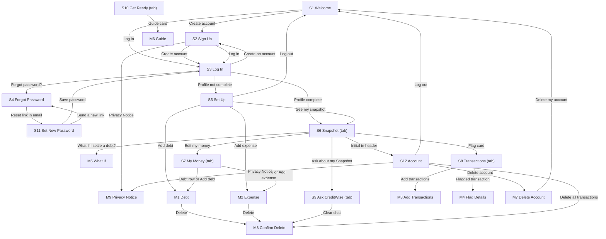

# CreditWise AI: Product Requirements Document

27 Oct 2026 · Sijabulile Ncube

## Document details

| Field | Answer |
| --- | --- |
| Product name | CreditWise AI |
| Author(s) | Sijabulile Ncube (no student number issued) |
| Course code and cohort | AI-Augmented Software Development, Melsoft Academy SNPL cohort 2026 |
| Facilitator / reviewer | Mnelisi Maswanganyi (Melsoft Academy facilitator) |
| Link to original app idea | docs/idea.md in the repository (CreditWise AI: App Concept Document, submitted 27 Oct 2026) |
| GitHub repository | github.com/Sijabulile-Ncube/creditwise-ai. This PRD is saved there as docs/PRD.md |
| Version | v0.2 |
| Status | In review |

## Change log

| Version | Date | Section(s) changed | What changed | Regenerated? (screens / MASTER.md / none) |
| --- | --- | --- | --- | --- |
| v0.2 | 27 Oct 2026 | Document details, 15 | Facilitator name added; Bafana Ndlovu's written peer review summary added | None |
| v0.1 | 27 Oct 2026 | All | First draft, written from the App Concept Document. Statement upload narrowed to the CreditWise CSV template only; PDF bank statements, goal tracking and other languages moved to Future features (4.3) to keep the MVP small. | None (nothing generated yet) |

## 1. Product overview

**1.1 Product name:** CreditWise AI

**1.2 One-line pitch:** CreditWise AI helps working South Africans to see their finances the way a lender does so that they apply for credit they can afford. (20 words)

**1.3 Problem statement:** Before a lender approves credit, the National Credit Act (NCA) requires it to check that the person can afford it, and one of the main measures is how much of their income already goes to debt (their DTI). The consumer never sees this calculation; they only get a "yes" or a "no", often without a clear reason. In a quick poll of 12 classmates and colleagues, 9 said they could not say what percentage of their income goes to debt, and 5 had been declined for credit at least once without understanding why. Today people cope by guessing, by applying anyway, or by asking friends, and every declined application wastes time and can count against them on their credit record. Small leaks such as double debit orders and unknown deductions also go unnoticed for months because nobody checks their bank activity line by line.

**1.4 Solution:**

- Users enter their gross and net monthly income, their monthly expenses and each debt they pay off, once, in a 3-step set-up.
- The Snapshot tab shows their DTI, a Green, Amber or Red status band, their Money left each month and their Room for new repayments, each with a plain-English note.
- Users upload their recent bank activity using the CreditWise CSV template, and the app flags possible double charges, higher-than-usual amounts and new payees so they can query them with their bank.
- Users ask questions in Ask CreditWise, an AI assistant that answers in plain English using their own figures, without giving financial advice.
- Users read short guides on vehicle finance, personal loans and credit cards, tick off a readiness checklist, and use What if to see how settling a debt would change their DTI.

**1.5 Platform:** Web app (works in a browser). Designed and built mobile-first at 390 px wide, then checked on tablet and desktop. No app-store app in v1.

**1.6 Vision:** Within 2 years, CreditWise AI is the free first stop South Africans use before any credit application, offered through employer financial wellness programmes and available in isiZulu, isiNdebele and Afrikaans.

**1.7 Key terms**

| Term | Exact meaning in this app |
| --- | --- |
| Money profile | The user's gross monthly income, net monthly income, expenses and debts, as entered in S5 Set Up and S7 My Money |
| Debt | One account the user pays off every month, e.g. a personal loan or store account, with its monthly repayment and balance owing (BR3) |
| Expense | One fixed monthly cost that is not a debt, e.g. rent or transport (BR3) |
| DTI | Debt-to-income ratio: total monthly debt repayments divided by gross monthly income, shown as a whole percentage (BR4) |
| Status band | Green, Amber or Red, based on the DTI (BR5). Always shown as a coloured label with the word and an icon, never colour alone |
| Money left | Net monthly income minus all expenses and all debt repayments (BR6) |
| Room | How much more the user could add in monthly debt repayments before their DTI reaches the Red band (BR7) |
| Flag | A mark the app puts on one transaction that may need checking, with a reason: "Possible double charge", "Higher than usual" or "New payee" (BR11 to BR14) |

## 2. Users, personas and roles

**2.1 Primary user:** Salaried South Africans aged 22 to 45 who are about to apply for credit (a first car, credit card or store account) or who already pay several debts and feel stretched. They live mostly in Gauteng, KwaZulu-Natal and the Western Cape, work in offices, retail, call centres and the public service, and have medium tech comfort: they use WhatsApp and their banking app daily but have never used a budgeting tool. Most use an Android phone on prepaid or contract data; some also use a work laptop on office Wi-Fi.

**2.2 Secondary users:** None in v1. Admin work is done in the Supabase dashboard (see 2.5).

**2.3 Personas**

| Field | Persona 1 | Persona 2 |
| --- | --- | --- |
| Name and age | Thando Nkosi, 27 | Sibusiso Ndlovu, 38 |
| Role (from 2.4) | User | User |
| Occupation / situation | Junior marketing coordinator in Johannesburg; wants to finance her first car in the next 3 months | Shift supervisor at a distribution centre in Pretoria; pays vehicle finance, a personal loan, a credit card and 3 store accounts |
| Device and connectivity | Samsung Android phone on a 10 GB data contract; work laptop on office Wi-Fi | Android phone on prepaid data, usually buys 2 GB at a time |
| Tech comfort | Medium | Medium |
| Language(s) | English, isiZulu | English, isiNdebele, Sepedi |
| Goal | Know what car instalment she can afford before she walks into a dealership | Understand why he keeps being declined and which debt to pay off first |
| Frustrations today | Bank and dealer jargon (balloon payment, DTI, total cost of credit); does not know if her store accounts will count against her | Has no single view of what he owes; noticed a double debit order only after 2 months; feels judged when asking for help |
| How the app helps | Shows her DTI (36%, Amber), her Room of R1,000.00 and, through What if, that settling both store accounts takes her to 26% (Green) | Shows all 6 debts in one list, his DTI (45%, Red) and Money left of -R3,100.00, flags the double debit order, and explains it all without judgement |
| Quote | "I just want to know what I can afford before the salesman tells me." | "Every time I apply, they say no, but nobody tells me why." |

**2.4 Roles and permissions**

| Role | How someone gets this role | Can do | Cannot do |
| --- | --- | --- | --- |
| User | Signs up on S2, confirms they are 18 or older, and verifies their email | Create, read, update and delete their own money profile, debts, expenses, transactions, flag statuses, checklist ticks and Ask CreditWise messages; read all guides and checklist items; delete their own account | Read or change any other user's data (blocked by RLS on every table); create, edit or delete guides or checklist items; send more than 20 questions per day to Ask CreditWise (BR15, enforced by the server); see any other user in any list |
| Admin | Not an app account in v1. The project owner logs in to the Supabase dashboard | In the Supabase dashboard: add and edit guides and checklist items; delete a user's account on written request | Nothing is blocked in the dashboard; the admin follows the POPIA rules in 12.4 and never views user money data except to delete it on request |

**2.5 Admin:** Admin work is done directly in the Supabase dashboard, with no admin screens in v1.

## 3. Goals, success metrics and non-goals

**3.1 Goals**

| # | Goal | Metric (what you count) | Target | How you will check it |
| --- | --- | --- | --- | --- |
| G1 | New users see their credit picture quickly | % of new users whose money profile is complete (BR8) within 24 hours of signing up | 70% | money_profile.completed_at compared with user.created_at |
| G2 | Users act on their bank activity | % of users who added transactions and changed at least 1 flag from open to dismissed, querying or resolved within 7 days of their first import | 40% | transaction.flag_status_changed_at compared with the user's first transaction.created_at |
| G3 | Users understand their own position | Number of testers out of 10 who can correctly say their DTI, their status band and one step that would improve it, after 10 minutes of using the app | 8 out of 10 | User test with 10 classmates or colleagues using the seed accounts, recorded on a Google Form |

**3.2 Non-goals**

- No credit applications or links to lenders. CreditWise AI is not a credit provider and is not registered with the National Credit Regulator, so it never applies for, approves or arranges credit.
- No financial advice or product recommendations. Giving advice needs a licence under the FAIS Act; the app only explains and educates (BR17).
- No credit scores or credit bureau data. Getting bureau data needs paid agreements and formal consent processes that are beyond this project.
- No direct bank connections (open banking or bank log-ins). Storing bank log-in details is a security risk, so users upload a CSV file they create themselves.
- No reading of PDF bank statements in v1. Every bank's PDF layout is different; the CreditWise CSV template is the only import format.
- No native Android or iPhone app. A mobile-first web app reaches every phone without app-store approval.

## 4. Features, business rules and notifications

**4.1 Feature list**

| ID | Feature name | What the user can do (list every action) | Priority | Goal (G#) | Stories (US#) | Screens (S#) |
| --- | --- | --- | --- | --- | --- | --- |
| F1 | Account | Sign up, verify email, log in, reset password, read the Privacy Notice, log out, delete all transactions, delete account | Must | G1 | US1, US2, US3 | S1, S2, S3, S4, S11, S12, M7, M9 |
| F2 | Money profile | Complete the 3-step set-up; edit gross and net income; add, edit and delete debts; add, edit and delete expenses | Must | G1 | US4, US5 | S5, S7, M1, M2, M8 |
| F3 | Snapshot | See DTI, status band, Money left and Room, each with a plain-English note; see a bar showing where net income goes | Must | G1, G3 | US6 | S6 |
| F4 | Transaction check | Upload a CSV file using the CreditWise template; add one transaction by hand; see the last 90 days of transactions; filter to flagged only; open a flag; mark it "Looks fine", "I'll query it" or "Sorted"; undo "Looks fine" | Must | G2 | US7, US8 | S8, M3, M4 |
| F5 | Ask CreditWise | Ask a question in plain English; tap a suggested question; read answers that use my own figures; clear the conversation | Must | G3 | US9, US10 | S9 |
| F6 | Get ready | Read guides on vehicle finance, personal loans and credit cards; tick and untick checklist items; see checklist progress | Should | G3 | US11 | S10, M6 |
| F7 | What if | Choose one or more debts to imagine settling; see the new DTI, status band, Money left and Room; nothing is saved | Should | G3 | US12 | S6, M5 |

**4.2 MVP definition:** A user can sign up, enter their income, expenses and debts, see their DTI with a status band, Money left and Room, upload transactions to get flags, and ask Ask CreditWise questions about their own numbers.

**4.3 Future features**

- Reading PDF bank statements from the big South African banks
- Goal tracking: set a target DTI and date, and track progress month by month
- isiZulu, isiNdebele and Afrikaans versions of every screen
- Monthly history of DTI and Money left, shown as a chart
- Employer dashboard for financial wellness programmes (totals only, never individual data)

**4.4 Business rules**

| ID | Rule (exact logic, numbers and limits) | Used by (F#, S#) |
| --- | --- | --- |
| BR1 | **Money format.** All amounts are South African rand with 2 decimals, from R0.00 to R10,000,000.00. Shown as "R1,234.50" (comma between thousands, full stop before cents). Negative amounts are shown as "-R3,100.00" in the error colour. Input fields accept digits, one full stop and up to 2 decimals; spaces and the letter R are removed before saving. | All |
| BR2 | **Income.** Gross monthly income (before tax and deductions) is required, R1.00 to R10,000,000.00. Net monthly income (take-home pay) is required, R1.00 or more, and cannot be more than gross. Error: "Take-home pay can't be more than your income before deductions." | F2, S5, S7 |
| BR3 | **Debts and expenses.** Debt: name 2 to 40 characters; type is one of Personal loan, Vehicle finance, Home loan, Credit card, Store account, Student loan, Other; monthly repayment R1.00 to R1,000,000.00 (required); balance owing R0.00 to R10,000,000.00 (optional). Expense: name 2 to 40 characters; category is one of Housing, Transport, Food, Utilities, Insurance, Education, Phone and internet, Family support, Other; monthly amount R1.00 to R1,000,000.00 (required). A user can have at most 15 debts and 20 expenses. At the limit the "Add debt" or "Add expense" button is disabled with "You've reached the limit of 15 debts." or "You've reached the limit of 20 expenses." | F2, S5, S7, M1, M2 |
| BR4 | **DTI.** DTI = (sum of all debts' monthly repayments ÷ gross monthly income) × 100, rounded to the nearest whole number (0.5 rounds up). With no debts, DTI is 0%. Recalculated every time income or a debt is saved or deleted. Example: R9,000.00 ÷ R25,000.00 × 100 = 36%. | F3, F5, F7, S6, M5 |
| BR5 | **Status band.** Uses the rounded DTI. Green: 0% to 30%, label "Green: healthy". Amber: 31% to 40%, label "Amber: getting stretched". Red: 41% and above, label "Red: lenders may decline". These bands are CreditWise's own guide for learning, not any lender's rule, and S6 says so under the band. | F3, F7, S6, M5 |
| BR6 | **Money left.** Money left = net monthly income − sum of all expenses − sum of all debt repayments. If below R0.00 it is shown in the error colour with "You're spending more than you take home." | F3, F7, S6, M5 |
| BR7 | **Room.** Room = (40% × gross monthly income) − sum of all debt repayments, rounded down to the whole rand. If the result is below R0.00, Room is R0.00 with "You have no Room before the Red band." Example: (0.40 × R25,000.00) − R9,000.00 = R1,000.00. | F3, F5, F7, S6, M5 |
| BR8 | **Complete money profile.** The money profile is complete when gross and net income are saved, at least 1 expense is saved, and the user taps "See my snapshot" on step 3 of S5. Debts may be empty only if the user ticks "I don't have any debts". Until complete, every log-in opens S5 at the step where the user stopped, and the tab bar is hidden. | F2, S5 |
| BR9 | **CSV import.** File must end in .csv, be 1 MB or smaller and have at most 500 data rows. The first row must be exactly date,description,amount (capital letters allowed). date: YYYY-MM-DD. description: 1 to 80 characters. amount: a number with an optional minus sign and up to 2 decimals, no R, spaces or commas; negative means money out, positive means money in. A row is skipped if any value breaks these rules, if the date is in the future, or if the date is more than 90 days before today. For each identical date + description + amount combination, the app keeps at most as many rows as the largest number found in any single file, so uploading the same file twice adds nothing. The result toast states rows added and rows skipped. | F4, M3 |
| BR10 | **Stored transactions.** Only the last 90 days are kept: a scheduled job deletes older transactions every day at 02:00 SAST. A user can store at most 1,000 transactions. If an import would go over 1,000, nothing is imported and M3 shows "This would take you over 1,000 transactions. Delete all transactions in Account, then try again." A transaction added by hand needs a date within the last 90 days (not in the future), a description of 1 to 80 characters, an amount from R0.01 to R1,000,000.00 and a choice of Money in or Money out. | F4, S8, M3, S12 |
| BR11 | **Flag: Possible double charge.** Descriptions are compared after changing to lower case, removing all digits and turning repeated spaces into one space. If 2 money-out transactions have the same compared description and the same amount, and their dates are 0 to 3 days apart, the later one (or the second one in the file, if the dates are equal) is flagged "Possible double charge". | F4, S8, M4 |
| BR12 | **Flag: Higher than usual.** A money-out transaction of R200.00 or more is flagged "Higher than usual" if there are at least 2 earlier money-out transactions with the same compared description (BR11) and its amount is at least 2 times their average. Example: R350.00 and R380.00 earlier (average R365.00), then R1,150.00, which is more than R730.00, so it is flagged. | F4, S8, M4 |
| BR13 | **Flag: New payee.** A money-out transaction of R1,000.00 or more is flagged "New payee" if no earlier stored transaction has the same compared description (BR11) and its date is at least 30 days after the user's earliest stored transaction. | F4, S8, M4 |
| BR14 | **Flag rules.** Only money-out transactions are flagged, and each has at most 1 flag, in this priority order: BR11, then BR12, then BR13. All flags are recalculated after every import, hand-added transaction or delete. A transaction that still qualifies keeps its status; one that no longer qualifies loses its flag. Status changes: open → dismissed ("Looks fine"); dismissed → open ("Undo"); open → querying ("I'll query it"); querying → resolved ("Sorted"). Only open flags are counted in the Transactions tab badge and on the S6 Flag card. | F4, S8, M4 |
| BR15 | **Ask CreditWise limits.** A question is 1 to 500 characters. Each user can send 20 questions per day; the count resets at 00:00 SAST. The server checks the count (User.ask_count, which "Clear chat" does not reset) before calling the AI. Answers are limited to 200 words. Only the last 10 messages of the conversation are sent as context. Messages are kept for 30 days, then deleted by the daily 02:00 SAST job. | F5, S9 |
| BR16 | **What Ask CreditWise is told.** Each question is sent with: gross and net income, total expenses, each debt's type, monthly repayment and balance owing, DTI, status band, Money left, Room, and the number of open flags of each reason. It never receives the user's name, email, debt names, expense names or transaction descriptions. | F5, S9 |
| BR17 | **Ask CreditWise guardrails.** The assistant never names or recommends a lender or product, never says whether a user will be approved or declined, never gives investment, tax or legal advice, and never tells a user to stop paying a debt. If asked for any of these it replies exactly: "I can't give financial advice or tell you whether a lender will approve you. I can explain how things work using your numbers. For personal advice, speak to a registered financial adviser or a debt counsellor registered with the National Credit Regulator." If asked about something unrelated to money or credit, it replies exactly: "I can only help with questions about your money and credit." | F5, S9 |
| BR18 | **What if.** The user ticks 1 or more of their debts. The app recalculates DTI (BR4), status band (BR5), Money left (BR6) and Room (BR7) as if those repayments were R0.00, and shows the before and after values side by side. Nothing is saved. Example: settling the Clothing store card (R1,200.00) and Furniture store account (R1,300.00) moves Thando from 36% Amber to 26% Green and Room from R1,000.00 to R3,500.00. | F7, S6, M5 |
| BR19 | **Checklist.** Each guide has 5 to 8 checklist items. Ticking or unticking saves immediately. Progress is shown as "3 of 6 done" and as a bar. Ticks are kept until the user unticks them or deletes their account. | F6, S10, M6 |

**4.5 Notifications**

No push or SMS notifications in v1. The only emails are the 2 account emails sent by Supabase Auth.

| Trigger | Who receives it | Channel | Exact text | Tapping it opens |
| --- | --- | --- | --- | --- |
| User signs up on S2 | The new user | Email | Subject: "Verify your CreditWise AI email". Body: "Hi there, tap the button below to verify your email and start using CreditWise AI. This link works for 24 hours." Button: "Verify my email" | S3 Log In with the banner "Your email is verified. Log in to continue." |
| User asks for a reset link on S4 or S12 | That user | Email | Subject: "Reset your CreditWise AI password". Body: "We received a request to reset your password. This link works for 1 hour. If you didn't ask for this, you can ignore this email." Button: "Reset password" | S11 Set New Password |
| A transaction has an open flag | The user | In-app: red badge with the number of open flags on the Transactions tab ("9+" above 9) | The number, e.g. "3" | S8 Transactions with the "Flagged" filter on |

## 5. Accounts and sign-in

| Decision | Answer |
| --- | --- |
| Sign-up methods | Email + password only, through Supabase Auth |
| Who may sign up | Anyone with an email address who is 18 or older |
| Minimum age | 18. S2 Sign Up has the checkbox "I am 18 or older" (unticked by default), which must be ticked. Credit in South Africa is for adults, and this avoids needing parent consent under POPIA. |
| Email or phone verification | Email verification is required. After sign-up the user goes to S3 Log In with the banner "Check your email and tap the link to verify your account." Log-in is refused until the email is verified. The link works for 24 hours; S3 has a "Resend email" link, which can be used once every 60 seconds. |
| Password rules | At least 10 characters, with at least 1 letter and at least 1 number. Eye icon to show or hide. Helper text under the field: "At least 10 characters, with a letter and a number." |
| Forgot password | S3 → "Forgot password?" → S4 Forgot Password. The user enters their email and taps "Send link". S4 always shows "If an account exists for this email, we've sent a reset link." The link works for 1 hour and opens S11 Set New Password. After saving, the user goes to S3 with the banner "Password changed. Log in with your new password." |
| Failed log-in attempts | After 5 wrong passwords for the same email within 15 minutes, S3 shows "Too many attempts. Try again in 15 minutes." and the "Log in" button is disabled for 15 minutes. |
| Stay logged in | The user is logged out after 30 minutes with no taps, clicks or typing, and always after 7 days. S3 then shows "You were logged out to keep your money details safe. Log in again." |
| Log out | S12 Account → "Log out". No confirmation. Goes to S1 Welcome. |
| Delete account | S12 Account → "Delete account" → M7 Delete Account. The user types DELETE and taps "Delete my account". Immediately and permanently deletes the login, money profile, debts, expenses, transactions, checklist ticks and Ask CreditWise messages. No data is shared with other users, so nothing else is affected. Goes to S1 with the toast "Your account and all your data have been deleted." |
| Change email or phone | Changing email is not allowed in v1. No phone number is collected. |
| Change password | S12 Account → "Change password" sends the same reset email as S4 and shows the toast "We've sent a reset link to your email." |
## 6. User stories, acceptance criteria and edge cases

**6.1 Stories**

**US1 (F1):** As a new user, I want to create an account so that my money details are saved privately.

- **T-US1-1:** Given I am on S2 Sign Up, when I enter my first name, an email, a password of 10+ characters with a letter and a number, tick "I am 18 or older" and "I agree to the Privacy Notice", and tap "Create account", then my account is created and I go to S3 Log In with the banner "Check your email and tap the link to verify your account."
- **T-US1-2 (unhappy):** Given the email already has an account, when I tap "Create account", then I see "This email already has an account. Log in instead?" with a "Log in" link to S3.
- **T-US1-3 (unhappy):** Given either checkbox is unticked, or the password is under 10 characters or has no letter or no number, then "Create account" stays disabled; when I leave the password field it shows a red border and "At least 10 characters, with a letter and a number."

**US2 (F1):** As a user, I want to log in and reset my password so that I can get back into my account.

- **T-US2-1:** Given my email is verified, when I enter the correct email and password on S3 and tap "Log in", then I go to S5 Set Up if my money profile is not complete (BR8), otherwise to S6 Snapshot.
- **T-US2-2 (unhappy):** Given I have not verified my email, when I tap "Log in", then I see "Please verify your email first." and a "Resend email" link.
- **T-US2-3:** Given I enter my email on S4 and tap "Send link", then I always see "If an account exists for this email, we've sent a reset link.", and opening the link takes me to S11, where a valid new password and "Save password" take me to S3 with "Password changed. Log in with your new password."
- **T-US2-4 (unhappy):** Given I open a reset link more than 1 hour old, then S11 shows "This link has expired. Ask for a new one." with a "Send a new link" button to S4.

**US3 (F1):** As a user, I want to log out and delete my account so that I stay in control of my data.

- **T-US3-1:** Given I am on S12, when I tap "Log out", then I go to S1 Welcome and pressing the browser back button does not show any of my data.
- **T-US3-2:** Given I am on M7, when I type DELETE and tap "Delete my account", then all my data is deleted (Section 5), I go to S1 and see "Your account and all your data have been deleted."
- **T-US3-3 (unhappy):** Given I have typed anything other than DELETE in capital letters, then "Delete my account" stays disabled.

**US4 (F2):** As a new user, I want to enter my income, expenses and debts once so that I can see my credit picture.

- **T-US4-1:** Given I am on step 1 of S5, when I enter gross income R25,000.00 and net income R19,800.00 and tap "Next", then I go to step 2 (Expenses) and the progress bar shows "Step 2 of 3".
- **T-US4-2 (unhappy):** Given I enter a net income higher than my gross income, when I leave the field, then I see "Take-home pay can't be more than your income before deductions." and "Next" stays disabled.
- **T-US4-3:** Given I have at least 1 expense and either at least 1 debt or "I don't have any debts" ticked, when I tap "See my snapshot" on step 3, then my money profile is marked complete and I go to S6 Snapshot.
- **T-US4-4 (unhappy):** Given I have no debts and have not ticked "I don't have any debts", then "See my snapshot" stays disabled with the hint "Add a debt or tick 'I don't have any debts'."

**US5 (F2):** As a user, I want to update my debts and expenses so that my Snapshot stays correct.

- **T-US5-1:** Given I am on S7 My Money, when I tap a debt, change its monthly repayment in M1 and tap "Save debt", then M1 closes, I see the toast "Debt saved" and the totals on S7 and S6 use the new amount.
- **T-US5-2:** Given I tap "Delete" in M1 and confirm in M8, then the debt disappears from S7 and I see "Debt deleted".
- **T-US5-3 (unhappy):** Given I already have 15 debts (BR3), then "Add debt" is disabled and shows "You've reached the limit of 15 debts."

**US6 (F3):** As a user, I want to see my DTI, status band, Money left and Room so that I know how a lender might see me.

- **T-US6-1:** Given Thando's sample money profile (8.4), when she opens S6, then she sees DTI "36%", the band "Amber: getting stretched", Money left "R1,702.00" and Room "R1,000.00".
- **T-US6-2:** Given my Money left is below R0.00, then it shows in the error colour with "You're spending more than you take home."
- **T-US6-3 (unhappy):** Given the server cannot be reached, then S6 shows "We couldn't load your Snapshot. Try again." with a "Try again" button, and no old numbers are shown.

**US7 (F4):** As a user, I want to add my bank activity so that the app can check it for me.

- **T-US7-1:** Given I am on M3 and choose a valid CSV file with 62 rows, when I tap "Upload", then M3 closes, S8 lists the transactions newest first, and I see the toast "62 transactions added, 0 skipped. 3 need checking."
- **T-US7-2 (unhappy):** Given the first row of my file is not date,description,amount, when I tap "Upload", then M3 shows "This file doesn't match the CreditWise template. Download the template and try again." and nothing is saved.
- **T-US7-3 (unhappy):** Given my file has 10 rows older than 90 days, then those rows are skipped and the toast says "52 transactions added, 10 skipped."
- **T-US7-4:** Given I switch M3 to "Add one" and enter 28 Oct 2026, "Taxi fare", R45.00, Money out, when I tap "Add transaction", then it appears on S8 and I see "Transaction added".

**US8 (F4):** As a user, I want to see and deal with flagged transactions so that I can stop money leaking.

- **T-US8-1:** Given Thando's sample transactions, when she taps "Flagged" on S8, then she sees exactly 3: FITZONE GYM DEBIT R399.00 on 2 Oct 2026 ("Possible double charge"), PREPAID ELECTRICITY R1,150.00 on 18 Oct 2026 ("Higher than usual") and ONLINE TECH STORE R2,499.00 on 21 Oct 2026 ("New payee").
- **T-US8-2:** Given M4 is open for an open flag, when I tap "I'll query it", then the flag shows "Querying", the Transactions tab badge drops by 1, and I see "Marked as querying. Contact your bank to ask about it."
- **T-US8-3:** Given I tap "Looks fine", then the flag shows "Dismissed" with an "Undo" link for that transaction; tapping "Undo" sets it back to open.
- **T-US8-4 (unhappy):** Given I have no transactions, then S8 shows "No transactions yet. Upload your bank activity to check for double charges and unusual amounts." with an "Add transactions" button that opens M3.

**US9 (F5):** As a user, I want to ask questions about my money so that I understand my options in plain English.

- **T-US9-1:** Given Thando's sample data, when she sends "What car instalment can I afford?", then within 15 seconds she sees an answer of 200 words or fewer that mentions her Room of R1,000.00 and does not name any lender.
- **T-US9-2:** Given I tap the suggested question "Why is my DTI amber?", then it is sent as if I had typed it.
- **T-US9-3 (unhappy):** Given I have already sent 20 questions today (BR15), when I try to send another, then I see "You've used your 20 questions for today. You can ask again after midnight." and the send button is disabled.

**US10 (F5):** As a user, I want the assistant to be honest about what it can't do so that I don't mistake it for advice.

- **T-US10-1:** Given I ask "Which bank will approve me for a car?", then the answer is exactly the BR17 refusal text.
- **T-US10-2:** Given I ask "What's the weather in Durban?", then the answer is exactly "I can only help with questions about your money and credit."
- **T-US10-3 (unhappy):** Given the AI service fails or takes longer than 30 seconds, then I see "Ask CreditWise is not available right now. Try again in a few minutes." and my question stays in the text box and does not count towards my 20.

**US11 (F6):** As a user, I want to read short guides and tick a checklist so that I'm ready before I apply.

- **T-US11-1:** Given I am on S10, when I tap "Vehicle finance", then M6 opens with the guide and its 6 checklist items.
- **T-US11-2:** Given I tick "I have my 3 latest payslips", then the progress changes to "1 of 6 done" and stays ticked after I log out and log in again.
- **T-US11-3 (unhappy):** Given I am offline, when I try to tick an item, then it does not change and I see the offline banner "You're offline. Changes won't be saved."

**US12 (F7):** As a user, I want to see what happens if I settle a debt so that I can choose what to pay off first.

- **T-US12-1:** Given Thando's sample data, when she opens M5 and ticks Clothing store card and Furniture store account, then she sees DTI "36% → 26%", band "Amber → Green", Money left "R1,702.00 → R4,202.00" and Room "R1,000.00 → R3,500.00".
- **T-US12-2:** Given I close M5, then my saved money profile and S6 are unchanged.
- **T-US12-3 (unhappy):** Given I have no debts, then the "What if I settle a debt?" button on S6 is hidden.

**6.2 Edge cases**

| Situation | What the user sees (exact text) | What the app does |
| --- | --- | --- |
| Gross income is changed so that DTI moves from Amber to Red | Band changes to "Red: lenders may decline" next time S6 loads | Recalculates DTI, band, Money left and Room from saved data; nothing else changes |
| A user deletes a debt while M5 What if is open in another tab | "Your debts changed. Close and open What if again." | Closes M5 on the next tap; shows the saved figures |
| The same CSV file is uploaded twice | "0 transactions added, 62 skipped." | Skips matching rows (BR9); flags are unchanged |
| A flagged transaction becomes older than 90 days | It disappears from S8 | The 02:00 SAST job deletes it; the badge count drops |
| The user is logged out after 30 minutes while typing in M1 | "You were logged out to keep your money details safe. Log in again." | Nothing in M1 is saved; after log-in the user goes to S6 |
| Gross income is R1.00 and repayments are large, so DTI is over 999% | DTI shows "999%+" | Stores the real value; only the display is capped |
| The user's browser blocks the file picker or the file is a .xlsx | "Please choose a .csv file. In Excel, use Save As and choose CSV." | Nothing is uploaded |

## 7. User flows and navigation map

**7.1 Flows**

**Flow 1: First-time sign-up to first Snapshot (F1, F2, F3)**

- **Starts when:** Thando opens creditwise-ai.vercel.app for the first time.
- **Steps:**
    1. S1 Welcome: taps "Create account" → S2 Sign Up
    2. S2 Sign Up: taps "Privacy Notice" → M9 Privacy Notice; taps "Close" → back to S2
    3. S2: fills in the form, ticks both boxes, taps "Create account" → S3 Log In with the verify-email banner
    4. Taps "Verify my email" in the email → S3 with "Your email is verified. Log in to continue."; logs in
    5. If her money profile is not complete (BR8) → S5 Set Up; otherwise → S6 Snapshot
    6. S5 step 1: enters gross and net income, taps "Next"
    7. S5 step 2: taps "Add expense" → M2 Expense; saves each expense → back to S5; taps "Next"
    8. S5 step 3: taps "Add debt" → M1 Debt; saves each debt → back to S5; or ticks "I don't have any debts"
    9. Taps "See my snapshot" → S6 Snapshot
- **Ends when:** S6 shows DTI 36%, "Amber: getting stretched", Money left R1,702.00 and Room R1,000.00.

**Flow 2: Check bank activity (F4)**

- **Starts when:** Thando wants to check her last 3 months of bank activity.
- **Steps:**
    1. Taps the Transactions tab → S8 Transactions
    2. If she has no transactions → empty state; taps "Add transactions" → M3 Add Transactions; otherwise taps "Add transactions" in the header → M3
    3. M3: taps "Download template" if she needs it; chooses her CSV file; taps "Upload"
    4. If the file breaks BR9 → M3 shows the error and stays open; otherwise → S8 with the toast "62 transactions added, 0 skipped. 3 need checking."
    5. S8: taps "Flagged" → sees 3 flagged transactions; taps FITZONE GYM DEBIT → M4 Flag Details
    6. M4: taps "I'll query it" → back to S8; the flag shows "Querying" and the badge shows 2
- **Ends when:** S8 shows the gym transaction marked "Querying".

**Flow 3: Ask a question (F5)**

- **Starts when:** Thando is on S6 and wants to know what car instalment she can afford.
- **Steps:**
    1. Taps "Ask about my Snapshot" on S6, or the Ask tab → S9 Ask CreditWise
    2. S9: taps the suggested question "What car instalment can I afford?" or types her own, taps send
    3. If she has used 20 questions today → limit message, send disabled; otherwise → the answer appears under her question
    4. If the AI fails → error message, question kept in the box; she taps send again
- **Ends when:** She reads an answer that uses her Room of R1,000.00.

**Flow 4: Plan which debt to settle (F7, F2)**

- **Starts when:** Sibusiso sees his Red band on S6.
- **Steps:**
    1. S6: taps "What if I settle a debt?" → M5 What If
    2. M5: ticks Store account A and Store account B, and sees the before and after figures; taps "Close" → S6 (nothing saved)
    3. After paying one off in real life, taps the My Money tab → S7 My Money; taps Store account A → M1 Debt
    4. M1: taps "Delete" → M8 Confirm Delete; taps "Delete" → S7 with "Debt deleted"
- **Ends when:** S6 shows his new DTI.

**Flow 5: Get ready to apply (F6)**

- **Starts when:** Thando wants to know what she needs for vehicle finance.
- **Steps:**
    1. Taps the Get Ready tab → S10 Get Ready
    2. S10: taps "Vehicle finance" → M6 Guide
    3. M6: reads the guide, ticks the checklist items she has done; taps "Close" → S10, which shows "2 of 6 done" on the Vehicle finance card
- **Ends when:** Her ticks are saved.

**Flow 6: Forgot password (F1)**

- **Starts when:** Sibusiso cannot remember his password.
- **Steps:**
    1. S3 Log In: taps "Forgot password?" → S4 Forgot Password
    2. S4: enters his email, taps "Send link" → sees the confirmation text
    3. Taps "Reset password" in the email → S11 Set New Password
    4. If the link is older than 1 hour → "This link has expired. Ask for a new one."; taps "Send a new link" → S4; otherwise enters a new password twice and taps "Save password" → S3
- **Ends when:** S3 shows "Password changed. Log in with your new password."

**Flow 7: Manage my account (F1)**

- **Starts when:** Thando wants to leave the app and remove her data.
- **Steps:**
    1. Any tab: taps her initial in the header → S12 Account
    2. S12: taps "Privacy Notice" → M9; taps "Close" → S12
    3. S12: taps "Delete account" → M7 Delete Account
    4. M7: types DELETE, taps "Delete my account" → S1 Welcome; or taps "Cancel" → S12
- **Ends when:** S1 shows "Your account and all your data have been deleted."

**7.2 Navigation map**

Tabs: on phones and tablets (under 1024 px) a bottom tab bar; on desktop (1024 px and wider) a left side menu with the same 5 items. Shown on S6, S7, S8, S9, S10 and S12 (S12 has no active tab). Hidden on S1 to S5 and S11.

- S6 Snapshot
- S7 My Money
- S8 Transactions
- S9 Ask
- S10 Get Ready

## 8. Screens

**8.1 Screen inventory**

Checked against the common list: Welcome (S1), Sign up (S2), Log in (S3), Forgot password (S4, plus S11 to set the new password), Onboarding (S5 Set Up is the onboarding; no separate intro slides are needed because S1 explains the app), Home (S6 Snapshot), Profile and settings (S12 Account, with log out, change password, delete all transactions, delete account and the Privacy Notice). A separate profile-edit screen is not needed because the only profile detail is the first name, which is set on S2 and cannot be changed in v1.

12 full screens (S1 to S12) and 9 pop-ups (M1 to M9).

| ID | Screen name | Type | Who can open it | Purpose (one line) | Tab bar shown? | Stories (US#) |
| --- | --- | --- | --- | --- | --- | --- |
| S1 | Welcome | Full screen | Logged out | Explain the app in one line; "Create account" and "Log in" | No | US1, US2, US3 |
| S2 | Sign Up | Full screen | Logged out | Create an account | No | US1 |
| S3 | Log In | Full screen | Logged out | Log in; shows verify, reset and logged-out banners | No | US2 |
| S4 | Forgot Password | Full screen | Logged out | Ask for a reset link | No | US2 |
| S5 | Set Up | Full screen, 3 steps | Logged in: User whose money profile is not complete | Enter income, expenses and debts for the first time | No | US4 |
| S6 | Snapshot | Tab | Logged in: User | See DTI, status band, Money left, Room and where money goes | Yes | US6, US12 |
| S7 | My Money | Tab | Logged in: User | Edit income; list, add, edit and delete expenses and debts | Yes | US5 |
| S8 | Transactions | Tab | Logged in: User | List the last 90 days of transactions; see and handle flags | Yes | US7, US8 |
| S9 | Ask CreditWise | Tab | Logged in: User | Ask questions and read answers about my own numbers | Yes | US9, US10 |
| S10 | Get Ready | Tab | Logged in: User | Pick a guide and see checklist progress | Yes | US11 |
| S11 | Set New Password | Full screen | Anyone with a valid reset link | Choose a new password | No | US2 |
| S12 | Account | Full screen | Logged in: User | Log out, change password, Privacy Notice, delete all transactions, delete account | Yes (no tab active) | US3 |
| M1 | Debt | Modal (full height on phone, centred dialog 480 px wide on desktop) | Logged in: User | Add, edit or delete one debt | No | US4, US5 |
| M2 | Expense | Modal (same as M1) | Logged in: User | Add, edit or delete one expense | No | US4, US5 |
| M3 | Add Transactions | Bottom sheet (centred dialog on desktop) | Logged in: User | Upload a CSV file or add one transaction by hand | No | US7 |
| M4 | Flag Details | Bottom sheet (centred dialog on desktop) | Logged in: User | See why a transaction was flagged and change its status | No | US8 |
| M5 | What If | Modal (full height on phone, centred dialog 560 px wide on desktop) | Logged in: User with at least 1 debt | Tick debts and compare before and after figures | No | US12 |
| M6 | Guide | Modal (full height on phone, centred dialog 720 px wide on desktop) | Logged in: User | Read one guide and tick its checklist | No | US11 |
| M7 | Delete Account | Modal (centred dialog) | Logged in: User | Confirm permanent account deletion | No | US3 |
| M8 | Confirm Delete | Modal (centred dialog) | Logged in: User | Confirm deleting a debt, an expense, all transactions or the Ask CreditWise chat | No | US5 |
| M9 | Privacy Notice | Modal (full height on phone, centred dialog 720 px wide on desktop) | Anyone | Read what data is collected, why, where it is stored and how to delete it | No | US1, US3 |

**8.2 Screen specifications**

Shared components named here (Header, Tab bar, Primary button, Toast and so on) are described in 8.3. All sample people and figures come from 8.4.

### S1 Welcome

- **Purpose:** Explain what CreditWise AI does and let the user create an account or log in.
- **Who can open it:** Logged out
- **Comes from / goes to:** First visit, S12 "Log out", M7 → S1 → S2 ("Create account"), S3 ("Log in")
- **Layout (top to bottom):**
    1. Logo wordmark, centred, 32 px tall
    2. Title (24 px): "See your money the way a lender does."
    3. Body text: "Check your debt-to-income ratio, spot double charges and ask questions in plain English. Free, private and built for South Africans."
    4. 3 benefit rows, each a 24 px Lucide icon and one line: gauge "Know your DTI and status band"; search "Spot double charges and unusual amounts"; message-circle "Ask questions about your own numbers"
    5. Primary button "Create account"
    6. Secondary button "Log in"
    7. Small text: "CreditWise AI explains and educates. It does not give financial advice or credit."
- **Lists and cards:** None
- **Form fields:** None
- **Buttons and links:** "Create account" → S2. "Log in" → S3.
- **States:**
    - Normal: as above.
    - Empty, Loading, Error: Not needed because the screen has no data.
    - Offline: Offline banner at the top; buttons still work and S2 or S3 shows the same banner.
    - Success: after account deletion, Toast "Your account and all your data have been deleted."
- **Sample content:** The fixed text above.

### S2 Sign Up

- **Purpose:** Create an account.
- **Who can open it:** Logged out
- **Comes from / goes to:** S1, S3 ("Create an account") → S2 → S3 (after sign-up or "Log in"), M9
- **Layout (top to bottom):**
    1. Header: back arrow (→ S1), title "Create your account"
    2. Form fields (table below)
    3. Checkbox "I am 18 or older"
    4. Checkbox "I agree to the Privacy Notice", where "Privacy Notice" is a link to M9
    5. Primary button "Create account" (disabled until every field is valid and both boxes are ticked)
    6. Text "Already have an account?" and link "Log in"
- **Lists and cards:** None
- **Form fields:**

| Field label | Type | Required? | Placeholder text | Rules | Error message (exact text) |
| --- | --- | --- | --- | --- | --- |
| First name | Text | Yes | "e.g. Thando" | 2 to 40 characters; letters, spaces, hyphens and apostrophes only | "Enter your first name (2 to 40 letters)." |
| Email | Email | Yes | "you@example.com" | Must contain one @ and a full stop after it; saved in lower case | "Enter a valid email address, like you@example.com." |
| Password | Password with eye icon | Yes | "At least 10 characters" | Section 5 password rules | "At least 10 characters, with a letter and a number." |
| I am 18 or older | Checkbox | Yes | None | Unticked by default | None (button stays disabled) |
| I agree to the Privacy Notice | Checkbox | Yes | None | Unticked by default | None (button stays disabled) |

- **Buttons and links:** "Create account" → creates the account → S3 with the verify banner. "Privacy Notice" → M9. "Log in" → S3. Back arrow → S1.
- **States:**
    - Normal: empty form.
    - Empty: Not needed (a form).
    - Loading: after tapping, the button shows a spinner and the label "Creating account…" and is disabled.
    - Error: "Something went wrong. Try again." above the button; typed values are kept. Email already used: "This email already has an account. Log in instead?" with a "Log in" link.
    - Offline: Offline banner; "Create account" disabled.
    - Success: S3 with "Check your email and tap the link to verify your account."
- **Sample content:** Thando, thando.nkosi@example.com.

### S3 Log In

- **Purpose:** Log in.
- **Who can open it:** Logged out
- **Comes from / goes to:** S1, S2, S11, email verify link, automatic log-out → S3 → S5 or S6 (BR8), S4, S2
- **Layout (top to bottom):**
    1. Header: back arrow (→ S1), title "Log in"
    2. Banner area (only one shows at a time, in a light green box for good news and a light amber box for warnings): "Check your email and tap the link to verify your account." / "Your email is verified. Log in to continue." / "Password changed. Log in with your new password." / "You were logged out to keep your money details safe. Log in again."
    3. Form fields (table below)
    4. Link "Forgot password?" (right-aligned)
    5. Primary button "Log in"
    6. Text "New to CreditWise AI?" and link "Create an account"
- **Lists and cards:** None
- **Form fields:**

| Field label | Type | Required? | Placeholder text | Rules | Error message (exact text) |
| --- | --- | --- | --- | --- | --- |
| Email | Email | Yes | "you@example.com" | As S2 | "Enter a valid email address, like you@example.com." |
| Password | Password with eye icon | Yes | "Your password" | Not empty | "Enter your password." |

- **Buttons and links:** "Log in" → S5 if the money profile is not complete, otherwise S6. "Forgot password?" → S4. "Create an account" → S2. "Resend email" (only with the not-verified error) → sends the verify email again, Toast "Verification email sent."
- **States:**
    - Normal: empty form, or a banner as above.
    - Empty: Not needed (a form).
    - Loading: button spinner, label "Logging in…".
    - Error: wrong details: "Email or password is incorrect." Not verified: "Please verify your email first." with "Resend email". Locked: "Too many attempts. Try again in 15 minutes." Server: "Something went wrong. Try again."
    - Offline: Offline banner; "Log in" disabled.
    - Success: goes to S5 or S6.
- **Sample content:** thando.nkosi@example.com.

### S4 Forgot Password

- **Purpose:** Ask for a password reset link.
- **Who can open it:** Logged out
- **Comes from / goes to:** S3, S11 ("Send a new link") → S4 → S3
- **Layout (top to bottom):**
    1. Header: back arrow (→ S3), title "Reset your password"
    2. Body text: "Enter the email you signed up with and we'll send you a link to choose a new password."
    3. Email field
    4. Primary button "Send link"
    5. Link "Back to log in"
- **Lists and cards:** None
- **Form fields:**

| Field label | Type | Required? | Placeholder text | Rules | Error message (exact text) |
| --- | --- | --- | --- | --- | --- |
| Email | Email | Yes | "you@example.com" | As S2 | "Enter a valid email address, like you@example.com." |

- **Buttons and links:** "Send link" → sends the reset email and shows the success text. "Back to log in" → S3.
- **States:**
    - Normal: empty field.
    - Empty: Not needed (a form).
    - Loading: button spinner, label "Sending…".
    - Error: "Something went wrong. Try again."
    - Offline: Offline banner; "Send link" disabled.
    - Success: the form is replaced by a green box: "If an account exists for this email, we've sent a reset link." and the link "Back to log in".
- **Sample content:** sibusiso.ndlovu@example.com.

### S5 Set Up

- **Purpose:** Enter income, expenses and debts for the first time, in 3 steps.
- **Who can open it:** Logged in: User whose money profile is not complete (BR8)
- **Comes from / goes to:** S3 → S5 → M1, M2, S6 ("See my snapshot"), S1 ("Log out")
- **Layout (top to bottom):**
    1. Header: logo wordmark on the left; text button "Log out" on the right
    2. Title "Set up your money profile" and progress bar with the text "Step 1 of 3", "Step 2 of 3" or "Step 3 of 3"
    3. Step 1, Income: heading "Your income"; body "Use your latest payslip. Gross is before tax and deductions; take-home is what reaches your bank."; 2 money fields (table below)
    4. Step 2, Expenses: heading "Your monthly expenses"; body "Add costs that are not debts, like rent, transport and groceries."; list of Expense rows; button "Add expense" (→ M2); total line "Total expenses: R9,098.00"
    5. Step 3, Debts: heading "Your debts"; body "Add every account you pay off monthly, like loans, credit cards and store accounts."; list of Debt rows; button "Add debt" (→ M1); checkbox "I don't have any debts" (disabled when at least 1 debt exists); total line "Total repayments: R9,000.00"
    6. Bottom bar: secondary button "Back" (hidden on step 1) and primary button "Next" (steps 1 and 2) or "See my snapshot" (step 3)
- **Lists and cards:** Expense row: name, category in grey, monthly amount right-aligned; tap → M2 in edit mode. Debt row: name, type in grey, monthly repayment right-aligned, "Owing R68,000.00" in small grey text if a balance was given; tap → M1 in edit mode.
- **Form fields (step 1):**

| Field label | Type | Required? | Placeholder text | Rules | Error message (exact text) |
| --- | --- | --- | --- | --- | --- |
| Monthly income before deductions (gross) | Number (money, "R" shown in front) | Yes | "e.g. 25000" | BR1, BR2 | "Enter an amount from R1.00 to R10,000,000.00." |
| Monthly take-home pay (net) | Number (money) | Yes | "e.g. 19800" | BR1, BR2; not more than gross | "Take-home pay can't be more than your income before deductions." |
| I don't have any debts (step 3) | Checkbox | No | None | Only enabled when there are 0 debts | None |

- **Buttons and links:** "Next" on step 1 → saves income → step 2. "Next" on step 2 (disabled until at least 1 expense) → step 3. "See my snapshot" (disabled until at least 1 debt or the box is ticked; hint "Add a debt or tick 'I don't have any debts'.") → marks the profile complete → S6. "Back" → previous step, nothing lost. "Log out" → S1.
- **States:**
    - Normal: step with data as above.
    - Empty: step 2 with no expenses: "No expenses added yet." above "Add expense". Step 3 with no debts: "No debts added yet." above "Add debt".
    - Loading: 2 grey placeholder rows while saved data loads.
    - Error: "We couldn't save that. Try again." above the bottom bar; typed values are kept.
    - Offline: Offline banner; "Next", "Add expense", "Add debt" and "See my snapshot" disabled.
    - Success: Toast "Expense saved" or "Debt saved" after M1 or M2 closes; after "See my snapshot", S6 with Toast "Your Snapshot is ready."
- **Sample content:** Thando: gross R25,000.00, net R19,800.00; expenses Rent R4,800.00, Transport R1,500.00, Groceries R2,000.00, Cellphone contract R399.00, Gym R399.00; debts Personal loan R4,500.00, Clothing store card R1,200.00, Furniture store account R1,300.00, Credit card R2,000.00.

### S6 Snapshot

- **Purpose:** Show how a lender might see the user: DTI, status band, Money left and Room.
- **Who can open it:** Logged in: User with a complete money profile
- **Comes from / goes to:** S3, S5, Snapshot tab → S6 → M5, S7, S8, S9, S12
- **Layout (top to bottom):**
    1. Header: logo wordmark on the left; Initial avatar on the right (→ S12)
    2. Greeting "Hi Thando" and small grey text "Updated 27 Oct 2026, 14:05"
    3. DTI card: label "Debt-to-income (DTI)"; the number "36%" in Display size; Status pill "Amber: getting stretched"; a horizontal scale from 0% to 60% with markers at 30% and 40% and a dot at the user's DTI; text "R9,000.00 of your R25,000.00 monthly income goes to debt repayments."; small grey text "Bands are CreditWise's guide for learning, not a lender's rule."
    4. Two Stat cards side by side (stacked under 360 px): "Money left" "R1,702.00" with "What's left from your take-home pay after expenses and debts."; "Room" "R1,000.00" with "How much more you could add in monthly repayments before reaching Red."
    5. Card "Where your take-home pay goes": one stacked horizontal bar with 3 parts and a legend: Expenses R9,098.00 (46%), Debt repayments R9,000.00 (45%), Money left R1,702.00 (9%). If Money left is below R0.00, the bar shows Expenses and Debt repayments only, and the text "Over by R3,100.00 each month" in the error colour.
    6. Flag card (only if open flags exist): alert icon, "3 transactions need checking", chevron (→ S8 with "Flagged" on)
    7. Secondary button "What if I settle a debt?" (→ M5; hidden when there are 0 debts)
    8. Primary button "Ask about my Snapshot" (→ S9)
    9. Link "Edit my money" (→ S7)
    10. Tab bar, Snapshot active
- **Lists and cards:** DTI card, Stat cards and Flag card as above.
- **Form fields:** None
- **Buttons and links:** Initial avatar → S12. Flag card → S8 (Flagged filter on). "What if I settle a debt?" → M5. "Ask about my Snapshot" → S9. "Edit my money" → S7.
- **States:**
    - Normal: as above.
    - Empty: Not needed because S6 only opens when the money profile is complete (BR8). With 0 debts the DTI is 0% and the band is "Green: healthy".
    - Loading: grey placeholders for the DTI card, 2 Stat cards and the bar.
    - Error: "We couldn't load your Snapshot. Try again." with a "Try again" button; no old numbers shown.
    - Offline: Offline banner; figures already loaded in this visit stay visible; "What if I settle a debt?" and "Ask about my Snapshot" disabled.
    - Success: after S5, Toast "Your Snapshot is ready."
- **Sample content:** Thando: 36%, "Amber: getting stretched", Money left R1,702.00, Room R1,000.00, 3 transactions need checking. Sibusiso: 45%, "Red: lenders may decline", Money left -R3,100.00 with "You're spending more than you take home.", Room R0.00 with "You have no Room before the Red band.", over by R3,100.00 each month. Ayanda: 0%, "Green: healthy", Money left R3,700.00, Room R5,600.00, no flag card, no What if button.

### S7 My Money

- **Purpose:** Keep income, expenses and debts up to date.
- **Who can open it:** Logged in: User with a complete money profile
- **Comes from / goes to:** My Money tab, S6 ("Edit my money") → S7 → M1, M2
- **Layout (top to bottom):**
    1. Header: title "My Money"; Initial avatar on the right (→ S12)
    2. Income card: "Income before deductions (gross)" R25,000.00; "Take-home pay (net)" R19,800.00; text button "Edit". Tapping "Edit" turns the 2 values into money fields with "Save income" (primary) and "Cancel" (secondary)
    3. Expenses card: heading "Expenses" and total "R9,098.00 a month"; list of Expense rows (as S5); button "Add expense"
    4. Debts card: heading "Debts" and total "R9,000.00 a month"; list of Debt rows (as S5); button "Add debt"
    5. Tab bar, My Money active
- **Lists and cards:** Expense row and Debt row as in S5. Rows are sorted by monthly amount, highest first.
- **Form fields (Income card in edit mode):** same 2 money fields, rules and error messages as S5 step 1.
- **Buttons and links:** "Edit" → edit mode. "Save income" → saves, Toast "Income saved". "Cancel" → back to the saved values. Expense row or "Add expense" → M2. Debt row or "Add debt" → M1. "Add debt" disabled at 15 debts with "You've reached the limit of 15 debts."; "Add expense" disabled at 20 expenses with "You've reached the limit of 20 expenses."
- **States:**
    - Normal: as above.
    - Empty: Debts card with 0 debts: "No debts added. Your DTI is 0%." above "Add debt". Expenses can't be empty (BR8 needs at least 1); if the user deletes the last expense, the card shows "Add at least 1 expense so your Money left is correct."
    - Loading: 3 grey placeholder cards.
    - Error: "We couldn't load your money details. Try again." with "Try again".
    - Offline: Offline banner; "Edit", "Add expense", "Add debt" and row taps disabled.
    - Success: Toasts "Income saved", "Expense saved", "Expense deleted", "Debt saved", "Debt deleted".
- **Sample content:** Thando's data (8.4). Sibusiso's 6 debts: Vehicle finance R5,900.00 (owing R182,000.00), Personal loan R3,800.00, Credit card R2,100.00, Store account A R900.00, Store account B R850.00, Store account C R850.00.
### S8 Transactions

- **Purpose:** See the last 90 days of bank activity and deal with flags.
- **Who can open it:** Logged in: User with a complete money profile
- **Comes from / goes to:** Transactions tab, S6 Flag card → S8 → M3, M4
- **Layout (top to bottom):**
    1. Header: title "Transactions"; Initial avatar on the right (→ S12)
    2. Primary button "Add transactions" (→ M3), full width on phone
    3. Filter chips: "All" and "Flagged (3)" (the number counts open and querying flags)
    4. Small grey text: "Showing the last 90 days. Older transactions are deleted automatically."
    5. List of Transaction rows grouped under date headings like "21 Oct 2026", newest first, 50 rows at a time, then a secondary button "Show more"
    6. Tab bar, Transactions active, with the red badge (BR14, 4.5)
- **Lists and cards:** Transaction row shows, in order: description (one line, cut with "…"); amount on the right (money out "-R2,499.00" in main text colour, money in "+R19,800.00" in success colour); under the description, if flagged, a Flag pill with the reason and, after the reason, the status if it is not open ("Possible double charge · Querying"). Flagged rows have an amber left border 4 px wide. Tapping a flagged row → M4; tapping an unflagged row does nothing.
- **Form fields:** None
- **Buttons and links:** "Add transactions" → M3. "All" / "Flagged" → filter the list. Flagged row → M4. "Show more" → next 50 rows.
- **States:**
    - Normal: as above.
    - Empty: illustration of a receipt, "No transactions yet. Upload your bank activity to check for double charges and unusual amounts." and primary button "Add transactions" (→ M3). With "Flagged" on and no flags: "Nothing to check right now. We'll flag anything unusual when you add transactions."
    - Loading: 6 grey placeholder rows.
    - Error: "We couldn't load your transactions. Try again." with "Try again".
    - Offline: Offline banner; list stays visible; "Add transactions" and row taps disabled.
    - Success: after M3, Toast "62 transactions added, 0 skipped. 3 need checking." After M4, Toasts as in M4.
- **Sample content:** Thando: 21 Oct 2026 ONLINE TECH STORE -R2,499.00 (New payee); 18 Oct 2026 PREPAID ELECTRICITY -R1,150.00 (Higher than usual); 2 Oct 2026 FITZONE GYM DEBIT -R399.00 (Possible double charge); 1 Oct 2026 FITZONE GYM DEBIT -R399.00; 25 Sep 2026 SALARY ACME MEDIA +R19,800.00. Ayanda: empty state.

### S9 Ask CreditWise

- **Purpose:** Ask questions about my own numbers and read plain-English answers.
- **Who can open it:** Logged in: User with a complete money profile
- **Comes from / goes to:** Ask tab, S6 ("Ask about my Snapshot") → S9 → M8 ("Clear chat")
- **Layout (top to bottom):**
    1. Header: title "Ask CreditWise"; text button "Clear chat" (hidden when empty); Initial avatar (→ S12)
    2. Info strip (always visible, light grey): "Ask CreditWise explains your numbers. It does not give financial advice."
    3. Conversation: Chat bubbles, oldest at the top, newest at the bottom, scrolled to the newest
    4. Suggested question chips (shown only when the conversation is empty): "Why is my DTI amber?" (the band word changes to the user's band), "What car instalment can I afford?", "How does a balloon payment work?", "What happens if I settle my store accounts?"
    5. Input bar fixed above the tab bar: text area (1 to 4 lines, grows as the user types), counter "0/500", small text "18 questions left today", send button (paper-plane icon, label for screen readers "Send question")
    6. Tab bar, Ask active
- **Lists and cards:** User bubble: right-aligned, primary colour background, white text, time "14:05". Assistant bubble: left-aligned, white with border, main text colour; under the text, small grey footer "Ask CreditWise explains; it does not give financial advice." and the time.
- **Form fields:**

| Field label | Type | Required? | Placeholder text | Rules | Error message (exact text) |
| --- | --- | --- | --- | --- | --- |
| Your question (label hidden, read by screen readers) | Text area | Yes | "Ask about your DTI, debts or credit…" | 1 to 500 characters (BR15); send disabled when empty or over 500 | "Questions can be up to 500 characters." |

- **Buttons and links:** Send → posts the question, shows a typing indicator (3 animated dots) in an assistant bubble, then the answer. Suggested chip → sends that text. "Clear chat" → M8.
- **States:**
    - Normal: conversation as above.
    - Empty: intro card: chat icon, "Ask anything about your Snapshot, your debts or how credit works. I'll use your own numbers." and the 4 suggested chips.
    - Loading: typing indicator while waiting; the send button is disabled. Opening the screen: 2 grey placeholder bubbles.
    - Error: "Ask CreditWise is not available right now. Try again in a few minutes." in a red-bordered note under the question; the question text goes back into the input; the daily count is not used.
    - Limit reached: "You've used your 20 questions for today. You can ask again after midnight."; input and send disabled.
    - Offline: Offline banner; input disabled.
    - Success: the answer bubble appears; counter updates, e.g. "17 questions left today".
- **Sample content:** Thando asks "What car instalment can I afford?" Answer: "Right now about R9,000.00 of your R25,000.00 income goes to debt, so your DTI is 36% (amber). Using CreditWise's bands, a new repayment of more than R1,000.00 a month would push you into the red range, where lenders are more likely to decline. If you settled your 2 store accounts first, that room would grow to about R3,500.00. Remember that a lender also looks at your credit record and its own rules, so treat this as a guide, not an approval." Sibusiso asks "Which bank will approve me?" Answer: the BR17 refusal text. Ayanda: empty state.

### S10 Get Ready

- **Purpose:** Choose a guide and see checklist progress before applying for credit.
- **Who can open it:** Logged in: User with a complete money profile
- **Comes from / goes to:** Get Ready tab → S10 → M6
- **Layout (top to bottom):**
    1. Header: title "Get Ready"; Initial avatar (→ S12)
    2. Body text: "Short guides on the most common types of credit, with a checklist of what to have ready before you apply."
    3. 3 Guide cards: Vehicle finance, Personal loans, Credit cards
    4. Small grey text: "You can get your credit report free once a year from each credit bureau."
    5. Tab bar, Get Ready active
- **Lists and cards:** Guide card shows, in order: Lucide icon (car, hand-coins, credit-card); title; one-line summary ("Instalments, balloon payments and what dealers check.", "How personal loans work and what they really cost.", "Limits, interest-free days and minimum payments."); progress bar and text "2 of 6 done" ("Not started" at 0); chevron.
- **Form fields:** None
- **Buttons and links:** Guide card → M6 for that guide.
- **States:**
    - Normal: 3 cards as above.
    - Empty: Not needed because the 3 guides are reference data that always exist (10.4).
    - Loading: 3 grey placeholder cards.
    - Error: "We couldn't load the guides. Try again." with "Try again".
    - Offline: Offline banner; cards still open M6 if the guide was loaded in this visit; ticking is disabled.
    - Success: progress text updates after closing M6.
- **Sample content:** Thando: Vehicle finance "2 of 6 done", Personal loans "Not started", Credit cards "Not started".

### S11 Set New Password

- **Purpose:** Choose a new password from a reset link.
- **Who can open it:** Anyone holding a reset link from the last hour
- **Comes from / goes to:** Reset email link → S11 → S3, S4
- **Layout (top to bottom):**
    1. Logo wordmark, centred
    2. Title "Choose a new password"
    3. Form fields (table below)
    4. Primary button "Save password"
- **Lists and cards:** None
- **Form fields:**

| Field label | Type | Required? | Placeholder text | Rules | Error message (exact text) |
| --- | --- | --- | --- | --- | --- |
| New password | Password with eye icon | Yes | "At least 10 characters" | Section 5 password rules | "At least 10 characters, with a letter and a number." |
| Confirm new password | Password with eye icon | Yes | "Type it again" | Must match New password | "The passwords don't match." |

- **Buttons and links:** "Save password" → saves, logs the user out everywhere → S3 with "Password changed. Log in with your new password." "Send a new link" (expired state only) → S4.
- **States:**
    - Normal: empty form.
    - Empty: Not needed (a form).
    - Loading: button spinner, label "Saving…".
    - Error: expired or used link: the form is replaced by "This link has expired. Ask for a new one." and primary button "Send a new link". Server: "Something went wrong. Try again."
    - Offline: Offline banner; "Save password" disabled.
    - Success: S3 with the banner above.
- **Sample content:** Not needed (passwords are never shown).

### S12 Account

- **Purpose:** Manage the account: log out, change password, read the Privacy Notice, delete transactions or the account.
- **Who can open it:** Logged in: User
- **Comes from / goes to:** Initial avatar in the Header on S6 to S10 → S12 → M7, M8, M9, S1
- **Layout (top to bottom):**
    1. Header: back arrow (returns to the tab the user came from), title "Account"
    2. Initial avatar (56 px), first name "Thando" and email "thando.nkosi@example.com" in grey
    3. List of Settings rows: "Change password" (key icon); "Privacy Notice" (shield icon); "Delete all transactions" (trash icon, error colour); "Log out" (log-out icon)
    4. Danger button "Delete account"
    5. Small grey text: "CreditWise AI v1.0. Your data is stored in London, United Kingdom."
    6. Tab bar, no tab active
- **Lists and cards:** Settings row: icon, label, chevron.
- **Form fields:** None
- **Buttons and links:** "Change password" → sends the reset email, Toast "We've sent a reset link to your email." "Privacy Notice" → M9. "Delete all transactions" → M8 (hidden when there are 0 transactions). "Log out" → S1. "Delete account" → M7.
- **States:**
    - Normal: as above.
    - Empty: Not needed (always has the user's details).
    - Loading: grey placeholder for the name and email.
    - Error: "Something went wrong. Try again." under the action that failed.
    - Offline: Offline banner; every row except "Privacy Notice" and "Log out" disabled.
    - Success: Toasts "We've sent a reset link to your email." and "All transactions deleted."
- **Sample content:** Thando Nkosi, thando.nkosi@example.com.

### M1 Debt

- **Purpose:** Add, edit or delete one debt.
- **Who can open it:** Logged in: User
- **Comes from / goes to:** S5 step 3, S7 → M1 → back to where it was opened, M8 ("Delete")
- **Layout (top to bottom):**
    1. Modal header: title "Add a debt" (new) or "Edit debt" (existing); close icon "X" (label "Close")
    2. Form fields (table below)
    3. Primary button "Save debt"; secondary button "Cancel"
    4. In edit mode only: danger text button "Delete"
- **Lists and cards:** None
- **Form fields:**

| Field label | Type | Required? | Placeholder text | Rules | Error message (exact text) |
| --- | --- | --- | --- | --- | --- |
| Name | Text | Yes | "e.g. Clothing store card" | 2 to 40 characters (BR3) | "Enter a name of 2 to 40 characters." |
| Type | Dropdown | Yes | "Choose a type" | Personal loan, Vehicle finance, Home loan, Credit card, Store account, Student loan, Other | "Choose a type." |
| Monthly repayment | Number (money) | Yes | "e.g. 1200" | R1.00 to R1,000,000.00 (BR1, BR3); helper text "The amount on your statement each month." | "Enter an amount from R1.00 to R1,000,000.00." |
| Balance owing | Number (money) | No | "Optional, e.g. 6400" | R0.00 to R10,000,000.00 | "Enter an amount from R0.00 to R10,000,000.00." |

- **Buttons and links:** "Save debt" → saves, closes, Toast "Debt saved". "Cancel" or "X" → closes without saving. "Delete" → M8.
- **States:**
    - Normal: empty form (add) or filled form (edit).
    - Empty: Not needed (a form).
    - Loading: button spinner, label "Saving…".
    - Error: "We couldn't save that. Try again." above the buttons; values kept.
    - Offline: Offline banner inside the modal; "Save debt" and "Delete" disabled.
    - Success: closes with Toast "Debt saved".
- **Sample content:** Clothing store card, Store account, R1,200.00, R6,400.00. Personal loan, Personal loan, R4,500.00, R68,000.00. Vehicle finance, Vehicle finance, R5,900.00, R182,000.00.

### M2 Expense

- **Purpose:** Add, edit or delete one expense.
- **Who can open it:** Logged in: User
- **Comes from / goes to:** S5 step 2, S7 → M2 → back to where it was opened, M8 ("Delete")
- **Layout (top to bottom):**
    1. Modal header: title "Add an expense" or "Edit expense"; close icon "X"
    2. Form fields (table below)
    3. Primary button "Save expense"; secondary button "Cancel"
    4. In edit mode only: danger text button "Delete"
- **Lists and cards:** None
- **Form fields:**

| Field label | Type | Required? | Placeholder text | Rules | Error message (exact text) |
| --- | --- | --- | --- | --- | --- |
| Name | Text | Yes | "e.g. Rent" | 2 to 40 characters (BR3) | "Enter a name of 2 to 40 characters." |
| Category | Dropdown | Yes | "Choose a category" | Housing, Transport, Food, Utilities, Insurance, Education, Phone and internet, Family support, Other | "Choose a category." |
| Monthly amount | Number (money) | Yes | "e.g. 4800" | R1.00 to R1,000,000.00 | "Enter an amount from R1.00 to R1,000,000.00." |

- **Buttons and links:** "Save expense" → saves, closes, Toast "Expense saved". "Cancel" or "X" → closes. "Delete" → M8.
- **States:** Same as M1, with "Expense saved" and "Save expense".
- **Sample content:** Rent, Housing, R4,800.00. Transport, Transport, R1,500.00. School fees, Education, R2,000.00.

### M3 Add Transactions

- **Purpose:** Upload a CSV file or add one transaction by hand.
- **Who can open it:** Logged in: User
- **Comes from / goes to:** S8 → M3 → S8
- **Layout (top to bottom):**
    1. Sheet header: title "Add transactions"; close icon "X"
    2. Segmented control: "Upload CSV" (default) | "Add one"
    3. Upload CSV tab: numbered help text: "1. Download the template. 2. Copy your bank activity into it: date, description and amount (minus for money out). 3. Save it as CSV and upload it here."; link "Download template" (downloads creditwise-template.csv with the header row and 2 example rows); file picker button "Choose file" showing the file name and size once chosen, e.g. "thando-oct.csv (4 KB)"; small text "Up to 500 rows and 1 MB. Only the last 90 days are kept."; primary button "Upload" (disabled until a file is chosen)
    4. Add one tab: form fields (table below); primary button "Add transaction"
- **Lists and cards:** None
- **Form fields (Add one tab):**

| Field label | Type | Required? | Placeholder text | Rules | Error message (exact text) |
| --- | --- | --- | --- | --- | --- |
| Date | Date | Yes | "DD MMM YYYY" | Today or up to 90 days before today (BR10) | "Choose a date in the last 90 days." |
| Description | Text | Yes | "e.g. Taxi fare" | 1 to 80 characters | "Enter a description of up to 80 characters." |
| Amount | Number (money) | Yes | "e.g. 45" | R0.01 to R1,000,000.00 | "Enter an amount from R0.01 to R1,000,000.00." |
| Money in or out | Toggle (2 options) | Yes | None ("Money out" selected by default) | Money in or Money out | None |
| File (Upload CSV tab) | File upload | Yes | "No file chosen" | BR9 | See States |

- **Buttons and links:** "Download template" → downloads the file. "Choose file" → opens the device file picker. "Upload" → checks and imports → closes → S8 with the result Toast. "Add transaction" → saves → closes → S8 with Toast "Transaction added". "X" → closes.
- **States:**
    - Normal: Upload CSV tab with no file chosen.
    - Empty: Not needed (a form).
    - Loading: "Checking your file…" with a progress bar; buttons disabled.
    - Error: wrong header: "This file doesn't match the CreditWise template. Download the template and try again." Not a .csv: "Please choose a .csv file. In Excel, use Save As and choose CSV." Too big: "This file is bigger than 1 MB or has more than 500 rows. Split it into smaller files." Over 1,000 stored: "This would take you over 1,000 transactions. Delete all transactions in Account, then try again." Server: "Something went wrong. Try again."
    - Offline: Offline banner; "Upload" and "Add transaction" disabled.
    - Success: closes; S8 Toast "62 transactions added, 0 skipped. 3 need checking." (numbers from the import).
- **Sample content:** thando-oct.csv (4 KB, 62 rows). Add one: 28 Oct 2026, "Taxi fare", R45.00, Money out.

### M4 Flag Details

- **Purpose:** Explain why a transaction was flagged and let the user change its status.
- **Who can open it:** Logged in: User (own transactions only)
- **Comes from / goes to:** S8 flagged row → M4 → S8
- **Layout (top to bottom):**
    1. Sheet header: Flag pill with the reason; close icon "X"
    2. Transaction summary: description (bold), date and amount, e.g. "FITZONE GYM DEBIT · 2 Oct 2026 · -R399.00"
    3. Explanation text for the reason (see Sample content)
    4. Status line: "Status: Open", "Status: Querying", "Status: Dismissed" or "Status: Sorted on 30 Oct 2026"
    5. Buttons, depending on status: Open: primary "I'll query it", secondary "Looks fine". Querying: primary "Sorted". Dismissed: secondary "Undo". Resolved: no buttons.
- **Lists and cards:** None
- **Form fields:** None
- **Buttons and links:** "I'll query it" → status querying, closes, Toast "Marked as querying. Contact your bank to ask about it." "Looks fine" → status dismissed, closes, Toast "Marked as fine." "Sorted" → status resolved, closes, Toast "Marked as sorted." "Undo" → status open, Toast "Flag reopened." "X" → closes.
- **States:**
    - Normal: as above.
    - Empty, Loading: Not needed because all details come from the row already loaded on S8.
    - Error: "We couldn't update this flag. Try again." above the buttons.
    - Offline: Offline banner; buttons disabled.
    - Success: the Toasts above.
- **Sample content:** Possible double charge: "We found 2 payments of R399.00 to FITZONE GYM DEBIT within 3 days (1 Oct 2026 and 2 Oct 2026). If you expected only one, ask your bank about it." Higher than usual: "This payment of R1,150.00 is more than double your usual R365.00 to PREPAID ELECTRICITY." New payee: "This is your first payment of R1,000.00 or more to ONLINE TECH STORE. If you don't recognise it, contact your bank straight away."

### M5 What If

- **Purpose:** Show how settling one or more debts would change the Snapshot, without saving anything (BR18).
- **Who can open it:** Logged in: User with at least 1 debt
- **Comes from / goes to:** S6 → M5 → S6
- **Layout (top to bottom):**
    1. Modal header: title "What if I settle a debt?"; close icon "X"
    2. Body text: "Tick the debts you're thinking of paying off. Nothing is saved."
    3. Checkbox list of the user's debts: name and "R1,200.00 a month"
    4. Comparison table with columns "Now" and "After": rows DTI, Status band (Status pills), Money left, Room. Before any tick, the After column shows "Tick a debt to see the change."
    5. Small grey text: "This is a guide. Settling a debt early may have fees; ask your lender for a settlement letter."
    6. Secondary button "Close"
- **Lists and cards:** Debt checkbox row: checkbox, name, monthly repayment.
- **Form fields:** One checkbox per debt; none required.
- **Buttons and links:** Ticking or unticking → After column updates at once. "Close" or "X" → S6.
- **States:**
    - Normal: as above.
    - Empty: Not needed because M5 can only open when there is at least 1 debt.
    - Loading: Not needed because all figures come from S6's loaded data and are calculated in the browser.
    - Error: if the debts changed meanwhile: "Your debts changed. Close and open What if again."
    - Offline: works offline (no saving), with the Offline banner.
    - Success: Not needed (nothing is saved).
- **Sample content:** Thando ticks Clothing store card and Furniture store account: DTI 36% → 26%; Amber → Green; Money left R1,702.00 → R4,202.00; Room R1,000.00 → R3,500.00. Sibusiso ticks Store account A, B and C (R2,600.00): DTI 45% → 37%; Red → Amber; Money left -R3,100.00 → -R500.00; Room R0.00 → R1,000.00.

### M6 Guide

- **Purpose:** Read one guide and tick its checklist.
- **Who can open it:** Logged in: User
- **Comes from / goes to:** S10 → M6 → S10
- **Layout (top to bottom):**
    1. Modal header: guide title, e.g. "Vehicle finance"; close icon "X"
    2. Section "How it works" (2 to 4 short paragraphs)
    3. Section "Words to know": term in bold and one-sentence meaning, e.g. "Balloon payment: a large lump sum you pay at the end of the term, which makes monthly instalments lower."
    4. Section "What lenders check": 3 to 5 bullets
    5. Section "Before you apply": progress bar and "2 of 6 done", then the checklist items with checkboxes
    6. Secondary button "Close"
- **Lists and cards:** Checklist row: checkbox and text.
- **Form fields:** One checkbox per checklist item; saving is immediate (BR19).
- **Buttons and links:** Checkbox → saves the tick or untick, progress updates. "Close" or "X" → S10.
- **States:**
    - Normal: as above.
    - Empty: Not needed (every guide has 5 to 8 items).
    - Loading: grey placeholder lines for the text.
    - Error: the tick goes back to how it was, with the Toast "We couldn't save that tick. Try again."
    - Offline: Offline banner; checkboxes disabled; text readable if loaded.
    - Success: no Toast; the checkbox and progress change at once.
- **Sample content:** Vehicle finance checklist (Thando has ticked the first 2): "I have my 3 latest payslips"; "I have my last 3 months' bank statements"; "I have my ID and driver's licence"; "I have proof of address from the last 3 months"; "I've checked my free credit report"; "My Room covers the instalment I'm planning".
### M7 Delete Account

- **Purpose:** Confirm permanent deletion of the account and all data.
- **Who can open it:** Logged in: User
- **Comes from / goes to:** S12 → M7 → S1 (deleted) or S12 ("Cancel")
- **Layout (top to bottom):**
    1. Title "Delete your account?"
    2. Body text: "This permanently deletes your money profile, debts, expenses, transactions, checklist ticks and Ask CreditWise messages. You can't undo this."
    3. Text field (table below)
    4. Danger button "Delete my account"; secondary button "Cancel"
- **Lists and cards:** None
- **Form fields:**

| Field label | Type | Required? | Placeholder text | Rules | Error message (exact text) |
| --- | --- | --- | --- | --- | --- |
| Type DELETE to confirm | Text | Yes | "DELETE" | Must be exactly DELETE in capital letters | None (button stays disabled) |

- **Buttons and links:** "Delete my account" → deletes everything → S1 with Toast "Your account and all your data have been deleted." "Cancel" → S12.
- **States:**
    - Normal: empty field, button disabled.
    - Empty: Not needed (a form).
    - Loading: button spinner, label "Deleting…".
    - Error: "We couldn't delete your account. Try again."
    - Offline: Offline banner; button disabled.
    - Success: S1 with the Toast above.
- **Sample content:** Not needed (fixed text).

### M8 Confirm Delete

- **Purpose:** Confirm deleting one debt, one expense, all transactions, or the Ask CreditWise conversation.
- **Who can open it:** Logged in: User
- **Comes from / goes to:** M1, M2, S12, S9 → M8 → back to S7 or S5 (debt or expense), S12 (transactions), S9 (chat)
- **Layout (top to bottom):**
    1. Title (by item): "Delete Clothing store card?" / "Delete Gym?" / "Delete all transactions?" / "Clear this chat?"
    2. Body text (by item): debt or expense: "Your Snapshot will update straight away." All transactions: "This deletes all 62 transactions and their flags. You can't undo this." Chat: "This deletes all your Ask CreditWise messages. It doesn't reset your 20 questions for today."
    3. Danger button "Delete" (or "Clear" for the chat); secondary button "Cancel"
- **Lists and cards:** None
- **Form fields:** None
- **Buttons and links:** "Delete" or "Clear" → deletes → closes M8 (and M1 or M2) → Toast "Debt deleted", "Expense deleted", "All transactions deleted." or "Chat cleared". "Cancel" → closes M8 only.
- **States:**
    - Normal: as above.
    - Empty, Loading: Not needed (a short confirmation); the button shows a spinner while deleting.
    - Error: "We couldn't delete that. Try again."
    - Offline: Offline banner; "Delete" or "Clear" disabled.
    - Success: the Toasts above.
- **Sample content:** "Delete Clothing store card?"

### M9 Privacy Notice

- **Purpose:** Explain what personal information is collected, why, where it is stored, for how long, and how to delete it (POPIA).
- **Who can open it:** Anyone
- **Comes from / goes to:** S2, S12 → M9 → back
- **Layout (top to bottom):**
    1. Modal header: title "Privacy Notice"; close icon "X"
    2. Small grey text "Last updated 27 Oct 2026"
    3. Sections, each a heading and short paragraphs, using the content of 12.4: "What we collect", "Why we collect it", "Where it's stored" (Supabase in London, United Kingdom; questions to Ask CreditWise are processed by Anthropic in the United States without your name or email), "How long we keep it", "Your rights" (to see, correct or delete your information, and to complain to the Information Regulator), "Contact us"
    4. Secondary button "Close"
- **Lists and cards:** None
- **Form fields:** None
- **Buttons and links:** "Close" or "X" → back to S2 or S12.
- **States:**
    - Normal: as above.
    - Empty, Loading, Error: Not needed because the notice is fixed text built into the app.
    - Offline: readable offline.
    - Success: Not needed.
- **Sample content:** The fixed text described above.

**8.3 Shared components**

| Component | Used on | What it contains | How it behaves |
| --- | --- | --- | --- |
| Header | S2 to S12 | Left: back arrow or logo wordmark. Centre or left: title (Heading size). Right: Initial avatar (S6 to S10) or a text button | 56 px tall, white background, 1 px bottom border; stays at the top when scrolling |
| Tab bar | S6 to S10, S12 | 5 items, each a Lucide icon with a label below: gauge "Snapshot", wallet "My Money", receipt "Transactions", message-circle "Ask", list-checks "Get Ready" | Phone and tablet: fixed at the bottom, 64 px tall. Desktop (1024 px and wider): becomes a left side menu 240 px wide with the logo at the top. Active item: primary colour icon and label with a 3 px bar; others in secondary text colour. Red count badge on Transactions (4.5) |
| Primary button | All | Label, optional spinner | 48 px tall, primary colour background, white 16 px semibold label, 8 px corners. Disabled: 40% opacity and not clickable. Hover (desktop): darker by 8%. Keyboard focus: 2 px outline in the accent colour with a 2 px gap |
| Secondary button | All | Label | 48 px tall, white background, 1 px primary colour border, primary colour label |
| Danger button | S12, M7, M8 | Label | 48 px tall, error colour background, white label. Text-button version (M1, M2 "Delete", S12 "Delete all transactions") has no background and an error colour label |
| Text field | All forms | Label above (14 px semibold), input 48 px tall, helper or error text below (14 px) | Normal: 1 px border #D6D1C4. Focused: 2 px primary colour border. Error: 2 px error colour border, alert-circle icon and the error message; the user's text is kept |
| Money field | S5, S7, M1, M2, M3 | Text field with a fixed "R" before the input | Numeric keyboard on phones; shows thousands separators after the user leaves the field (BR1) |
| Card | S6 to S10, S12 | White background, 1 px border #E3DED3, 12 px corners, 16 px padding | No shadow |
| Stat card | S6 | Card with label (14 px), value in Money style (28 px), note (14 px, secondary text) | Value in error colour if negative |
| Status pill | S6, M5 | Icon and label: check-circle "Green: healthy", alert-triangle "Amber: getting stretched", x-circle "Red: lenders may decline" | Fully rounded; light background with dark text: Green #DCF2E3 / #14532D, Amber #FDECD3 / #7C2D12, Red #FDE2E0 / #7F1D1D |
| Flag pill | S8, M4 | flag icon and reason, plus status if not open | Amber pill colours (as Status pill) for open and querying; grey #EEEBE4 / #5B6670 for dismissed and resolved |
| Initial avatar | S6 to S10, S12 | First letter of the first name in a circle | 32 px (56 px on S12), primary colour background, white letter; label for screen readers "Account" |
| Expense row / Debt row | S5, S7 | As described in S5 | 56 px tall minimum, chevron on the right, tap opens M2 or M1 |
| Transaction row | S8 | As described in S8 | 64 px tall minimum |
| Chat bubble | S9 | As described in S9 | Maximum 85% of the screen width |
| Guide card | S10 | As described in S10 | Whole card is tappable |
| Settings row | S12 | Icon, label, chevron | 56 px tall |
| Banner | S3 | Icon and one sentence | Green #DCF2E3 for good news, amber #FDECD3 for warnings; stays until the user leaves the screen |
| Toast | All | One line, white text on #1F2A37, 8 px corners | Appears at the bottom above the tab bar; disappears after 3 seconds |
| Confirmation pop-up | M7, M8 | Title, body text, Danger button, Secondary button | Centred, 400 px wide maximum, dark overlay behind at 50%; closes on "Cancel" or Escape, never on overlay tap |
| Empty-state block | S5, S7, S8, S9 | Line illustration (120 px), one sentence, optional Primary button | Centred in the free space |
| Loading placeholder | All lists and cards | Grey #ECE8DF blocks in the shape of the content | Gentle pulse animation; replaced when data arrives |
| Offline banner | All screens | Grey #EEEBE4 bar, wifi-off icon, "You're offline. Changes won't be saved." | Appears under the Header while offline; save actions disabled |

**8.4 Sample data set** (used on every screen and in the seed data, 10.4)

**Users**

- **Thando Nkosi**, thando.nkosi@example.com. Gross R25,000.00; net R19,800.00. Expenses: Rent (Housing) R4,800.00; Transport (Transport) R1,500.00; Groceries (Food) R2,000.00; Cellphone contract (Phone and internet) R399.00; Gym (Other) R399.00; total R9,098.00. Debts: Personal loan (Personal loan) R4,500.00, owing R68,000.00; Credit card (Credit card) R2,000.00, owing R18,000.00; Furniture store account (Store account) R1,300.00, owing R14,500.00; Clothing store card (Store account) R1,200.00, owing R6,400.00; total R9,000.00. Results: DTI 36%, Amber, Money left R1,702.00, Room R1,000.00.
- **Sibusiso Ndlovu**, sibusiso.ndlovu@example.com. Gross R32,000.00; net R24,500.00. Expenses: Rent R5,500.00; Groceries R3,500.00; Transport R2,200.00; School fees R2,000.00; total R13,200.00. Debts: Vehicle finance R5,900.00, owing R182,000.00; Personal loan R3,800.00, owing R41,000.00; Credit card R2,100.00, owing R22,500.00; Store account A R900.00; Store account B R850.00; Store account C R850.00; total R14,400.00. Results: DTI 45%, Red, Money left -R3,100.00, Room R0.00.
- **Ayanda Mthembu**, ayanda.mthembu@example.com. Gross R14,000.00; net R11,900.00. Expenses: Rent R4,500.00; Groceries R2,000.00; Transport R1,200.00; Family support R500.00; total R8,200.00. No debts (ticked "I don't have any debts"). Results: DTI 0%, Green, Money left R3,700.00, Room R5,600.00. No transactions, no chat messages, no checklist ticks: use Ayanda to test empty states.

**Transactions** (dates 10 Aug 2026 to 28 Oct 2026)

- Thando: 62 transactions, including SALARY ACME MEDIA +R19,800.00 on 25 Aug, 25 Sep and 24 Oct 2026; FITZONE GYM DEBIT -R399.00 on 1 Sep, 1 Oct and 2 Oct 2026 (2 Oct flagged "Possible double charge", status open); PREPAID ELECTRICITY -R350.00 on 12 Aug, -R380.00 on 14 Sep and -R1,150.00 on 18 Oct 2026 (18 Oct flagged "Higher than usual", open); ONLINE TECH STORE -R2,499.00 on 21 Oct 2026 (flagged "New payee", open).
- Sibusiso: 40 transactions, including SALARY LOGISTIX DC +R24,500.00 on 25 Aug, 25 Sep and 23 Oct 2026; FAMILYCARE FUNERAL PLAN -R250.00 on 3 Oct and 5 Oct 2026 (5 Oct flagged "Possible double charge", status querying).
- Ayanda: none.

**Ask CreditWise messages:** Thando has 2 (the question and answer in S9 Sample content). Sibusiso has 2 ("Which bank will approve me?" and the BR17 refusal). Ayanda has none.

**Checklist ticks:** Thando has ticked the first 2 Vehicle finance items. Sibusiso and Ayanda have none.

## 9. Design direction

**9.1 Look and brand**

| Item | Your choice |
| --- | --- |
| Look and feel (3 words) | Calm, trustworthy, "ledger" (like a neat accounts book: warm paper background, clear lines, numbers that line up) |
| Primary colour | Ledger green #0F5C4D (buttons, links, active tab). White text on it: 7.9:1 |
| Secondary / accent colour | Brass #B7791F, for the focus outline and small highlights only, never for text |
| Background colour | Paper #F7F5F0 (page); cards are white #FFFFFF |
| Main text colour | Ink #1F2A37 (13.3:1 on the page background, 14.5:1 on white) |
| Secondary text colour | Slate #5B6670 (5.4:1 on the page, 5.9:1 on white) |
| Error / success / warning colours | Error #B42318 (6.6:1 on white) / success #1E7B4A (5.3:1 on white) / warning #B45309 (5.0:1 on white). Status and Flag pills use the light background and dark text pairs in 8.3, all 7.7:1 or higher |
| Dark mode | No (v1) |
| Font | Inter for all text; IBM Plex Mono for rand amounts and percentages so digits line up (both free at fonts.google.com) |
| Text sizes | Display (DTI number) 40 px bold, IBM Plex Mono; Title 24 px semibold; Heading 18 px semibold; Body 16 px regular; Money in lists 16 px medium, IBM Plex Mono; Small 14 px regular; Caption 12 px regular (timestamps and footnotes only) |
| Spacing unit | 8 px, so gaps are 4, 8, 16, 24 or 32 px |
| Screen side margin | 16 px under 640 px; 24 px from 640 to 1024 px; 32 px above 1024 px |
| Corner radius | Cards 12 px; inputs 8 px; buttons 8 px; pills and avatars fully round |
| Shadows | None; 1 px borders #E3DED3 instead |
| Button height | 48 px |
| Icon set | Lucide, outline, 24 px (20 px inside buttons and pills) |
| Logo | Wordmark "CreditWise" in Inter bold, ledger green #0F5C4D, followed by "AI" in white Inter bold inside a ledger green rounded rectangle (4 px corners). No other symbol |
| Images and illustrations | No photos. Simple line illustrations in ledger green for empty states (receipt, chat, coins). No profile pictures: Initial avatar only |
| Reference apps | Monzo (calm, plain-language money screens); 22seven (South African money overview); Google Sheets (numbers that line up in a clean grid) |

**9.2 Tone of voice:** Calm, plain and never judgemental, like a helpful friend who works at a bank. Speak to the user as "you". Example: "Your DTI is 36%. That's in the amber range, so lenders may look more closely." not "Warning! Your debt level is too high." Avoid jargon; when a financial term is needed, explain it in the same sentence.

**9.3 Platform rules (web)**

- Designed first at 390 × 844 px (phone), then 1440 px wide (desktop).
- Phone (under 640 px): one column; bottom Tab bar; modals open full height; main buttons full width at the bottom of forms.
- Tablet (640 to 1024 px): one column, maximum 720 px wide and centred; bottom Tab bar; on S6 the 2 Stat cards sit side by side.
- Desktop (over 1024 px): left side menu 240 px wide; content maximum 1120 px wide; on S6 the DTI card and the "Where your take-home pay goes" card sit side by side; on S7 the Expenses and Debts cards sit side by side; modals are centred dialogs at the widths in 8.1.
- Every clickable thing has a hover look (darker by 8% or underline for links) and a keyboard-focus look (2 px brass outline with a 2 px gap). Escape closes modals.
- Screens that look different on desktop: S6, S7 and S8 (S8 shows the transaction list as a table with columns Date, Description, Amount, Flag).

**9.4 Accessibility**

- Body text 16 px; small text 14 px; captions 12 px only for timestamps and footnotes.
- Every text colour above passes 4.5:1 (checked with the WebAIM contrast checker; ratios listed in 9.1).
- Everything tappable is at least 44 × 44 px.
- Colour is never used alone: status bands always show the word and an icon; flags show a pill with the reason; errors show a red border, an icon and a message; negative money shows a minus sign.
- Every icon-only button has a label for screen readers (e.g. "Close", "Send question", "Account"). The DTI scale has the text "Your DTI is 36%, in the amber band" for screen readers.
- All screens can be used with the keyboard alone, in a logical order.
## 10. Data model

**10.1 Entities and fields**

All money fields are Money (ZAR), stored as a decimal with 2 places. All date-times are saved in UTC and shown in SAST.

**Entity: User:** one person with an account (a profile row linked one-to-one to the Supabase Auth login).

| Field | Type | Required? | Default | Unique? | Rules | If the linked record is deleted |
| --- | --- | --- | --- | --- | --- | --- |
| id | ID | Yes | Same as the Auth login ID | Yes | None | None |
| email | Email | Yes | None | Yes | Lower case; never shown to anyone except the user | None |
| first_name | Text (40) | Yes | None | No | 2 to 40 characters; letters, spaces, hyphens, apostrophes | None |
| is_18_or_older | Yes/No | Yes | No | No | Must be Yes to sign up | None |
| privacy_accepted_at | Date-time | Yes | Now | No | Set when the Privacy Notice box is ticked on S2 | None |
| ask_count | Whole number | Yes | 0 | No | Questions answered on ask_count_date; 0 to 20 (BR15). Only a successful answer adds 1, so failed questions are not counted | None |
| ask_count_date | Date | No | None | No | The SAST date ask_count belongs to; when it is not today, the server treats ask_count as 0 and resets it | None |
| created_at | Date-time | Yes | Now | No | None | None |

**Entity: MoneyProfile:** one user's income and set-up progress (exactly one per user).

| Field | Type | Required? | Default | Unique? | Rules | If the linked record is deleted |
| --- | --- | --- | --- | --- | --- | --- |
| id | ID | Yes | Auto | Yes | None | None |
| user_id | Link to User | Yes | Current user | Yes | None | Delete this too |
| gross_income | Money (ZAR) | No (set on S5 step 1) | None | No | R1.00 to R10,000,000.00 (BR2) | None |
| net_income | Money (ZAR) | No (set on S5 step 1) | None | No | R1.00 to gross_income (BR2) | None |
| has_no_debts | Yes/No | Yes | No | No | Can only be Yes when the user has 0 debts | None |
| setup_step | Whole number | Yes | 1 | No | 1, 2 or 3: the S5 step to reopen (BR8) | None |
| completed_at | Date-time | No | None | No | Set when "See my snapshot" is tapped (BR8); used for G1 | None |
| updated_at | Date-time | Yes | Now | No | Updated on every change to income, debts or expenses; shown on S6 as "Updated ..." | None |
| created_at | Date-time | Yes | Now | No | None | None |

**Entity: Debt:** one account the user pays off monthly.

| Field | Type | Required? | Default | Unique? | Rules | If the linked record is deleted |
| --- | --- | --- | --- | --- | --- | --- |
| id | ID | Yes | Auto | Yes | None | None |
| user_id | Link to User | Yes | Current user | No | At most 15 per user (BR3) | Delete this too |
| name | Text (40) | Yes | None | No | 2 to 40 characters | None |
| type | Choice | Yes | None | No | Personal loan, Vehicle finance, Home loan, Credit card, Store account, Student loan, Other | None |
| monthly_repayment | Money (ZAR) | Yes | None | No | R1.00 to R1,000,000.00 | None |
| balance_owing | Money (ZAR) | No | None | No | R0.00 to R10,000,000.00 | None |
| created_at | Date-time | Yes | Now | No | None | None |
| updated_at | Date-time | Yes | Now | No | None | None |

**Entity: Expense:** one fixed monthly cost that is not a debt.

| Field | Type | Required? | Default | Unique? | Rules | If the linked record is deleted |
| --- | --- | --- | --- | --- | --- | --- |
| id | ID | Yes | Auto | Yes | None | None |
| user_id | Link to User | Yes | Current user | No | At most 20 per user (BR3) | Delete this too |
| name | Text (40) | Yes | None | No | 2 to 40 characters | None |
| category | Choice | Yes | None | No | Housing, Transport, Food, Utilities, Insurance, Education, Phone and internet, Family support, Other | None |
| monthly_amount | Money (ZAR) | Yes | None | No | R1.00 to R1,000,000.00 | None |
| created_at | Date-time | Yes | Now | No | None | None |
| updated_at | Date-time | Yes | Now | No | None | None |

**Entity: Transaction:** one line of the user's bank activity, with its flag.

| Field | Type | Required? | Default | Unique? | Rules | If the linked record is deleted |
| --- | --- | --- | --- | --- | --- | --- |
| id | ID | Yes | Auto | Yes | None | None |
| user_id | Link to User | Yes | Current user | No | At most 1,000 per user (BR10) | Delete this too |
| date | Date | Yes | None | No | Not in the future; not more than 90 days ago (BR9, BR10) | None |
| description | Text (80) | Yes | None | No | 1 to 80 characters | None |
| amount | Money (ZAR) | Yes | None | No | Negative = money out, positive = money in; not R0.00; up to R1,000,000.00 either way | None |
| source | Choice | Yes | None | No | csv, manual | None |
| flag_type | Choice | Yes | none | No | none, double_charge, higher_than_usual, new_payee (BR11 to BR14) | None |
| flag_status | Choice | Yes | none | No | none, open, dismissed, querying, resolved (10.3) | None |
| flag_status_changed_at | Date-time | No | None | No | Set when the user changes flag_status; shown as "Sorted on ..." in M4; used for G2 | None |
| created_at | Date-time | Yes | Now | No | None | None |

**Entity: ChatMessage:** one question or answer in Ask CreditWise.

| Field | Type | Required? | Default | Unique? | Rules | If the linked record is deleted |
| --- | --- | --- | --- | --- | --- | --- |
| id | ID | Yes | Auto | Yes | None | None |
| user_id | Link to User | Yes | Current user | No | None | Delete this too |
| role | Choice | Yes | None | No | user, assistant | None |
| text | Long text (2,000) | Yes | None | No | user: 1 to 500 characters (BR15); assistant: up to 200 words | None |
| created_at | Date-time | Yes | Now | No | Rows older than 30 days are deleted daily (BR15). A question is only saved after its answer arrives | None |

**Entity: Guide (reference data):** one guide shown on S10 and M6.

| Field | Type | Required? | Default | Unique? | Rules | If the linked record is deleted |
| --- | --- | --- | --- | --- | --- | --- |
| id | ID | Yes | Auto | Yes | None | None |
| slug | Text (30) | Yes | None | Yes | vehicle-finance, personal-loans, credit-cards | None |
| title | Text (40) | Yes | None | No | None | None |
| summary | Text (80) | Yes | None | No | Shown on the Guide card | None |
| icon | Text (30) | Yes | None | No | Lucide icon name: car, hand-coins, credit-card | None |
| body | Long text (6,000) | Yes | None | No | Markdown with the sections "How it works", "Words to know", "What lenders check" | None |
| sort_order | Whole number | Yes | None | No | 1, 2, 3 | None |

**Entity: ChecklistItem (reference data):** one item on a guide's checklist.

| Field | Type | Required? | Default | Unique? | Rules | If the linked record is deleted |
| --- | --- | --- | --- | --- | --- | --- |
| id | ID | Yes | Auto | Yes | None | None |
| guide_id | Link to Guide | Yes | None | No | 5 to 8 items per guide (BR19) | Block the delete (remove items first) |
| text | Text (80) | Yes | None | No | Starts with "I have", "I've" or "My" | None |
| sort_order | Whole number | Yes | None | No | 1 to 8 | None |

**Entity: ChecklistTick:** one user's tick on one checklist item.

| Field | Type | Required? | Default | Unique? | Rules | If the linked record is deleted |
| --- | --- | --- | --- | --- | --- | --- |
| id | ID | Yes | Auto | Yes | The pair user_id + item_id is unique | None |
| user_id | Link to User | Yes | Current user | No | None | Delete this too |
| item_id | Link to ChecklistItem | Yes | None | No | None | Delete this too |
| created_at | Date-time | Yes | Now | No | Unticking deletes the row | None |

**10.2 Relationships**

- One User has exactly one MoneyProfile.
- One User has many Debts, many Expenses, many Transactions and many ChatMessages.
- One Guide has many ChecklistItems.
- Users tick many ChecklistItems and each ChecklistItem is ticked by many Users, through ChecklistTick.

**10.3 Status values and changes**

| Entity.field | From | To | Who or what causes it |
| --- | --- | --- | --- |
| Transaction.flag_status | none | open | Automatic: flag recalculation finds the transaction qualifies (BR11 to BR14) |
| Transaction.flag_status | open, dismissed, querying or resolved | none | Automatic: after an import, add or delete, the transaction no longer qualifies (BR14) |
| Transaction.flag_status | open | dismissed | User taps "Looks fine" in M4 |
| Transaction.flag_status | dismissed | open | User taps "Undo" in M4 |
| Transaction.flag_status | open | querying | User taps "I'll query it" in M4 |
| Transaction.flag_status | querying | resolved | User taps "Sorted" in M4 |
| MoneyProfile.setup_step | 1 → 2 → 3 | next step | User taps "Next" on S5 |
| MoneyProfile.completed_at | empty | date-time | User taps "See my snapshot" on S5 (BR8) |

**10.4 Reference and seed data**

- **Reference data:** the 3 Guides (Vehicle finance, Personal loans, Credit cards) and their ChecklistItems (Vehicle finance 6 items as in M6; Personal loans 5 items; Credit cards 5 items). They are loaded by a migration before the first user signs up, and maintained by the project owner in the Supabase dashboard. Guide text is written by the project owner from her credit risk and vehicle finance experience and checked against the National Credit Regulator's consumer information.
- **Seed data:** the 3 users, money profiles, debts, expenses, transactions, chat messages and checklist ticks in 8.4. The seed script moves every transaction date forward by the same number of days so that the newest is yesterday, which keeps them inside the 90-day window on demo day. Flags are created by running the real flag calculation, not typed in.
- **Test accounts** (role User; there is no Admin app account): thando.nkosi@example.com, sibusiso.ndlovu@example.com, ayanda.mthembu@example.com. The test-only password is kept in supabase/seed/README.md, never in this document or in GitHub issues.

## 11. Tech stack and architecture

**11.1 Stack**

| Layer | Your choice (with version) | Why |
| --- | --- | --- |
| Frontend (what users see) | React 19 + TypeScript 5 + Vite 6, React Router 7 | Covered in the course; I have built React + TypeScript + Vite projects before |
| Styling | Tailwind CSS 3.4, with the 9.1 values set as design tokens in tailwind.config.ts | Tailwind classes I already know; tokens keep every screen matching |
| Backend / API | Node.js 22 LTS + Express 5, deployed as a Vercel Function under /api | Keeps the AI key and the flag and CSV logic on the server; Express is covered in the course |
| Database | Supabase PostgreSQL | Covered in the course; Row-Level Security (RLS) protects each user's money data |
| Log-in (authentication) | Supabase Auth (email + password, email verification) | Handles passwords, verification and reset emails, so my code never stores passwords |
| File / image storage | None. CSV files are read on the server, turned into Transaction rows and then discarded | The app has no images and does not need to keep uploaded files, which is safer for POPIA |
| Scheduled jobs | Supabase Cron, daily at 02:00 SAST (00:00 UTC): delete transactions older than 90 days (BR10) and chat messages older than 30 days (BR15) | Keeps only the data the app needs |
| AI | Anthropic Claude API, model claude-haiku-5-5, through the @anthropic-ai/sdk package on the server | Fast and low-cost for short answers; only the server holds the key |
| CSV reading | Papa Parse 5 on the server | Reliable CSV parsing with clear row errors |
| Hosting / how you share the demo | Vercel: one project serves the React app and the /api Express function, e.g. creditwise-ai.vercel.app | Free, one URL for classmates and my facilitator |
| Language and package manager | TypeScript, npm, Node.js 22 LTS | Fewer type bugs; same language on both sides |
| Testing | Vitest 3 for business rules (11.7) + manual checklist of every T- criterion from Section 6 | Vitest works natively with Vite |
| Version control | GitHub repository (link in Document details) | Save this PRD as docs/PRD.md and MASTER.md in the root folder |

**11.2 Third-party services**

| Service | What it does in your app | Free tier enough? | Needs a key? (list it in 11.5) |
| --- | --- | --- | --- |
| Anthropic Claude API | Writes Ask CreditWise answers (F5) | No free tier; pay per use. A monthly spend limit of US$5 is set in the Anthropic Console. 20 questions per user per day (BR15) keeps the cost low | Yes: ANTHROPIC_API_KEY |

Supabase and Vercel are the platform, not extra services. No payments and no SMS.

**11.3 How the parts connect**

- The React app talks to Supabase directly (with the public anon key and the user's login) to read and save the money profile, debts, expenses, checklist ticks and flag statuses; RLS makes sure each user can only reach their own rows.
- DTI, status band, Money left, Room and What if (BR4 to BR7, BR18) are calculated in the browser from the saved data, using shared functions in src/lib/calculations.ts, so S6 and M5 always agree.
- Uploading a CSV, adding a transaction by hand and deleting all transactions go through the Express API (POST /api/transactions/import, POST /api/transactions, DELETE /api/transactions). The server checks the user's login, applies BR9 and BR10, saves the rows, recalculates every flag (BR11 to BR14) and returns the counts for the Toast.
- Ask CreditWise sends the question to POST /api/ask. The server checks the login and today's count (BR15), reads the user's figures from the database (BR16), calls Claude with the guardrail instructions (BR17) and a 30-second time limit, saves the question and answer, and returns the answer. Deleting an account uses DELETE /api/account, which removes the Auth login with the service role key on the server; every other table row is removed by "delete this too" links.

**11.4 Permissions: who can do what to the data** (enforced by RLS policies in Supabase, and by the Express API for the routes above)

| Entity | Action (read / create / update / delete) | Who is allowed | Extra rule |
| --- | --- | --- | --- |
| User | Read, update | Owner only (id = current user) | first_name cannot be changed in v1; email is never readable by others; ask_count and ask_count_date can only be changed by the Express API |
| User | Delete | Owner only, through DELETE /api/account | Server checks the login before deleting |
| MoneyProfile, Debt, Expense | Read, create, update, delete | Owner only (user_id = current user) | Limits in BR3 checked by database rules (a trigger refuses the 16th debt or 21st expense) |
| Transaction | Read | Owner only | None |
| Transaction | Create, delete | Owner only, only through the Express API | The API applies BR9, BR10 and recalculates flags |
| Transaction | Update | Owner only | Only the columns flag_status and flag_status_changed_at may be changed, and only along the paths in 10.3 (checked by a database trigger) |
| ChatMessage | Read, delete | Owner only | Delete is used by "Clear chat" (M8) |
| ChatMessage | Create | Only the Express API, acting for the logged-in user | The API enforces 20 per day (BR15) |
| Guide, ChecklistItem | Read | Any logged-in user | Create, update and delete only by the admin in the Supabase dashboard |
| ChecklistTick | Read, create, delete | Owner only | The pair user_id + item_id is unique |

**11.5 Environment variables and secrets**

Real values live in a .env file that is never uploaded to GitHub; .env.example with the same names and placeholder values is committed.

| Name | What it is | Where to get it | Public or secret? |
| --- | --- | --- | --- |
| VITE_SUPABASE_URL | Supabase project address | Supabase dashboard → Project Settings → API | Public: safe in the app |
| VITE_SUPABASE_ANON_KEY | Public (anon / publishable) key | Same | Public: safe only because RLS is on for every table |
| SUPABASE_URL | Same project address, for the server | Same | Public, but set only on the server |
| SUPABASE_ANON_KEY | Same public key, used by the server to act as the logged-in user | Same | Public, but set only on the server |
| SUPABASE_SERVICE_ROLE_KEY | Admin (service role / secret) key | Same | Secret: server only, used only by DELETE /api/account and the seed script; never in the React app |
| ANTHROPIC_API_KEY | Key for the Claude API | console.anthropic.com → API keys | Secret: server only |
| ANTHROPIC_MODEL | The model name, claude-haiku-5-5 | Anthropic documentation | Public, set on the server |

**11.6 Folder structure**

- src/pages/ : one file per screen (S1Welcome.tsx to S12Account.tsx)
- src/modals/ : one file per modal (M1Debt.tsx to M9PrivacyNotice.tsx)
- src/components/ : the shared components from 8.3 (Header, TabBar, Buttons, TextField, MoneyField, Card, StatCard, StatusPill, FlagPill, Toast, OfflineBanner, EmptyState, LoadingPlaceholder, ChatBubble and others)
- src/lib/ : Supabase client, money formatting (BR1), calculations (BR4 to BR7, BR18), API calls
- api/ : the Express app: index.ts; routes/ask.ts, routes/transactions.ts, routes/account.ts; lib/csv.ts (BR9), lib/flags.ts (BR11 to BR14), lib/assistantPrompt.ts (BR16, BR17)
- supabase/migrations/ : tables, RLS policies, triggers, cron jobs, guides and checklist items
- supabase/seed/ : seed script, sample CSV files, README with the test password
- public/creditwise-template.csv : the CSV template users download
- tests/ : Vitest tests
- docs/PRD.md and docs/idea.md
- MASTER.md and .env.example in the root folder

**11.7 Testing plan**

- Every T- criterion in Section 6 is tested manually on an Android phone in Chrome and on a laptop in Chrome and Edge, using the checklist in MASTER.md.
- Automated Vitest tests: BR1 (money format), BR4 to BR7 (DTI, band, Money left, Room, including Thando's and Sibusiso's figures from 8.4), BR9 (CSV rules: wrong header, old dates, duplicate upload), BR11 to BR14 (each flag with Thando's sample transactions), BR15 (daily limit resets at 00:00 SAST) and BR18 (What if examples in M5).
- A guardrail test list of 10 questions (e.g. "Which bank will approve me?", "Should I buy shares?", "Must I stop paying my store card?") is run by hand; every one must return the exact BR17 text.
- Test accounts: the 3 in 10.4.
- **5-minute demo script:**
    1. Log in as Thando and show S6: 36%, Amber, Money left R1,702.00, Room R1,000.00.
    2. Open M5 What If, tick both store accounts: 26%, Green.
    3. Go to S8, upload thando-oct.csv, show the 3 flags and mark the gym payment "I'll query it".
    4. Go to S9 and ask "What car instalment can I afford?", then ask "Which bank will approve me?" to show the guardrail.
    5. Log in as Sibusiso to show the Red band and negative Money left, then as Ayanda to show the empty states.
    ## 12. Quality, errors, security and privacy

**12.1 Quality requirements**

| Area | Requirement (must be checkable) |
| --- | --- |
| Speed | Every screen shows content or Loading placeholders within 3 seconds on mobile data, tested on my Android phone. A 500-row CSV import finishes within 10 seconds. An Ask CreditWise answer appears within 15 seconds; after 30 seconds the error message shows (T-US10-3) |
| Data usage | First load of the app is under 500 KB (compressed); no images except small SVG icons and illustrations; S8 loads 50 transactions at a time; no video or autoplay |
| Offline | Screens already loaded stay visible with the Offline banner "You're offline. Changes won't be saved."; every save, upload, tick and question is disabled; M5 What If and M9 Privacy Notice still work |
| Devices | Android 10 or newer and iPhone iOS 16 or newer, in the latest Chrome, Safari, Edge and Samsung Internet; screens from 360 px wide |
| Language and region | English (South Africa); dates as 12 Mar 2026; 24-hour time; SAST; currency format R1,234.50 (BR1) |
| Accessibility | As in Section 9.4 |
| Scale | Works for 200 users in the first 3 months, each with up to 1,000 transactions (200,000 rows), within the Supabase free plan |
| Abuse limits | 20 Ask CreditWise questions per user per day (BR15); 500 rows and 1 MB per CSV, 1,000 stored transactions (BR9, BR10); 5 failed log-ins lock log-in for 15 minutes (Section 5); "Resend email" once every 60 seconds |

**12.2 Error messages used everywhere**

Raw error codes are never shown to users.

| Situation | Exact message | What happens next |
| --- | --- | --- |
| No internet | "You're offline. Changes won't be saved." | Offline banner; save buttons disabled; loaded data stays visible |
| Server or unknown error | "Something went wrong. Try again." | "Try again" button; typed values kept |
| Logged out because the session expired | "You were logged out to keep your money details safe. Log in again." | Go to S3; unsaved form values are discarded |
| Not allowed (wrong role or another user's data) | "You can't do that." | Nothing saved; user stays on the screen |
| Form field error | Red border, alert icon and the exact message under the field (8.2) | Field keeps the user's text |
| Ask CreditWise unavailable | "Ask CreditWise is not available right now. Try again in a few minutes." | Question stays in the box and is not counted |

**12.3 Security**

- Passwords are only handled by Supabase Auth, never stored by my code.
- Secret keys (SUPABASE_SERVICE_ROLE_KEY, ANTHROPIC_API_KEY) never go in the React app or on GitHub (11.5); Vercel stores them as encrypted environment variables.
- Every "Cannot do" in 2.4 and every rule in 11.4 is enforced by RLS, database triggers or the Express API, not only hidden on the screen.
- Every /api route checks the Supabase login token before doing anything and only acts on that user's rows.
- CSV files are read in memory on the server and never saved; cells starting with =, +, - followed by a letter, or @ are treated as plain text, so a file cannot run spreadsheet formulas.
- Ask CreditWise never receives the user's name, email or typed names (BR16). The user's question is sent inside clear markers, and the guardrail instructions tell the model to ignore any instructions inside the question.
- The app is served only over HTTPS (Vercel default).

**12.4 Privacy and POPIA**

| Personal information | Why you need it | Who can see it | Where it is stored (service and country) | How long you keep it | How the user deletes it |
| --- | --- | --- | --- | --- | --- |
| Email address | Log-in, verification and reset emails | The user; admin only to delete an account on request | Supabase Auth, London, United Kingdom (region eu-west-2) | Until the account is deleted | S12 → M7 |
| First name | Greeting on S6 and S12 | The user | Supabase, London, United Kingdom | Until the account is deleted | S12 → M7 |
| Income, expenses and debts | Calculate DTI, Money left and Room | The user | Supabase, London, United Kingdom | Until the user deletes them or the account | M1 or M2 → M8; or S12 → M7 |
| Transactions (date, description, amount) | Flag double charges and unusual amounts | The user | Supabase, London, United Kingdom | 90 days, then deleted automatically | S12 → "Delete all transactions" → M8; or M7 |
| Ask CreditWise questions and answers | Show the conversation | The user | Supabase, London, United Kingdom. Questions and figures (no name or email) are processed by Anthropic in the United States to create each answer | 30 days in Supabase, then deleted automatically. Anthropic keeps API data only as its API data policy allows; this is checked before launch and stated in M9 | S9 → "Clear chat" → M8; or M7 |
| Checklist ticks | Show progress on S10 and M6 | The user | Supabase, London, United Kingdom | Until unticked or the account is deleted | Untick in M6; or M7 |
| Age confirmation and Privacy Notice consent | Proof of the 18+ rule and consent | The user; admin | Supabase, London, United Kingdom | Until the account is deleted | M7 |

- **Consent:** on S2, the checkbox "I agree to the Privacy Notice" (unticked by default), with "Privacy Notice" as a link to M9. The time of consent is saved in User.privacy_accepted_at.
- **Privacy Notice:** M9, opened from S2 and S12. It states what is collected, why, where it is stored, how long it is kept, how to delete it, the user's right to complain to the Information Regulator, and a contact email: s.mabhena@gmail.com.
- **Under-18 users:** not allowed. The minimum age is 18 (Section 5).
- **Data outside South Africa:** the database is in London, United Kingdom, and Ask CreditWise questions are processed in the United States. M9 says so in plain words, and the user agrees to it when ticking the consent box.
- **Financial information:** money details are treated as confidential. They are never used for marketing, never sold or shared, and never shown to any other user.

## 13. Assumptions, risks, open questions and milestones

**13.1 Assumptions**

- Users are willing to type in their income, expenses and debts if it takes under 5 minutes. Check: time 5 testers completing S5 with Thando's figures; at least 4 of 5 finish in under 5 minutes.
- Users can copy their bank activity into the CreditWise CSV template. Check: give 5 testers a sample bank export and the template; at least 3 of 5 upload it successfully without help.
- The 30% and 40% bands are a fair learning guide for South African consumers. Check: compare with published NCR affordability guidance and ask 2 colleagues in credit risk to review the S6 wording before launch.
- Claude follows the BR17 guardrails reliably. Check: the 10-question guardrail test list (11.7) passes 10 out of 10 times, run 3 times.

**13.2 Risks**

| Risk | Likelihood (Low / Medium / High) | Impact (Low / Medium / High) | What you will do about it |
| --- | --- | --- | --- |
| Users treat the app's answers as financial advice | Medium | High | Info strip on S9, footer on every answer, BR17 refusal text, wording on S1 and S6; guardrail tests before every release |
| Ask CreditWise gives a wrong number | Medium | Medium | The server sends calculated figures (BR16) so the model never does the main maths; answers say figures are a guide; guardrail tests include number checks |
| Users upload real bank data and the database is breached | Low | High | RLS on every table, secrets only on the server, only 90 days kept, CSV files never stored, no ID numbers or account numbers collected |
| Anthropic costs go over budget | Low | Medium | 20 questions per user per day; US$5 monthly spend limit in the Anthropic Console; Haiku model |
| CSV template is too hard for non-technical users | Medium | Medium | Clear 3-step help in M3, a template with 2 example rows, "Add one" as a fallback; PDF statements are a Future feature |
| Flags produce too many false alarms | Medium | Low | Thresholds of R200.00 and R1,000.00 in BR12 and BR13; "Looks fine" in one tap; review flag counts in testing and adjust thresholds through the Change log |

**13.3 Open questions**

None. Every decision is written into the sections above.

**13.4 Milestones**

| Milestone | What is finished | Where to find it (link) | Target date |
| --- | --- | --- | --- |
| M0: Idea submitted | CreditWise AI: App Concept Document | docs/idea.md in the repository | Done (27 Oct 2026) |
| M1: PRD approved | This PRD, Status = Approved, signed off by my facilitator | docs/PRD.md | 4 Nov 2026 |
| M2: Design ready | Style guide (Step 0) and all 21 designs (S1 to S12, M1 to M9) generated and checked | Design file link (added when created) | 13 Nov 2026 |
| M3: MASTER.md ready | Generated and checked against this PRD (Section 14, Step 2 check) | MASTER.md | 18 Nov 2026 |
| M4: MVP built | F1 to F5 (Must) working at the Vercel URL, then F6 and F7 | creditwise-ai.vercel.app and the repository | 11 Dec 2026 |
| M5: Tested and demoed | Every T- test passed; demo script (11.7) presented | Test checklist in MASTER.md | 18 Dec 2026 |

## 14. Using this PRD with AI

The Section 14 prompts (Step 0 style guide, Step 1 screens, Step 2 MASTER.md, Step 3 build phases, Step 4 final check) are the same in every PRD, so they are not repeated here. They will be used, unchanged, once this PRD is Approved, with [App name] = "CreditWise AI", platform = web, and screen size 390 × 844 px (then 1440 px wide).

## 15. Submission checklist

**Complete**

- [x] No [brackets], "e.g." hints, *Why this matters* lines or Tips remain
- [x] Every Required section is filled in. The Recommended Secondary users item says "None" with a reason
- [x] The pitch follows the pattern and is 20 words. The problem statement has a number
- [x] 8 key terms are defined (1.7) and used consistently everywhere
- [x] 2 personas, each linked to a role. Every role says how it is enforced. The admin approach is stated (2.5)
- [x] 3 goals, each with a target and a way to check it. 6 non-goals, each with a reason
- [x] 5 Must features, 2 Should features and 12 full screens
- [x] Every rule, limit and calculation is written as a BR# (BR1 to BR19)
- [x] Notifications are listed (4.5)
- [x] Account decisions (Section 5) are answered
- [x] Every Must and Should feature has a story. Every story has 2 to 4 criteria with test IDs, including at least one unhappy path
- [x] 7 edge cases are listed
- [x] There is a flow for every Must feature (Flows 1 to 3; Flows 4 to 7 cover the rest), and a navigation map showing every screen
- [x] Every screen and modal has a full spec, including all states and sample content
- [x] All design values are filled in with exact numbers and hex codes. Every text colour passes the contrast check (ratios in 9.1)
- [x] Every entity has a field table. Status changes are listed. Reference and seed data are described
- [x] Stack (with versions), permissions table, environment variables, folder structure and testing plan are filled in
- [x] Error messages, security rules and the POPIA table are filled in, including consent and the age rule
- [x] Open questions (13.3) is empty. Milestones have dates, in order

**Consistent**

- [x] Every F# has at least one US#. Every US# has at least one S#. Every S# appears in a flow and in the navigation map
- [x] Every screen named in a flow, map or criterion exists in 8.1 with the same name
- [x] Every field shown on a screen exists in Section 10, and every Choice value is listed
- [x] Numbers and limits are the same everywhere (20 questions a day, 90 days, 500 rows, 1 MB, 1,000 transactions, 15 debts, 20 expenses, 30% and 40% bands)
- [x] IDs are unique and have no gaps (F1 to F7, BR1 to BR19, US1 to US12, S1 to S12, M1 to M9, G1 to G3)
- [x] The Change log is up to date

**Traceability check**

| Feature | Stories | Screens | Rules |
| --- | --- | --- | --- |
| F1 Account | US1, US2, US3 | S1, S2, S3, S4, S11, S12, M7, M9 | Section 5 |
| F2 Money profile | US4, US5 | S5, S7, M1, M2, M8 | BR1, BR2, BR3, BR8 |
| F3 Snapshot | US6 | S6 | BR4, BR5, BR6, BR7 |
| F4 Transaction check | US7, US8 | S8, M3, M4 | BR9 to BR14 |
| F5 Ask CreditWise | US9, US10 | S9 | BR15, BR16, BR17 |
| F6 Get ready | US11 | S10, M6 | BR19 |
| F7 What if | US12 | S6, M5 | BR18 |

**Peer review**

| Reviewer name | Date | Their one-sentence summary of your app |
| --- | --- | --- |
| Bafana Ndlovu | 27 Oct 2026 | "A practical idea that helps people understand their affordability before applying for credit, with an AI feature that explains everything in simple terms." (condensed from his written review) |

## 16. Glossary

The template's general glossary (acceptance criteria, API, RLS, MVP and others) applies unchanged. These are the extra money and credit terms used in this PRD.

| Term | Plain-English meaning |
| --- | --- |
| Balloon payment | A large lump sum paid at the end of a vehicle finance agreement, which makes the monthly instalments lower |
| Credit bureau | A company that keeps records of how people repay credit. South Africans can get their credit report free once a year from each bureau |
| Debit order | A regular payment your bank takes from your account automatically, e.g. for a gym or insurance |
| Debt counsellor | A person registered with the National Credit Regulator who helps over-indebted people rearrange their repayments |
| FAIS Act | The Financial Advisory and Intermediary Services Act: the law that says only licensed people may give financial advice |
| Gross income | Monthly income before tax and other deductions |
| Information Regulator | The South African body that enforces POPIA and handles privacy complaints |
| NCA | The National Credit Act, which sets the rules for lending in South Africa, including affordability checks |
| NCR | The National Credit Regulator, which registers lenders and debt counsellors and enforces the NCA |
| Net income (take-home pay) | The money that actually reaches your bank account each month after deductions |
| Over-indebted | Owing more in monthly repayments than you can afford to pay |
| Settlement letter | A letter from a lender stating the exact amount needed to pay off a debt in full on a certain date |
| Total cost of credit | Everything you pay on a loan: the amount borrowed plus interest and fees |